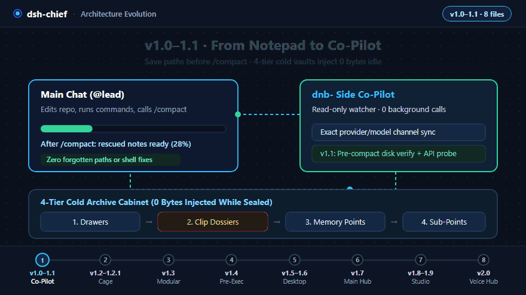
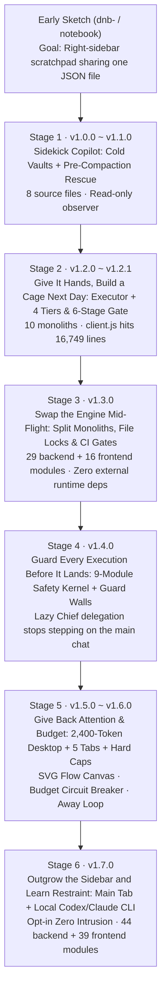
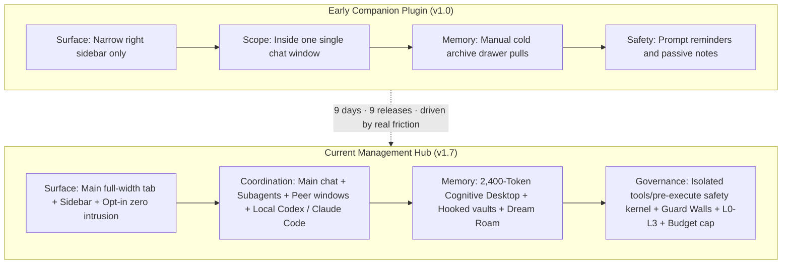

# How `dsh-chief` Evolved: From a Right-Sidebar Notepad to a Multi-Agent Command Hub

[简体中文 (`EVOLUTION.md`)](EVOLUTION.md) · [Back to README (`README.en.md`)](README.en.md) · [Changelog (`CHANGELOG.md`)](CHANGELOG.md) · [Architecture (`ARCHITECTURE.md`)](ARCHITECTURE.md)

---

Peek into `dsh-chief`'s frontend CSS and you will notice almost every class name starts with `dnb-`. Check line 119 of `runtime-hooks.js` and you will spot a one-time helper that migrates a legacy shared board into per-session boards.

Neither is an accident. `dnb` stands for **DSH Notebook**.

What is now a **44-backend-module (including a 9-module safety kernel) + 39-frontend-module** control hub for task topology, tiered memory, pre-execute guardrails, and cross-tool orchestration began with a simple idea: pin a scratchpad to the right sidebar of DeepSeek Harness (DSH), backed by one shared JSON file, so the AI stops forgetting things mid-task.

Between `v1.0.0` on November 14, 2026 and `v1.7.0` on November 22, 2026, nine releases shipped in nine days. `CHANGELOG.md` lists every commit in chronological order, which makes the big picture hard to follow. This page skips the raw ledger and tells the engineering story instead: **what real problems broke along the way, and why the architecture changed into what it is today.**

---

## Nine Days at a Glance

  

### Size and Shape Across Stages

| Stage | Releases & Dates | Code Footprint | Primary Role | Top Problem Solved |
| :--- | :--- | :--- | :--- | :--- |
| Stage 1 | `v1.0.0` – `v1.1.0` Nov 14 – 15 | 8 source files (`client.js` 10,607 lines) | **Sidebar Note-Taker & Co-Pilot** | Compaction erased hard-won findings; always-on memory plugins flooded prompts |
| Stage 2 | `v1.2.0` – `v1.2.1` Nov 16 – 17 | 10 source files (`client.js` 16,749 lines, `chief.js` 8,008 lines) | **Permission-Gated Operator** | Once Chief could edit files and run shells, unchecked power was dangerous while total lockdown was useless |
| Stage 3 | `v1.3.0` Nov 18 | 29 backend + 16 frontend modules (0 external npm deps) | **Verified Engineering Base** | 16K-line files made changes fragile; concurrent writes dropped data on Windows locks; obfuscated commands slipped checks |
| Stage 4 | `v1.4.0` Nov 19 | 38 backend (9 safety) + 16 frontend modules | **Pre-Execute Safety Gatekeeper** | Old gates only checked Chief itself, missing the main chat and subagents; high-tier Chief kept hijacking edits |
| Stage 5 | `v1.5.0` – `v1.6.0` Nov 20 – 21 | 38 backend + 20 frontend modules (5 tabs + top gear Settings) | **Attention & Budget Controller** | Too many switches hid who was spending tokens; bloated notes risked blowing context limits during unattended runs |
| Stage 6 | `v1.7.0` Nov 22 | **44 backend (9 safety) + 39 frontend modules** | **Opt-In Multi-Agent Command Hub** | A narrow sidebar cramped team graphs; local `Codex` / `Claude Code` worked in silos; plain chats got interrupted by global hooks |

---

## Chapter 1: A Notepad Grows Into a Sidekick (`v1.0.0` -> `v1.1.0`)

Anyone who runs multi-hour coding sessions with an AI hits the same three walls sooner or later:

- Around turn 80, the context fills up and `/compact` runs. Half an hour of verified file paths, port numbers, and error line numbers vanish into a high-level summary, so the model re-reads the repo from scratch.
- You spawn several subagents to work in parallel, then lose track of who stalled and who finished across separate tabs.
- You install a typical memory plugin, only for it to stuff dozens of stale notes into the system prompt on every turn, burning tokens and distracting the model.

`v1.0.0` targeted those exact three problems. Instead of altering the main chat flow, it sat quietly in the right sidebar as a read-only co-pilot:

1. **Zero-Byte Cold Vaults**: Long-term notes went into a four-tier archive cabinet (`Drawers -> Gold / Silver / Bronze clip dossiers -> Memory points -> Sub-details`). Sealed notes injected **0 bytes** into the prompt and loaded only when explicitly pulled or searched.
2. **Human-Owned Pacing and Billing Channels**: Default mode was `⏸ On-Demand` with zero background LLM calls. Whenever Chief was invoked manually, it matched the active session's exact `provider/model` string (keeping subscription routes separate from pay-per-token channels).
3. **Pre-Compaction Rescue (`v1.1.0`)**: Before DSH ran `/compact`, Chief wrote verified paths, commands, and outcomes to local disk, confirmed the write succeeded, and then triggered compaction.

Also in `v1.1.0`, the first real community issue arrived (`#1`, `@edz017`): older DSH hosts lacked the refactored subagent APIs and threw at runtime. That pushed us to add runtime host capability probing (`probeSubagentSupport`) so older DSH builds still mount the panel cleanly while blocking unsupported dispatches with clear upgrade guidance.

By then, the notepad had become a helpful co-pilot. Yet one clear limit appeared right away: **it could watch, track, and warn, but it could not act.** Asking it to check a file, tidy archives, or run compaction still forced you to bounce copy-paste between panes.

---

## Chapter 2: Give It Hands, Then Build a Cage the Next Day (`v1.2.0` -> `v1.2.1`)

`v1.2.0` gave Chief real tools via `chief-executor.js`.

Typing plain instructions into the right-hand composer let Chief inspect workspace files, run safe read commands, curate archives, and execute **Smart Compact** (even waking idle sleeping sessions when the host isolated direct compaction services). In the same release, storage expanded into three isolated vaults (**Session / Global / Precipitated**) with bidirectional diffing and strict promotion rules.

Giving an AI shell and file tools immediately created a sharper problem. Leave the door wide open and one bad turn can run `git reset --hard`, touch files outside the project, or save `.env` tokens into markdown archives. Lock everything down and you are back to a passive notepad.

So one day later, `v1.2.1` hit the brakes and built a governance cage around execution:

- **Four Tiers, Read-Only Start**: `advisor` (read-only default), `assistant`, `strategist` (per-action approval), and `chief` (high autonomy). Every newly created or handed-off session dropped safely into `advisor`.
- **Six-Stage Security Pipeline**: Every action passed through one fixed path: `User tier -> Action request -> Hard guards -> Policy decision -> Executor -> Audit log`.
- **Single-Use Approvals and Emergency Halt**: In `strategist`, edits and commands popped a clear confirmation card stating what runs, what changes, and why. Clicking **Allow** granted one execution, not permanent permission. Upgrading to `chief` required reading and checking an explicit risk modal verified on the backend. Anytime things looked wrong, clicking the red **`⏹ Halt`** button killed background loops immediately.

The security model held firm, but the codebase itself was creaking.

Four days of rapid additions stuffed everything into **10 source files**: `archives.js` grew to 2,796 lines, `index.js` to 6,075 lines, `chief.js` to 8,008 lines, and the frontend monolith `client.js` swelled to **16,749 lines**. Tweaking one button meant scrolling past unrelated logic, concurrent windows collided on Windows file locks, and even AI helpers reading a single 8,000-line backend file risked missing invariants hidden near the bottom.

---

## Chapter 3: Swapping the Engine Mid-Flight (`v1.3.0`)

Stacking more features onto a 16,749-line file was a guaranteed collapse. `v1.3.0` paused feature work for structural surgery:

- **Zero-Breakage Modular Split**: Every public export, HTTP route, and panel surface stayed 100% compatible while four giant files split cleanly into **29 backend modules + 16 frontend ES modules**. To keep the plugin at zero external npm dependencies, a tiny dependency-free topological bundler (`build-client.mjs`) compiled `src/client/` back into `client.js`.
- **Mechanical Guardrails in CI**: Automated Node 22 & Node 24 checks enforced hard structural rules on every change: **zero circular imports, zero mutable `export let` bindings**, and strict export-surface contracts.
- **Production Concurrency & Anti-Obfuscation**:
  - Board, state, and archive writes moved to `O_EXCL` spin locks and `threadId`-tagged temp files with jittered retries for transient Windows NTFS `EPERM / EACCES / EBUSY` errors;
  - Security verdicts moved out of mutable JSON state into an append-only `chief-audit.jsonl`;
  - Multi-step paused actions gained durable auto-resume (`resumeTasks`) after human approval;
  - Command checks learned to strip NFKC homoglyphs, PowerShell `-EncodedCommand` payloads, quote splits, `^` carets, and Windows NTFS Alternate Data Streams (`safe.txt:.env`).

Looking back, none of the later milestones—independent safety kernel, Cognitive Desktop, or multi-tool orchestration—could have stood upright without stopping at `v1.3.0` to rebuild the frame.

---

## Chapter 4: Holding the Execution Door While Stopping Self-Delegation Creep (`v1.4.0`)

With the frame solid, two deeper gaps showed up in daily testing:

First, the safety pipeline guarded Chief's own executor, yet **the main chat (`@lead`) and its subagents** made almost all real edits and shell runs. Catching a destructive command in logs after `@lead` already ran it was too late.

Second, at higher tiers (`L2`/`L3`), Chief occasionally jumped the gun: ask a quick question in the sidebar and Chief edited repo files itself, colliding mid-flight with `@lead`'s uncommitted edits.

`v1.4.0` drew two crisp boundaries:

### 1. Isolate the Safety Kernel and Block at `tools/pre-execute`
All security checks moved out of feature files into **9 zero-business-dependency modules under `pkg/safety/`**, locked alongside `chief-executor.js` via MD5 verification hashes so feature updates cannot quietly weaken defenses.

Next, that kernel hooked directly into DSH's **`tools/pre-execute`** lifecycle across **all active agents** (main chat, subagents, and Chief). Right before any read, write, or shell call hit disk, it passed **Guard Walls**:
- Switchable between `global` (follows every project), `workspace` (project-only), and `paused`;
- Plain-language drafting ("keep agents out of production config") created proposals that only locked in when a human clicked approve;
- **AI Cannot Tear Down Human Walls**: Even under `L3`, models have no tool access to delete or disable active Guard Walls. Hitting a dead end raises an explicit approval request instead.

### 2. Establish "Lazy Chief" Delegation
Chief settled into its true role as **orchestrator and safety supervisor, never a rogue co-coder**:
- Unless you explicitly ask Chief to edit directly, repo changes dispatch to `@lead` as `[EXECUTION_REQUEST]` items instead of impersonating user turns;
- On fresh blank chats, Chief guides `@lead` through read-only inspection and `graph.plan` planning before touching files;
- When Chief needs missing context mid-run, it slips a prioritized `[INQUIRY]` card into `@lead`'s pre-step queue so the main agent replies without derailing its active work.

That release turned a sidebar helper into a team-wide governance layer.

---

## Chapter 5: Returning Attention and Token Budgets to the User (`v1.5.0` -> `v1.6.0`)

Capability brought complexity. Power users loved the control; newcomers opening the panel saw too many knobs, worried which toggles triggered hidden API calls, feared archive growth would creep back into prompts, and hesitated to leave Away Mode running overnight without spending limits.

`v1.5.0` and `v1.6.0` tackled those two anxieties together: **cut noise, make costs legible, and cap autonomous runs.**

### `v1.5.0`: Attention & Memory Economics
- **The Cognitive Desktop**: When people work at a desk, only a few active papers stay on the blotter while everything else lives in labeled drawers. Context management copied that physical rule directly: across all three archive vaults, **only items pinned to the Cognitive Desktop (capped at `2,400 Tokens / 6 items`) enter every main prompt turn**. Overflow bumps older items into a watch queue while `🪝` keyword hooks let agents call `archive.pull` only when relevant.
- **Orthogonal Control Axes**: Scattered toggles collapsed into two clean axes—bottom bar for **permission ceiling (`L0–L3`)**, top bar for **background cadence (`off / patrol / managed`)**. `off` makes zero background calls; `patrol` makes zero routine calls and wakes only on errors, stream breaks, or blocked tools; `managed` adds quiet background **Dream Roam** maintenance (sorting unhooked drafts without touching code) plus a 5-condition auto-sleep guard that drops back to `off` after 15 idle minutes with zero open work.
- **Adaptive Effort**: Added a 180° fan-shaped thinking-effort gauge with automatic gearing—low/off for quick status summaries and Dream Roam, high/xhigh reserved for wall diagnosis and tricky failures.

Community feedback in Issues `#3` and `#4` (`@iridiumgit`) also shaped this release: full DSH light-theme parity for floating popovers and automatic hiding of Chief entry triggers inside subagent panes.

### `v1.6.0`: One Screen, Three Safety Nets for Away Mode
- **Navigation Consolidation**: Merged **Plan** into **Tasks**, slimming top navigation to five clean tabs (`Chief / Tasks / Peers / Archives / Guards`) and moving configuration into a rotating `⚙️` top-bar Settings view. **Tasks** introduced the **SVG Flow Canvas** (sequential steps, nested subagent tracks, cross-step return arcs) paired with a collapsed-by-default **Org Tree** that expands when clicking the Lead card.
- **Three Away-Mode Safeguards**:
  1. **Seven Milestone Alerts** (`pending_approval`, elevation requests, wall blocks, stream rescues, auto-sleep, budget stops, hazard halts) with quiet first-load baselines so old alerts never replay;
  2. **Segmented Ledger & Hard Budget Breaker**: Separate counters for `chat`, `review`, and `dream` usage with a default **30 calls / 300K tokens** circuit breaker in `managed` mode (direct user `ask_chief` prompts stay unblocked);
  3. **Redacted `.md` Battle Reports**: One-click export or copy of structured session summaries with API keys and private key blocks automatically scrubbed to `[REDACTED]`.
- **Plain Language Everywhere**: Shipped three one-click scenario presets (**Observer / Co-Pilot / Away Mode**), live `zh / en` localization, and rewritten beginner-friendly docs.

---

## Chapter 6: Leaving the Narrow Sidebar, Connecting Local CLIs, and Learning Restraint (`v1.7.0`)

By `v1.6.0`, single-session governance, memory budgeting, and unattended limits worked smoothly. Three practical realities pushed the final leap into `v1.7.0` (sharpened by heavy real-world feedback from `@iridiumgit` in Issues `#5` and `#6`):

1. **A Narrow Sidebar Runs Out of Room**: Tracking a multi-branch workflow canvas, peer agents, and external workers inside a thin side pane feels cramped—and opening several subagents spawned stacked sidebars instead of tabs.
2. **One Machine Often Runs Several Coding Agents**: Developers frequently run DSH alongside local **`Codex`** and **`Claude Code`** CLIs or multiple DSH windows. They act like one engineering squad, yet had no unified dispatch board or shared redlines.
3. **Power Needs Opt-In Boundaries (Issue `#6`)**: Once a plugin installs process-wide hooks, letting those hooks intercept plain, everyday chats is counterproductive. If you open a clean window to glance at a config file and never touched Chief, you should not hit workspace-boundary denials or prompt injections.

`v1.7.0` solved all three together:

- **Full-Width Command Surface & Clean Subagent Routing**: Registers a permanent **`Chief` / `参谋长`** `conversation.view` tab right next to Chat, hiding the duplicate host bottom composer while active, supporting independent placement and corner-button toggles, and routing subagent clicks into tabs on the existing right sidebar by default instead of splitting extra panes.
- **Cross-Tool Collaboration System**: Native non-`ccSwitch` discovery and one-click dispatch for local `Codex`, `Claude Code`, and dormant workspace DSH sessions—automatically injecting active redlines and Guard Walls before dispatch, merging external messages cleanly under cross-window pairs, filtering noise like `Mnemon` background tasks and empty shells, and keeping the canvas 100% static when idle so motion appears only when agents actually work.
- **Session-Level Opt-In Zero Intrusion**: Process-wide takeover tightened into per-session opt-in (`sessionEnabled`). Fresh plain chats and their subagents pass straight through all 8 backend hooks untouched—zero prompt injection, zero pre-execute blocking, zero stray board writes—until you click **Enable in This Session**, take an explicit Chief action, or opt back into auto-enable globally in Settings.
- **Final Monolith Cleanup**: Every remaining 2,000+ line file was split cleanly, bringing the runtime to **44 backend modules (9 in `pkg/safety/`) + 39 frontend modules**, still with **0 external npm dependencies**.

---

## Before vs. After: What Changed in Essence

---

## Four Engineering Rules Left Behind

Looking back across those nine days, nearly every architectural choice traces back to four plain lessons:

1. **Memory exists to save attention, not to cram prompts.**  
   First 0-byte cold drawers, then the `2,400`-token Cognitive Desktop both follow one rule: keep only active working notes on the desk, file the rest behind keyword hooks, and load details on demand.

2. **Build the brakes before attaching tools—enforce safety in code, not wishes.**  
   "Do not touch production files" written inside a prompt fades after 50 turns. Default `advisor` read-only starts, per-action approvals, and an isolated `tools/pre-execute` kernel that `L3` cannot disable actually hold.

3. **Multi-agent work fails on visibility and runaway spend, not lack of agents.**  
   Clean separation (`@lead` codes, Chief plans/routes/guards), readable flow topology, and hard budget circuit breakers turn parallel agents from a guessing game into something you can step away from safely.

4. **Mature hubs practice restraint.**  
   Strong tools become annoying when they intrude uninvited. Idle modes cost zero background calls, quiet canvases stay visually still, and plain chats remain completely untouched until you ask for Chief.

---

With `v1.7.0`, the structural foundation of a local multi-agent management hub—task topology, cognitive memory tiers, an isolated safety kernel, hard budget caps, cross-tool orchestration, and per-session opt-in restraint—is complete and tested.

Now that the core frame is steady, upcoming work can focus on more natural human-agent interaction: voice input, voice wake-up, and smoother long-term memory across projects.
