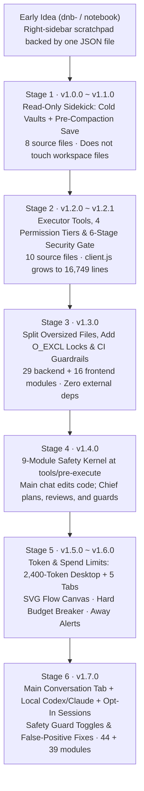
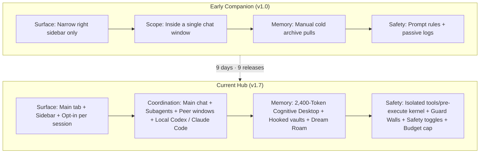

# How `dsh-chief` Evolved: From a Right-Sidebar Notepad to a Multi-Agent Management Hub

[简体中文 (`EVOLUTION.md`)](EVOLUTION.md) · [Back to README (`README.en.md`)](README.en.md) · [Changelog (`CHANGELOG.md`)](CHANGELOG.md) · [Architecture (`ARCHITECTURE.md`)](ARCHITECTURE.md)

---

If you check `dsh-chief`'s CSS classes, almost all of them start with `dnb-`. On line 119 of `runtime-hooks.js`, there is still a migration helper that moves legacy shared boards into per-session boards.

`dnb` stands for **DSH Notebook**.

What now runs as **45 backend modules (9 in `pkg/safety/`) + 39 frontend modules**—handling task graphs, tiered archives, global custom Chief naming (0-byte isolated from `@lead`), a 5-skin built-in theme system, pre-execute checks, and multi-agent coordination—started from a much simpler goal: hang a notepad in the right sidebar of DeepSeek Harness (DSH), backed by one shared JSON file, so the AI stops forgetting context mid-task.

Between `v1.0.0` on November 14, 2026 and `v1.7.0` on November 22, 2026, nine releases shipped in nine days. `CHANGELOG.md` lists changes commit by commit. This page steps back to explain what broke at each stage and why the code looks the way it does today.

---

## Nine Days at a Glance

  

### Size and Focus by Stage

| Stage | Versions & Dates | Code Structure | Primary Role | Core Problem Solved |
| :--- | :--- | :--- | :--- | :--- |
| Stage 1 | `v1.0.0` – `v1.1.0` Nov 14 – 15 | 8 source files (`client.js` 10,607 lines) | Sidebar scratchpad & co-pilot | `/compact` wiped verified paths and errors; always-on memory plugins wasted tokens |
| Stage 2 | `v1.2.0` – `v1.2.1` Nov 16 – 17 | 10 source files (`client.js` 16,749 lines, `chief.js` 8,008 lines) | Permission-gated assistant | Once Chief had shell/file tools, unrestricted access was risky while full lockdown was useless |
| Stage 3 | `v1.3.0` Nov 18 | 29 backend + 16 frontend modules (0 external npm deps) | Modular & concurrency base | 16K-line files were fragile; concurrent writes hit Windows locks; obfuscated commands slipped checks |
| Stage 4 | `v1.4.0` Nov 19 | 38 backend (9 safety) + 16 frontend | Pre-execute gate across agents | Old checks only watched Chief itself, missing `@lead` & subagents; high-tier Chief hijacked edits |
| Stage 5 | `v1.5.0` – `v1.6.0` Nov 20 – 21 | 38 backend + 20 frontend (5 tabs + top gear) | Token & away-run control | Scattered switches hid token spend; archive growth risked bloating prompts; overnight runs needed hard caps |
| Stage 6 | `v1.7.0` Nov 22 | **44 backend (9 safety) + 39 frontend** | Opt-in multi-agent hub | Narrow sidebar cramped team graphs; local `Codex` / `Claude Code` worked in silos; plain chats hit global hooks |

---

## 1. From a Sidebar Notepad to a Co-Pilot (`v1.0.0` → `v1.1.0`)

Anyone running long coding tasks with an AI runs into the same three headaches:

- Around turn 80, context fills up and `/compact` runs. Verified paths, port numbers, and stack traces disappear into a short summary, so the model reads the repo again from scratch.
- Several subagents work in parallel across separate tabs, and checking who stalled means clicking into each one.
- Typical memory plugins inject dozens of stale notes into the system prompt every turn, burning tokens and distracting the model.

`v1.0.0` targeted those three points from the right sidebar without modifying the main chat flow:

1. **Cold-Stored Archive Cabinets**: Notes lived in a four-layer archive (`Drawers -> Dossiers -> Points -> Details`). Sealed notes injected **0 bytes** into prompts and loaded only when explicitly pulled or searched.
2. **Human-Controlled Cadence & Billing Channels**: Default mode was `⏸ On-Demand` with zero background LLM calls. Manual Chief requests matched the session's exact `provider/model` channel so subscription routes did not accidentally fall back to pay-per-token billing.
3. **Save Before Compacting (`v1.1.0`)**: Right before `/compact` ran, Chief wrote active paths, commands, and findings to disk, verified the write, and then triggered compaction.

`v1.1.0` also resolved the first real compatibility bug (`Issue #1`): older DSH builds lacked the refactored subagent APIs and threw at runtime. Adding `probeSubagentSupport` let older hosts mount the panel cleanly while blocking unsupported dispatches with clear upgrade guidance.

At that stage, the notepad could watch and record, but still **could not run actions**. Even checking a quick file or triggering compaction required copy-pasting back and forth.

---

## 2. Adding File and Shell Tools, Then Adding Permission Limits (`v1.2.0` → `v1.2.1`)

`v1.2.0` added a built-in executor (`chief-executor.js`).

Typing plain instructions into the sidebar composer allowed Chief to read workspace files, search directories, organize archives, and trigger **Smart Compact** (even waking dormant sessions when host services isolated direct compaction). Storage expanded into three isolated vaults (**Session / Global / Precipitated**) with two-way diffing.

Giving an AI shell and file access immediately raised a sharper problem: leave permissions open and one bad turn can run `git reset --hard` or leak `.env` keys into notes; lock everything down and you are back to read-only.

One day later, `v1.2.1` put clear limits around execution:

- **Four Tiers, Read-Only Start**: `advisor` (read-only default), `assistant`, `strategist` (per-action approval), and `chief` (high autonomy). New and handed-off sessions always start at `advisor`.
- **Six-Stage Pipeline**: Every action goes through `User tier -> Request -> Hard guards -> Policy decision -> Executor -> Audit log`.
- **Single-Use Approvals & Instant Halt**: Under `strategist`, edits and commands pop a clear confirmation card stating what changes and why. Clicking **Allow** authorizes one run, not permanent access; upgrading to `chief` requires reading and checking a risk prompt verified by the backend; clicking the red `⏹ Halt` button stops background loops immediately.

The permission model worked, while the source tree grew unwieldy.

In four days, everything landed in **10 source files**: `archives.js` hit 2,796 lines, `index.js` hit 6,075 lines, `chief.js` hit 8,008 lines, and `client.js` reached **16,749 lines**. Tweaking one button meant scrolling past unrelated code, concurrent windows collided on Windows file locks, and long files made it easy to miss safety invariants.

---

## 3. Splitting Large Files, Adding File Locks, and Enforcing CI Checks (`v1.3.0`)

Piling more changes onto a 16,749-line file would not hold up. `v1.3.0` paused new features for structural cleanup:

- **Compatible Split**: Public exports, HTTP routes, and UI behavior stayed 100% compatible while four giant files split into **29 backend modules + 16 frontend modules**. To keep zero external runtime dependencies, a small topological bundler (`build-client.mjs`) builds `src/client/` into `client.js`.
- **CI Structural Rules**: Automated checks across Node 22 and Node 24 enforce **zero circular imports, zero mutable `export let` bindings**, and fixed export surfaces on every change.
- **Concurrency & De-Obfuscation**:
  - Board, state, and archive saves switched to `O_EXCL` spin locks with `threadId`-tagged temp files and retry jitter for Windows NTFS `EPERM / EACCES / EBUSY` errors;
  - Security verdicts moved out of mutable state JSON into an append-only `chief-audit.jsonl`;
  - Paused multi-step actions gained durable auto-resume (`resumeTasks`) after human approval;
  - Command checks learned to unwrap NFKC homoglyphs, PowerShell `-EncodedCommand` payloads, quote splits, `^` carets, and Windows NTFS ADS paths (`safe.txt:.env`).

Without stopping at `v1.3.0` to split the codebase, the standalone safety kernel and later features would have been much harder to keep bug-free.

---

## 4. Checking Actions Before Execution Without Taking Over the Main Chat (`v1.4.0`)

With the structure cleaner, two practical gaps showed up in daily runs:

1. Earlier checks guarded Chief's own executor, yet **the main chat (`@lead`) and its subagents** made most of the actual file edits and shell calls. Spotting a bad command in logs afterward was too late.
2. At higher tiers (`L2` / `L3`), Chief sometimes edited code itself when asked a quick sidebar question, stepping on `@lead`'s uncommitted work.

`v1.4.0` addressed both:

- **Standalone Safety Kernel at `tools/pre-execute`**: Security checks moved out of business modules into **9 standalone files under `pkg/safety/`**, checksum-locked alongside `chief-executor.js`. Hooking into DSH's `tools/pre-execute` meant reads, writes, and commands from `@lead`, subagents, and Chief all pass **Guard Walls** (`global` / `workspace` / `paused`) before touching disk. Users can draft rules in plain text for manual approval, and even `L3` models cannot delete or disable locked walls.
- **Lazy Delegation**: Chief focuses on planning, reviews, and guardrails. Unless you explicitly ask Chief to edit directly, workspace changes dispatch to `@lead` as `[EXECUTION_REQUEST]` items. Blank new chats start with read-only inspection and `graph.plan`, and mid-run questions slip into `@lead`'s queue as non-blocking `[INQUIRY]` cards.

That turned the plugin from a passive observer into a shared pre-execute gate across the whole agent team.

---

## 5. Controlling Prompt Tokens and Spend for Unattended Runs (`v1.5.0` → `v1.6.0`)

As features piled up, new users ran into two practical worries: too many switches made it hard to tell what spent background tokens, growing archives threatened to bloat prompts, and leaving Away Mode on overnight felt risky without hard limits.

`v1.5.0` and `v1.6.0` focused on trimming noise and adding spend limits:

- **Cognitive Desktop (`v1.5.0`)**: Like keeping only current papers on your desk and filing the rest in drawers, **only items pinned to the Cognitive Desktop (up to `2,400 Tokens / 6 items`) go into each main prompt turn**. Overflow moves back into a watch queue with `🪝` keyword hooks so agents pull older notes on demand via `archive.pull`.
- **Two Separate Control Axes & Auto-Sleep (`v1.5.0`)**: Scattered switches merged into bottom **permission tiers (`L0–L3`)** and top **run cadence (`off / patrol / managed`)**. `off` and idle `patrol` spend zero background tokens; `managed` organizes unhooked drafts quietly via **Dream Roam** (`🌙 梦境漫游`) and drops back to `off` after 15 idle minutes with zero open tasks. A 180° effort gauge (`🪄 Auto` by default) saves high reasoning effort for blocked debugging and wall drafting. Issues `#3` and `#4` also drove full light-theme popover fixes and hiding Chief buttons inside subagent panes.
- **5-Tab Layout & Away-Mode Safety Nets (`v1.6.0`)**: Merged **Plan** into **Tasks** (5 tabs: `Chief / Tasks / Peers / Archives / Guards`), moved configuration into the top-bar `⚙️` gear, and added the **SVG Flow Canvas** + click-to-expand **Org Tree**. Unattended runs gained **7 milestone alerts**, a **categorized LLM ledger + default `30 calls / 300K tokens` circuit breaker**, redacted `.md` battle report exports, three starter presets (**Observer / Co-Pilot / Away Mode**), live `zh / en` switching, and plain-language docs.

---

## 6. Direct Local CLI Collaboration, Main Tab, and Per-Session Opt-In (`v1.7.0`)

Once single-window tracking and budget caps worked reliably, daily workflows (`Issues #5` and `#6`) exposed three remaining gaps:

1. **One Machine Runs Multiple AI CLIs**: Developers often run local **`Codex`** and **`Claude Code`** alongside DSH windows, without a shared place to form squads, dispatch tasks, or enforce the same redlines.
2. **A Narrow Sidebar Runs Out of Room**: Inspecting flow graphs, peer links, and subagent rows in a thin side column feels tight, and clicking subagent buttons stacked extra split panes.
3. **Global Hooks Should Stay Out of Plain Chats (`Issue #6`)**: Once a plugin attaches to process-wide `tools/pre-execute`, intercepting plain chat windows where the user never opened Chief creates friction—especially without a UI toggle or when benign heredocs, read-only `git`/`grep` commands, or cleared `cursor.blocked` remarks trigger false alarms.

`v1.7.0` fixed all three:

- **Collaboration System & Local CLI Dispatch (`Peers` Tab)**: Redesigned the `Peers` squad canvas for `@lead`, subagents, linked windows, and local external CLIs. It discovers and dispatches local `Codex` and `Claude Code` without `ccSwitch` (including Windows `.cmd` shims and dormant workspace scans) with active redlines and Guard Walls attached, locks active squads (`HTTP 409`) with one-click `⏹ Halt`, routes external replies under cross-window pairs, filters out `Mnemon` tasks and empty `DS Bot` shells from Standby, keeps the canvas still until agents work, and gives `@lead` full squad visibility plus L2/L3 archive pull.
- **Main Tab Layout & Subagent Routing (`#5`)**: Registers a clean `Chief` / `参谋长` tab in `conversation.view`, hides the duplicate host composer while active, fits `0.2.2-rc.3` viewport height cleanly, provides independent placement/button toggles, and routes subagent clicks into **existing sidebar tabs** (`revealIfOpened: true`) with an optional split-pane toggle.
- **Opt-In Sessions, Safety Guard Switches & False-Positive Fixes (`#6`)**:
  - Switched from process-wide interception to **per-session opt-in (`sessionEnabled`)**: unactivated plain chats and their subagents pass all 8 backend hooks untouched;
  - Added human-only **per-session and global Safety Guard switches** in Settings (default on, independent of Redline Sentinel and manual Guard Walls, confirm-gated & audited, persisted across reloads);
  - Updated `isDestructiveShellCommand` to stop flagging non-executable document heredocs, `export` prefixes, `grep`/`rg`, `git log --format=`, `git commit`, and unpiped `echo`, while adding `normalizeCursorBlocked` across backend and frontend so cleared/approved remarks no longer light up red `Blocked` pills.
- **Final File Split**: Split remaining 2,000+ line files so the package runs cleanly across **44 backend modules (9 in `pkg/safety/`) + 39 frontend modules**, still with zero external npm dependencies.

---

## Before vs. After

---

## Four Lessons From These Releases

Looking back across those nine days, most decisions come down to four simple points:

1. **Memory is there to save prompt tokens, not stuff every turn.**  
   Zero-byte cold drawers early on and the `2,400`-token Cognitive Desktop later do the same thing: keep only active papers on the desk, file the rest behind keyword hooks, and pull details on demand.

2. **Put brakes and confirmations in place before giving tools.**  
   Warnings inside a system prompt fade as context grows. Starting read-only at `L0`, popping single-action approvals, and locking Guard Walls at `tools/pre-execute` stop accidents—while a human-only Safety Guard toggle keeps normal workflows from getting stuck on edge cases.

3. **Multi-agent teams fail when progress and spend stay hidden.**  
   Clear separation (`@lead` edits, Chief tracks plans and boundaries), a readable flow graph, and hard budget circuit breakers let you step away safely.

4. **Stay quiet when not asked.**  
   Idle modes spend zero background tokens, idle screens stay still, and plain chats run untouched until you enable Chief. Good tools step forward when needed and stay out of the way otherwise.

With `v1.7.0`, the core plumbing—task graphs, tiered archives, pre-execute safety & switches, budget caps, local CLI dispatch, and opt-in isolation—was tested and in place. `v1.7.1` added DSH `0.2.3-alpha.2` compatibility and simplified safety/rules into two plain concepts (`Safety Block` and `Rules for AI`), and **`v1.8.0`** refines the zero-dependency codebase to **45 backend modules (9 in `pkg/safety/`) + 39 frontend modules** with a built-in **5-skin Theme System** (defaulting to **Frosted Mist** with adaptive vector controls & restored interactive `EffortFanGauge` across all tabs), a redesigned **Tasks Tab** pairing a top **Bento Objective Ring Card** with a unified **Flow Canvas + Serpentine Bezier Beam** view (with subagent dispatch & return curves and no Org Tree clutter) plus header/settings decluttering, global custom Chief naming (0-byte `@lead` isolation, stripped built-in Private Brain ahead of a Chief-only memory plugin bridge), **Collaboration 2.0** (`Gemini CLI` discovery, redacted live streams, 2-hop handoff chaining & hardened anti-self-steer routing), one-click Guard-Wall preset packs, and a top-left live GitHub Star sync button supporting direct local `gh` CLI starring with web fallback.
