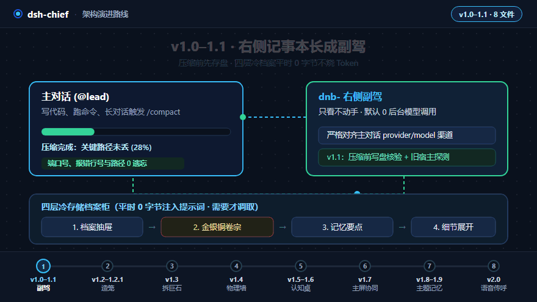
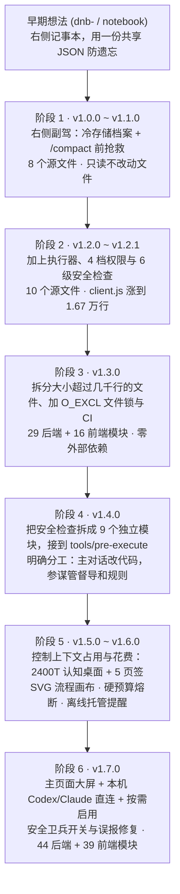
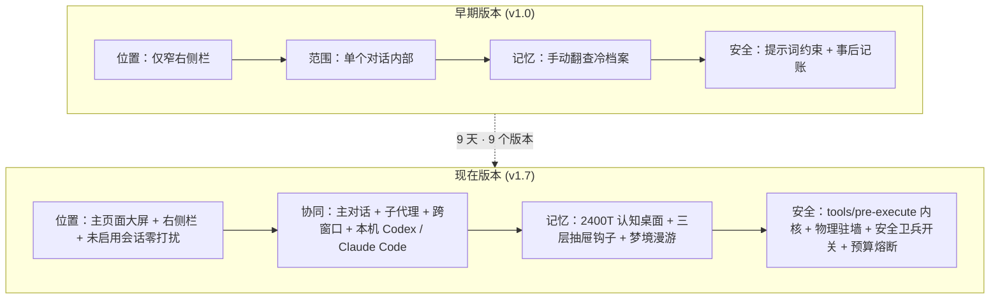

# `dsh-chief` 架构演进：从右侧记事本到多代理管理中心

[English (`EVOLUTION.en.md`)](EVOLUTION.en.md) · [返回首页 (`README.md`)](README.md) · [更新日志 (`CHANGELOG.md`)](CHANGELOG.md) · [模块说明 (`ARCHITECTURE.md`)](ARCHITECTURE.md)

---

看 `dsh-chief` 的前端样式，类名几乎都以 `dnb-` 开头；在 `runtime-hooks.js` 第 119 行，还能看到一段把“旧共享看板”迁成“按会话独立看板”的兼容代码。

`dnb` 是 **DSH Notebook** 的缩写。

现在这套 **44 个后端模块（含 `pkg/safety/` 9 个安全模块）+ 39 个前端模块**、管任务拓扑、分级档案、执行前拦截和多代理协作的插件，最早的想法很简单：在 DeepSeek Harness（DSH）右边栏挂一块记事本，用一份 JSON 文件帮主对话记东西，防止长聊丢信息。

从 2026 年 11 月 14 日 `v1.0.0` 到 11 月 22 日 `v1.7.0`，9 天发了 9 个版本。这篇文档不按提交顺序流水账，只按时间讲清楚每一阶段碰到了什么具体问题、后来怎么改的。

---

## 9 天演进概览

  

### 各阶段体量与重点

| 阶段 | 版本与日期 | 代码结构 | 主要角色 | 当时解决的核心问题 |
| :--- | :--- | :--- | :--- | :--- |
| 阶段 1 | `v1.0.0` – `v1.1.0` 11-14 ~ 11-15 | 8 个源文件 （`client.js` 10,607 行） | 右侧记事本与副驾 | `/compact` 压缩后丢路径和报错；常驻记忆每轮硬塞耗 Token |
| 阶段 2 | `v1.2.0` – `v1.2.1` 11-16 ~ 11-17 | 10 个源文件 （`client.js` 16,749 行，`chief.js` 8,008 行） | 带权限控制的可执行助理 | 参谋能动手之后，放开怕误删，全锁住又不实用 |
| 阶段 3 | `v1.3.0` 11-18 | 29 后端 + 16 前端模块 （零外部 npm 依赖） | 模块化与并发底座 | 万行单文件难改；并发写盘容易丢数据；命令变形绕过检查 |
| 阶段 4 | `v1.4.0` 11-19 | 38 后端（含 9 安全模块）+ 16 前端 | 全员执行前门禁 | 之前只管参谋自己，拦不住主对话和子代理；高权参谋会抢活改代码 |
| 阶段 5 | `v1.5.0` – `v1.6.0` 11-20 ~ 11-21 | 38 后端 + 20 前端 （5 页签 + 顶栏齿轮） | 成本控制与可视化托管 | 开关太散看不清花费；档案多了怕撑爆上下文；挂机跑飞怕烧钱 |
| 阶段 6 | `v1.7.0` 11-22 | **44 后端（含 9 安全模块）+ 39 前端** | 可按需启用的管理中心 | 窄边栏看不全团队拓扑；本机 `Codex`/`Claude Code` 各自孤立；普通闲聊被全局钩子误拦 |

---

## 1. 从右侧记事本到副驾（`v1.0.0` → `v1.1.0`）

跑长任务的时候，大家常碰到这三件事：

- 聊到七八十轮上下文快满，宿主执行 `/compact`，之前查出来的端口、路径、报错信息在摘要里被删掉，模型只能重新读一遍仓库。
- 主对话派了几个子代理并行干活，散在不同页签里，谁卡住谁做完，得一个个点开看。
- 装过一些全量记忆插件，每轮把几十条旧记录塞进 System Prompt，Token 花得快，主模型也容易被旧记录带偏。

`v1.0.0` 就是为了解决这三个点，没动主对话本身，只在右边栏挂了一个只读旁观的小助手：

1. **冷热分离的档案柜**：笔记放进四层冷存档案（抽屉 → 卷宗 → 记忆点 → 子细节）。没被打开时，向主对话提示词注入 **0 字节**，真用到了再按需翻出或搜索。
2. **节奏和通道人说了算**：默认 `⏸ 按需`，后台 0 次自动调模型。手动让参谋干活时，严格绑定主对话当前的 `provider/model` 渠道，避免订阅通道模型被错调成按量付费接口。
3. **压缩前先存档（`v1.1.0`）**：触发 `/compact` 前，先让参谋把路径、命令和结论写进本地档案、核验落盘成功，再执行压缩。

也是在 `v1.1.0`，社区提了第一个兼容性问题（Issue `#1`）：旧版 DSH 宿主还没加上命名子代理 API，直接调会报错。于是补了宿主能力探测（`probeSubagentSupport`）——老版本一样能打开面板，调不到高版本子代理能力时温和拦下并提示升级。

到这一步，副驾能记能看，但还**动不了手**。想让它查一段代码、理一份档案，或者代触发压缩，都只能人来回复制粘贴。

---

## 2. 加上工具执行，马上补权限和刹车（`v1.2.0` → `v1.2.1`）

`v1.2.0` 给参谋加上了执行器 `chief-executor.js`。

用户在右侧输入框说一句话，参谋就能读工作区、搜目录、整理档案，也能在长对话里跑「✦ 智选压缩」（绕开宿主的局部服务隔离，休眠窗口也能先唤醒再压缩）。档案柜也分成**本会话 / 系统全局 / 沉淀冷藏**三层，按需晋升，互相隔离。

可 AI 一旦能读写文件和跑终端命令，新风险立马来了：放开权限怕它跑 `git reset --hard` 或把 `.env` 密钥写进笔记；全锁死又跟只读一样使不上劲。

所以隔了一天，`v1.2.1` 就把权限拆开并加上刹车：

- **4 档权限，默认只读**：`advisor`（只读 · 默认）、`assistant`（助手）、`strategist`（逐项弹窗授权）、`chief`（高自主）。任何新对话或交接出来的新会话，默认全落在 `advisor`。
- **6 级检查链**：每次执行统一经过 `用户档位 → 操作请求 → 硬规则卫兵 → 权限判定 → 执行器 → 审计日志`。
- **单次放行与急停**：在 `strategist` 下，修改前先弹窗说明“改什么、为什么、有什么影响”，点「允许」只放行这一步；权限不够只能提交提权申请；切到高自主档前必须勾选风险确认；发现不对劲，点输入框右侧红色 `⏹ 急停` 直接停掉后台触发。

安全规则立住了，代码文件却越来越臃肿。

短短 4 天，所有功能都挤在 **10 个 JS 文件**里：`archives.js` 2,796 行，`index.js` 6,075 行，`chief.js` 8,008 行，前端单文件 `client.js` 涨到了 **16,749 行**。改个按钮要翻半天上下文，多窗口同时写盘会在 Windows 下撞文件锁丢数据，连 AI 自己读几千行的单文件都容易看漏约束。

---

## 3. 拆大文件、补文件锁和 CI 检查（`v1.3.0`）

往 1.6 万行单文件里继续加需求迟早要散架。`v1.3.0` 停下来做了一次结构拆分：

- **保持对外兼容，拆清内部结构**：对外导出、HTTP 路由和面板入口全部保留，内部拆成 **29 个后端模块 + 16 个前端源码模块**。为了继续保持 0 外部依赖，写了一个简单的拓扑排序脚本 `build-client.mjs` 把 `src/client/` 拼回 `client.js`。
- **用自动化门禁守住边界**：CI（Node 22 / 24 双版本）直接卡死几条结构规则——**零循环依赖、零跨模块 `export let` 可变导出**、每次修改自动核对导出表。
- **补齐并发与安全底座**：
  - 看板、状态、档案全部改用 `O_EXCL` 自旋锁 + 带 `threadId` 的临时文件原子重命名，专门对付 Windows NTFS 的 `EPERM / EACCES / EBUSY` 并发冲突；
  - 审计日志从状态 JSON 里独立成只追加文件 `chief-audit.jsonl`；
  - 加上审批后自动续跑（`resumeTasks`），点允许后接上之前卡住的步骤；
  - 命令检测补上反混淆——先做 NFKC 规范化，剥开 PowerShell `-EncodedCommand`、引号拼接、`^` 转义和 Windows NTFS ADS 流（如 `safe.txt:.env`）再查。

回过头看，没有 `v1.3.0` 这一步把架子拆开，后面的独立安全内核、认知桌面和多代理协同都无从下手。

---

## 4. 把拦截放到执行前，参谋不抢主对话的活（`v1.4.0`）

底座稳了以后，日常使用里又露出了两个明显问题：

1. 之前的拦截主要看管参谋自己的执行器，但真正高频改文件、敲命令的是**主对话和子代理**。主对话跑偏了再靠日志提醒，已经晚了。
2. 参谋权限调高以后容易越界替代——用户在右侧随口提一嘴需求，参谋自己就去改仓库文件，跟主对话还没提交的改动撞在一起。

`v1.4.0` 做了两件事：

- **抽出独立安全内核，卡在 `tools/pre-execute`**：所有校验剥进 **`pkg/safety/` 的 9 个无业务依赖模块**，连同 `chief-executor.js` 加 MD5 锁保护。同时挂进宿主的 `tools/pre-execute` 钩子：不管是主对话、子代理还是参谋，执行读写或命令前一刻先过「🧱 物理驻墙」（支持 `🌐 全局` / `📁 本工程` / `⏸ 暂挂`，能用大白话让参谋起草草案、由人确认落锁；哪怕开到 `L3`，AI 也无权删改锁定的墙）。
- **确立懒介入分工**：参谋主要负责规划、督导与查缺，除非用户明确点名它自己动手，改代码和跑命令一律通过 `[EXECUTION_REQUEST]` 派给 `@lead`；新开空白窗先引导只读看代码排计划；缺上下文时只发轻量 `[INQUIRY]` 问询让 `@lead` 顺手回答，不打断主线任务。

从这一版起，插件才真正成了整支小队执行前的共同安全关口。

---

## 5. 控制上下文和预算，让挂机可控（`v1.5.0` → `v1.6.0`）

功能变多以后，界面和成本又成了新问题：老手觉得好用，新手打开却怕点错按钮后台偷偷花钱，也怕档案越存越多挤爆提示词，更不敢在没限额的情况下挂机跑一整晚。

`v1.5.0` 和 `v1.6.0` 主要在解这两个顾虑：

- **📌 认知桌面（`v1.5.0`）**：就像人办公只把当前要看的几页纸摊在桌上，其余收进抽屉——三层档案柜里**只有摆上认知桌面的最多 6 份（`2,400 Tokens`）会随轮带进主对话**，超额按优先级退回观察队并留好 `🪝` 关键词钩子，需要时由模型调 `archive.pull` 按需翻出。
- **控制轴正交 + 自动休眠（`v1.5.0`）**：底部只管**权限（`L0–L3`）**，顶栏只管**运行频率（`⏸ 关停 / 🛡 巡检 / 🤖 托管`）**。关停和巡检空闲时 0 后台消耗；托管时会在空闲顺手做 **「🌙 梦境漫游」** 归档整理，任务全清且闲置满 15 分钟自动退回 `off`。搭配 180° 扇形思考强度表盘，默认 `🪄 自适应` 按任务难易调挡。这版也顺手修了社区反馈（Issues `#3`、`#4`）的浅色主题弹窗和子代理隐藏入口问题。
- **5 页签合并 + 挂机保险（`v1.6.0`）**：把「规划」并进「任务」，顶栏收成 5 个页签（`参谋 / 任务 / 协同 / 档案 / 边界`），设置收到顶栏齿轮 `⚙️` 里。任务页补上 **SVG 流程画布** 与点击主卡展开的**组织树**；托管加入 **7 类桌面提醒**、**分类账本 + 默认 `30 次 / 300K Token` 硬熔断**、以及一键导出的 **脱敏 `.md` 复盘战报**；还上线了「只读旁观 / 日常协作 / 离桌托管」三档预设和中英双语切换，重写了面向普通用户的新手说明。

---

## 6. 协同系统直连本机外协、主页面大屏与按需启用（`v1.7.0`）

到 `v1.6.0`，单窗口里的管理、记忆和预算已经能闭环。不过拿到日常工作里配合多工具一起跑时，这几个问题变得很明显：

1. **本机不止 DSH 一个工具**：很多人一边用 DSH，一边在跑本机 `Codex`、`Claude Code` 或其他独立 DSH 窗口，各自孤立没法在同一个台面上编队、派单和共用红线。
2. **窄边栏装不下**：流程图、协同编队和子代理状态挤在窄侧边栏里局促；点几个子代理还会不断弹出新分屏。
3. **全局挂钩太打扰**：注册到进程级 `tools/pre-execute` 后，从没点开过参谋长的普通聊天窗也会被安全卫兵拦住，而且之前内置安全卫兵既没开关、还会误判文档 heredoc、只读命令和已批准状态的 `cursor.blocked`。

`v1.7.0` 一次把这几块全部收口：

- **全新「协同系统」直连本机 `Codex` / `Claude Code`**：不用第三方中转工具，跨平台自动探测并派发本机 `Codex`、`Claude Code` 与同工作区内的休眠 DSH 窗口（含 Windows `.cmd` shim）；派单自动带当前红线和物理驻墙，工作时自动锁编防拆（HTTP 409）并支持 `⏹ 急停解体`，外协消息统一归入「跨窗」，待命池「刷新扫描」滤掉 `Mnemon` 后台任务和空白空壳；画布空闲时全静止，只有工作中对应的节点和连线才会泛光流动，同时让 `@lead` 看清整支编队并支持 L2/L3 桌面取档。
- **主页面大屏与可控入口（`#5`）**：在对话顶部加上简洁的 **`参谋长 / Chief`** 主页面页签（自动隐藏下方重复的宿主主输入框并适配 `0.2.2-rc.3` 贴底高度），设置里可自由选择显示位置与隐藏快捷按钮；点击协同页子代理默认改为在**现有右侧栏加页签**并去重，同时保留切换新开分屏选项。
- **按需启用、安全卫兵开关与误报收敛（`#6`）**：
  - 全进程默认接管改为**会话级按需启用（`sessionEnabled`）**——未启用的普通窗及其子代理走过全 8 处后端钩子时直接无害放行；
  - 设置页新增人类专控的**「🛡️ 内置安全卫兵」**本会话开关与全局总开关（默认开启，关闭需风险确认弹窗并写入审计，独立于「红线哨兵」与手工「物理驻墙」）；
  - 修复 `destructive_command` 误伤非可执行文档 heredoc、`grep`/`rg`、`git log --format=`、`git commit` 与普通 `echo` 的问题，同时加入前后端 `normalizeCursorBlocked`，不再把“无 / 已获用户批准执行 / 用户已接受…”误标成红色「受阻」告警条。
- **再拆一轮源码**：把其余超过 2,000 行的文件拆细，最终形成 **44 个后端模块（含 9 个安全内核模块）+ 39 个前端模块**，依然保持 0 外部运行依赖。

---

## 前后变化对比

---

## 这几版攒下来的四点经验

回头梳理这 9 天的改动，基本就剩四条实在的经验：

1. **记忆是用来省提示词的，不是用来塞满上下文的。**  
   早期的 0 字节冷存和后来的 `2,400 Tokens` 认知桌面其实是一回事：把当下要用的放桌面，其余打上标签收进抽屉，需要时按需拉出来。

2. **给模型工具前先补刹车和确认。**  
   写在提示词里的约束聊久了就会失效。默认只读 `L0`、弹窗单次授权，加上卡在 `tools/pre-execute` 这一层由人工锁定的物理墙，才能真正挡住误操作；同时也得留好人类可控的开关，才不至于把正常命令卡死。

3. **多代理协作最怕看不见进度和预算失控。**  
   主对话写代码、参谋盯流程和守边界、流程画布把依赖画直白、挂机加上调用和 Token 硬上限，人才能放心离开屏幕。

4. **不需要的时候别出声。**  
   空闲时不调后台模型、画面保持静止、普通闲聊窗口未启用时完全放行。用到它的时候立刻到位，不用它的时候像没装过一样，工具才算好用。

到这里，`v1.7.0` 整套底座——任务拓扑、分级记忆、安全内核与开关、预算熔断、本机外协和按需启用——已经跑通并经历了两周高密度的测试和真实反馈。后面就可以接着做更自然的人机交互：比如语音输入、语音唤起，以及更顺手的跨项目长期记忆。
