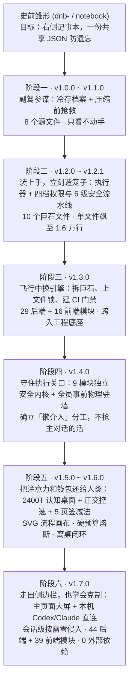
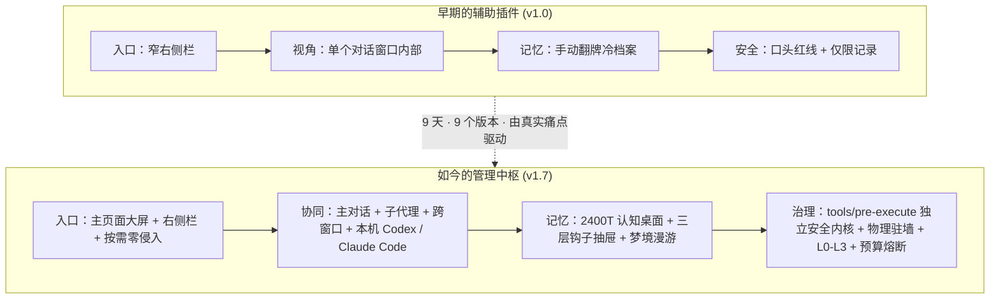

# `dsh-chief` 架构演进之路：一块右侧记事本，怎么长成多智能体管理中枢的？

[English (`EVOLUTION.en.md`)](EVOLUTION.en.md) · [返回首页 (`README.md`)](README.md) · [更新日志 (`CHANGELOG.md`)](CHANGELOG.md) · [模块契约 (`ARCHITECTURE.md`)](ARCHITECTURE.md)

---

如果你翻开 `dsh-chief` 的前端样式源码，会发现几乎所有类名都以 `dnb-` 开头；如果看 `runtime-hooks.js` 第 119 行，还能撞见一段把“旧共享看板”迁往“按会话隔离看板”的一次性代码。

那不是巧合。`dnb` 是 **DSH Notebook** 的缩写。

这个如今拆成 **44 个后端模块（含 9 个独立安全内核）+ 39 个前端模块**、管着任务拓扑、三层记忆金库、执行前物理防线与多代理协同的系统，最初的想法朴素得很：在 DeepSeek Harness（DSH）右边栏挂一块记事本，共享一份 JSON 文件，让 AI 干活时别老忘事。

从 2026 年 11 月 14 日的 `v1.0.0` 到 11 月 22 日的 `v1.7.0`，9 天发了 9 个版本。版本记录（`CHANGELOG.md`）按时间堆着一条条改动，不太容易看出背后的脉络。这篇文档不按功能清单报账，只讲一件事：**每一步遇到了什么真麻烦，我们为什么把架构改成了今天这样。**

---

## 一张图看完 9 天演进路线

  

### 规模与形态变化一览

| 阶段 | 版本与日期 | 代码骨架 | 核心角色定位 | 这一步解决的头号矛盾 |
| :--- | :--- | :--- | :--- | :--- |
| 阶段一 | `v1.0.0` – `v1.1.0` 11-14 ~ 11-15 | 8 个源文件 （`client.js` 10,607 行） | **右侧副驾 / 记录员** | 对话一压缩就失忆；普通记忆插件每轮塞大段旧账烧 Token |
| 阶段二 | `v1.2.0` – `v1.2.1` 11-16 ~ 11-17 | 10 个源文件 （`client.js` 16,749 行，`chief.js` 8,008 行） | **带刹车的实权助理** | 副驾学会自己动手干活后，放权怕删库改乱，锁死又帮不上忙 |
| 阶段三 | `v1.3.0` 11-18 | 29 后端 + 16 前端模块 （0 外部依赖打包） | **可验证的工程底座** | 万行巨石改一处动全身；并发写盘撞锁；命令变形绕过检查 |
| 阶段四 | `v1.4.0` 11-19 | 38 后端（含 9 安全内核）+ 16 前端 | **全员事前安全关口** | 原先只锁住了参谋自己，主对话和子代理乱改文件拦不住；高权参谋爱抢活 |
| 阶段五 | `v1.5.0` – `v1.6.0` 11-20 ~ 11-21 | 38 后端 + 20 前端 （5 页签 + 顶栏齿轮） | **注意力与托管总控** | 开关太碎看不懂谁在花钱；档案越存越怕爆上下文；挂机跑飞怕烧穿额度 |
| 阶段六 | `v1.7.0` 11-22 | **44 后端（含 9 安全内核）+ 39 前端** | **按需零侵入的多智能体中枢** | 窄边栏装不下全局指挥；本机 `Codex`/`Claude Code` 各自为战；普通闲聊被全局钩子误打扰 |

---

## 第一章：从“记事本”长出“副驾参谋”（`v1.0.0` → `v1.1.0`）

用 AI 跑长任务的人，大概率都踩过同几个坑：

- 聊到第 80 轮，上下文快满了，宿主执行 `/compact` 一压缩，前面花半小时查出来的端口号、配置路径和报错行号瞬间没影，AI 回头又从第一行重新翻代码。
- 为了省时间开了一堆子代理，结果散在不同的标签页里，谁卡住了、谁做完了全靠挨个点进去看。
- 装过一些常驻记忆插件，结果它每轮都把几十条陈年笔记塞进 System Prompt，Token 哗哗流走，模型还被旧账带偏。

`v1.0.0` 就是冲着这三个痛点来的。我们没去改主对话的聊天体验，而是站到右侧栏，做了一位**“不抢活、只在旁边记事和盯盘的副驾”**：

1. **冷热分离的档案柜**：把长期笔记放进四层冷存储档案柜（抽屉 → 金/银/暗铜曲别针卷宗 → 记忆点 → 细节）。平时往模型提示词里注入 **0 字节**，真用到了再按需翻牌或搜索。
2. **节奏和计费权归人管**：默认 `⏸ 按需`，后台 0 次自动调用模型；就算手动让参谋干活，也严格对齐当前主对话的完整 `provider/model` 渠道标识，防止把订阅通道的同名模型错配到按量付费接口。
3. **压缩前抢救闭环（`v1.1.0`）**：在 `/compact` 动手之前，先由参谋把关键路径、命令和结论落盘写进本地档案、核验写成功，再让宿主安全压缩。

也是在 `v1.1.0`，社区提了第一个真实 Issue（`#1`，`@edz017`）：装在旧版 DSH 上时，新子代理 API 还不存在，直接调用会报错。这逼着我们补上了第一套**宿主能力运行时探测（`probeSubagentSupport`）**——老宿主照样能挂面板，只是在调用高版本能力时温和拦下并提示升级。

到这一步，记事本变成了“能记不丢、看得见子代理树”的副驾。但新问题马上露头了：**它只能干看着，自己动不了手。** 想让它顺手查段代码、整理档案或帮主对话触发一次压缩，还得人来回复制粘贴。

---

## 第二章：给副驾装上“手”，隔天就得造一只“笼子”（`v1.2.0` → `v1.2.1`）

`v1.2.0` 给参谋长装上了真正能干活的手——`chief-executor.js`。

用户在右侧「✦ 许愿框」里说一句大白话，参谋就能自己读工作区、搜目录、整理档案，甚至在对话长到不行时执行「✦ 智选压缩」（绕开宿主内部服务隔离、连休眠窗口都能先唤醒再安全压缩）。同一版里，档案柜也从单库长成了**本会话 / 系统全局 / 沉淀冷藏**三层金库，带双向差分，严格按梯度逐级晋升，互不串味。

可一旦 AI 拿到了工具执行权，画风立刻变了。能自己改文件、跑命令的 AI，就像刚拿到机房钥匙的新手：权限全放开，万一它跑个 `git reset --hard`、误删文件或者把 `.env` 密钥顺手记进公开笔记，后果不堪设想；全锁死呢，又退回“只能干看”。

所以仅仅隔了一天，`v1.2.1` 踩下了最重要的一脚刹车：**把权力关进制度的笼子。**

- **四档权限，一律只读起步**：划分 `advisor`（只读 · 默认）、`assistant`（助手）、`strategist`（逐项授权）、`chief`（高自主）。任何新窗口、任何交接过来的新会话，统统默认落在 `advisor`，绝不悄悄替你改代码。
- **6 级安全流水线**：每一次操作都得过同一套通道：`用户模式 → 操作请求 → 硬红线卫兵 → 权限判定 → 执行器 → 审计日志`。
- **单次放行与红色急停**：在 `strategist` 档位下，改文件或跑命令前必须弹窗写明“做什么、改谁、什么影响”，你点「允许」只放行这一次，不给永久通行证；权限不够时 AI 只能打报告申请提权；想切到最高档必须读完风险告知并勾选确认；任何时候觉得不对劲，点输入栏最右侧红色 `⏹ 急停` 立刻切断后台自驱。

安全制度立住了，代码库却悄悄走到了悬崖边。

短短 4 天，所有新功能都在往最初那几个文件里塞。到 `v1.2.1` 发完，整个插件还挤在 **10 个 JS 文件**里：`archives.js` 2,796 行，`index.js` 6,075 行，`chief.js` 8,008 行，前端单文件 `client.js` 更是飙到了 **16,749 行**。改一个小按钮要翻半天上下文，多窗口并发写看板还会撞上 Windows 文件锁丢数据，甚至连协助开发的 AI 读这种万行巨石时，都容易看漏另一头的安全边界。

---

## 第三章：飞行中换引擎——拆巨石、上钢锁（`v1.3.0`）

继续往 16,000 行的单文件里堆需求，系统迟早散架。`v1.3.0` 没急着追新功能，停下来做了一次“飞行中换引擎”的结构大手术：

- **零破坏拆分**：对外公开的接口、事件、导出 100% 保持兼容，内部把 4 个超长单体彻底拆成 **29 个后端模块 + 16 个前端源码模块**。为了守住“零外部 npm 依赖”的承诺，专门写了一个不到几百行的零依赖拓扑排序打包器 `build-client.mjs` 来拼装客户端。
- **用自动化门禁锁死结构**：写进 CI（Node 22 / 24 双版本）的硬规矩只有几条，但条条致命——**零循环依赖、零跨模块 `export let` 可变状态**、每次改动自动验证导出契约。
- **把底座补成生产级**：
  - 看板、状态、档案全部换上 `O_EXCL` 自旋文件锁 + 带 `threadId` 的临时文件原子替换，专门治 Windows NTFS 下的 `EPERM / EACCES / EBUSY` 并发丢写；
  - 审计记录从主状态文件里拆出去，做成独立只追加的 `chief-audit.jsonl`，谁也截断不了；
  - 加上审批后自动续跑（`resumeTasks`），弹窗点完“允许”，卡住的多步任务自己接着跑完；
  - 命令检查学会反混淆——执行前先把 NFKC 字符变形、PowerShell `-EncodedCommand`、引号拼接、`^` 插入符和 Windows NTFS ADS 流（比如 `safe.txt:.env`）剥干净再审。

回过头看，如果没有 `v1.3.0` 这一步停下来拆骨架，后面的安全内核、认知桌面和多代理协同根本长不出来。这一版之后，`dsh-chief` 才算从“能跑的插件脚本”变成了一套能扛长期迭代的工程系统。

---

## 第四章：卡死执行关口，同时学会不抢活（`v1.4.0`）

地基打牢后，两个藏在深处的问题浮出水面：

第一，之前的安全护栏主要管着参谋长自己的执行器，可平时真正高频改代码、敲终端命令的是**主对话和子代理**。主对话要是失手跑错命令，参谋事后在日志里提醒已经晚了。

第二，参谋长权限拉高以后，偶尔会“手痒”——用户随口在右侧提个需求，它自己直接下场改文件，结果跟正在干活的主对话互相覆盖代码，场面一度很混乱。

`v1.4.0` 用两个决定彻底划清了界限：

### 1. 抽出独立安全内核，把防线推到“执行前一毫秒”
我们把所有跟安全有关的逻辑从业务层彻底剥离，拆成 **`pkg/safety/` 下的 9 个零业务依赖模块**（路径守卫、命令拆解、硬红线、物理驻墙、能力引擎、策略插件、审计账本等），和执行器一起上 **MD5 锁校验**——业务层怎么改，都不许碰安全内核。

紧接着，把这道防线卡进宿主最关键的钩子 **`tools/pre-execute`**。从此，不管动手的是主对话、子代理还是参谋自己，只要要读写文件或敲命令，落地前一毫秒必须先过 **「🧱 物理驻墙」**：
- 支持 `🌐 全局`（跨工程随身带）、`📁 本工程`、`⏸ 暂挂` 三态切换；
- 不会写规则没关系，用大白话跟参谋说“别碰生产配置目录”，它会起草规则草案，等你亲手点确认才落锁；
- **人设的墙，AI 拆不掉**：哪怕给到最高权限 `L3`，模型也无权删除或停用已锁定的驻墙，真撞死了只能提交审批单，等你点头放行。

### 2. 确立「懒介入」分工哲学
参谋长的定位在这一版彻底定型：**它是参谋和督导，不是抢活干的替补队员。**
- 只要用户没点名让参谋亲自改文件，工作区改动和命令一律派发给在线的主对话 `@lead` 执行，绝不冒充用户发言；
- 新开的空白窗口里，参谋先引导主对话只读看代码、排计划，不盲目乱改；
- 参谋半途缺情报时，通过后台优先问询通道悄悄递一张 `[INQUIRY]` 小纸条给主对话，主对话顺手秒回后继续干原来的活，零打断。

从这一刻起，插件不再只是“陪在旁边看”，而是真正站上了整支 AI 团队的**执行前治理关口**。

---

## 第五章：把“注意力”和“钱包”还给人类（`v1.5.0` → `v1.6.0`）

系统越做越强，反而带来了新的负担。老用户觉得趁手，新用户一打开面板却容易发懵：页签和开关越来越多，搞不清开哪个会后台扣费；档案柜攒了几十份笔记，既怕喂给主对话太烧 Token，又怕藏太深 AI 找不到；离桌挂机跑任务时，最担心的就是 AI 卡进死循环把额度一夜烧干。

`v1.5.0` 和 `v1.6.0` 连续两版，干的都是同一件事：**做减法、立秩序，把人的注意力和预算守住。**

### `v1.5.0`：给记忆和算力装上“经济系统”
- **「📌 认知桌面」模型**：人办公时，书桌上永远只摊着当下最要紧的几份文件，其余都收在抽屉里。我们把这套直觉直接搬进了上下文管理——不管三层档案柜里存了多少资料，**每轮随对话发给主模型的，只有摆上「认知桌面」的最多 6 份（上限 `2,400 Tokens`）**。放超了自动按优先级挤回抽屉，并留好 `🪝` 关键词钩子，AI 真需要时自己调 `archive.pull` 按钩子拉出来，平时零污染。
- **控制轴彻底正交**：砍掉零散开关，只留两条互不打架的轴——底部管**权限多大（`L0–L3`）**，顶部管**多久动一次（`⏸ 关停 / 🛡 巡检 / 🤖 托管`）**。关停就是 0 后台消耗；巡检平时也 0 消耗，只有报错、断流或撞墙才醒来；开启托管后，空闲时参谋长会悄悄进入 **「🌙 梦境漫游」** 帮你归整零散草稿和关键词钩子，等所有任务清空且闲置满 15 分钟（满足 5 项休眠条件），自动退回关停省钱。
- **思考深度自适应**：加上 180° 扇形思考强度表盘，默认「自动调节」——做摘要、理卷宗自动降档省算力，遇到撞墙排障、起草防线自动拉高推理深度。

这一版也吸收了社区的两条精准反馈（Issues `#3`、`#4`，`@iridiumgit`）：彻底修好 DSH 浅色主题下弹窗透黑的问题，并在子代理窗口自动藏起参谋入口，防止误操作把焦点带偏。

### `v1.6.0`：简明可视，敢真正放手离桌
- **界面大瘦身**：把原本分开的「规划」和「任务」合二为一，顶栏收紧到 5 个页签（`参谋 / 任务 / 协同 / 档案 / 边界`），把所有配置项收进顶栏一枚旋转齿轮 `⚙️` 里。任务页换上 **SVG 流程画布**（主线步骤 + 子代理分支 + 异常回指虚线弧）和**默认收起、点主代理整卡展开的组织树**，一屏看清全局进度。
- **离桌托管三保险**：
  1. **7 类关键节点桌面通知**（待审批、提权、撞墙、断流续跑、休眠、触及预算、急停），新会话静默建基线，绝不拿旧通知刷屏；
  2. **按类型分账 + 硬预算熔断**：把参谋的 `问答 / 巡检 / 梦境` 消耗分开记账，托管模式默认达到 **30 次调用或 300K Token** 立即熔断停机（你在输入框主动问它永远不受限）；
  3. **脱敏复盘战报**：回来点一下就能导出或复制整局 Markdown 战报，里面的疑似密钥和私钥片段自动抹成 `[REDACTED]`。
- **把“程序员黑话”全换成大白话**：推出「只读旁观 / 日常协作 / 离桌托管」3 档开箱情景预设、中英双语实时切换，把 README 和界面提示从头重写成普通人 3 分钟就能看懂的话。

---

## 第六章：走出侧边栏、连上本机外协，并学会克制（`v1.7.0`）

到了 `v1.6.0`，单机单窗口里的指挥、安全、记忆、预算闭环已经很完整了。但真正把它推向“管理中枢”最后一步的，是两个来自真实重度使用场景的叩问（社区 Issues `#5`、`#6`，`@iridiumgit`），以及一个绕不开的现实：

1. **窄边栏装不下了**：当你同时盯着任务流程画布、多个子代理和外部工具时，挤在右侧一条窄栏里怎么看都局促；点几个子代理还会一层层新开分屏，把屏幕切得稀碎。
2. **电脑里不止一个 AI**：很多人一边开着 DSH 主对话，一边本机还装着 `Codex`、`Claude Code` 和其他独立 DSH 窗口。它们本来就是一支团队，凭什么不能在一个台子上编队派单、共用同一套安全红线？
3. **最戳中要害的反思（Issue `#6`）**：当一个插件强大到能注册进程级钩子、在执行前拦下所有越界读写时，如果它默认对**每一个普通的闲聊窗口**生效，反而变成了一种打扰——“我只是新开个窗口随便查点资料，从没打开过参谋长，凭什么也被安全卫兵拦着？”

`v1.7.0` 把这三件事一次做透，完成了从“常驻侧边插件”到“成熟管理中枢”的成年礼：

- **形态升维：主页面大屏 + 可控子代理页签**：注册对话顶部常驻的「参谋长」主页面页签，一键切入宽屏指挥台并自动藏起下方重复的宿主输入框（切回对话无痕恢复）；右键/设置里自由决定主页面、右侧栏和两个快捷按钮的去留；点击协同页子代理默认改为在现有右侧栏优雅加页签并去重，不再堆叠侧边栏。
- **跨工具协同：全新「协同系统」直连本机外协**：不用折腾第三方中转，直接探测并连上本机安装的 `Codex`、`Claude Code` 与同工作区内的休眠 DSH 窗口；派单前自动附上当前红线和物理驻墙，外协往来消息统一收进「跨窗」折叠流，同时过滤掉待命池里的后台维护任务（如 `Mnemon`）和空白空壳。画布平时 100% 静止省眼，只有真正开工时对应节点和连线才会泛起主题色流光。
- **权力的克制：会话级按需启用、普通窗口零侵入**：这是 `v1.7.0` 最具分量的架构收口。全进程默认接管改为**会话级按需激活**——全新普通窗口及其拉起的子代理默认未启用参谋长，后端全 8 处钩子直接无害放行：不注入提示词、不拦截工作区外读写、不跑空转守卫、不落盘多余看板；真需要重度工程治理时，点一下「在本会话启用」或发一句指令，整套中枢立刻就位。
- **再清一次巨石**：把所有超过 `2,000` 行的大文件继续拆细，最终落成 **44 个后端模块（含 9 个安全内核）+ 39 个前端模块**，依然保持 **0 外部运行依赖**。

---

## 对比：它到底变成了什么？

---

## 走完这条路，留下的四条工程体会

回头看这 9 天的演进，所有架构决定拆到最后，其实都绕不过四条很朴素的道理：

1. **记忆是用来省注意力的，不是用来塞满上下文的。**  
   早期的 0 字节冷存和后来的 `2,400 Tokens` 认知桌面，本质上都在做同一件事——只把眼前最要紧的放桌上，其余贴好标签收进抽屉，用时再拿。

2. **放权之前先造刹车，管住 AI 靠物理关口不靠口头叮嘱。**  
   写在提示词里的“千万别删库”聊长了总会被忘掉。真正管用的是 `L0` 默认只读、弹窗逐项授权、以及卡在 `tools/pre-execute` 上连高权模型自己也拆不掉的独立安全内核。

3. **多代理协作的核心不是堆人头，而是分工清楚、进度看得见、花销兜得住。**  
   主对话专心写代码，参谋专心排障、派单和守边界；流程画布把黑盒摊平在屏幕上；硬预算熔断让用户真的敢合上电脑去做别的事。

4. **真正成熟的中枢懂得克制。**  
   能力越强，越不能到处刷存在感。空闲时 0 消耗、画面全静止；普通闲聊窗口默认零侵入放行。**召之即来，不召则静**，工具才不会反过来变成负担。

---

到了 `v1.7.0`，支撑一个本地多智能体管理中枢的骨架——任务拓扑、认知记忆、安全内核、预算治理、跨窗与本机外协编队、按需零侵入——都已经跑通并经受了高并发压测与真实社区反馈的打磨。

接下来，底座稳了，就可以把视线往更自然的人机交互挪一挪：比如语音输入与语音唤起、更顺手的长期跨项目记忆体验。故事还在继续。
