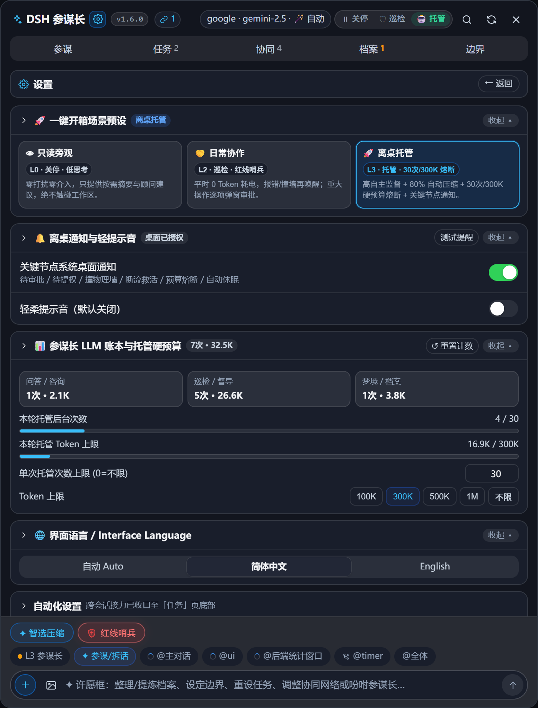

<div align="center">


<br />

# ✦ DSH Chief (`dsh-chief` · DSH 参谋长)
### Multi-Agent Command Cockpit · SuperAgent Cross-Session Synergy · 4-Tier Cold Archive Vault for DeepSeek Harness

[](https://dsh.deepseek.com)
[](https://github.com/deepseek-ai/dsh-superagent-prototype)
[](https://nodejs.org)
[](#)
[](#03--4-tier-cold-engineering-archive-cabinet-档案-tab)
[](LICENSE)

> **Turn scattered chat tabs into a unified Chief of Staff command center**: inspired by DeepSeek's official **[SuperAgent (`dsh-superagent-prototype`)](https://github.com/deepseek-ai/dsh-superagent-prototype)** *Router + Isolated Workers* architecture to eliminate the human attention bottleneck and context pollution—natively integrated with **DeepSeek Harness (DSH)** split-pane subagent streams, panel-native **Goal Supervision + Human Approval Gate**, live `steer` injection, pre-compaction detail harvesting, multi-cabinet precipitated cold vaults, and one-click cross-session Chief deployment.

[简体中文 (`README.md`)](README.md) · **English** · [Changelog (`CHANGELOG.md`)](CHANGELOG.md)

</div>

---

## 🔗 Deep Synergy with Official DeepSeek SuperAgent & Native DSH Runtime

DeepSeek's official **[`dsh-superagent-prototype`](https://github.com/deepseek-ai/dsh-superagent-prototype)** highlights two core bottlenecks in multi-agent engineering: the **Human Attention Bottleneck** across concurrent sessions and **Context Pollution** from accumulated history—solving them via a persistent **Router** coordinating isolated **Worker** sessions.

**`dsh-chief` brings that exact Router–Worker command paradigm into an interactive right-sidebar cockpit natively wired into DSH:**

1. **Visual Router–Worker Orchestration**: Supervise your Root Coordinator, spawned Subagents, and linked independent DSH Worker windows from one **Full-Spread Pyramid DAG** and unified **Collaboration Directory**.
2. **Native DSH Split-Pane Subagent Stream (`subagentchat`)**: Click `分屏对话` on any pyramid node or directory row to invoke DSH's native `sidebarRight.openResource('dsh-resource://subagentchat/...')` split-pane live viewer.
3. **Panel-Native Goal Supervision & Human Approval Gate**: Click **`🎯 设为目标`** right inside the `规划` (Plan) tab to enable long-horizon goal supervision without slash-command friction. When objectives change, stale checklists are flagged for clean reset; once the Chief determines the goal is achieved, it remains in `goal` supervision mode until you explicitly click **Approve & Close (`✅ 批准结项`)** or **Reject & Continue (`↩ 驳回继续`)**.
4. **Composer `+` Tactical Cockpit & `✦ 智选` Co-Managed Compaction**: Open the centered **`+`** trigger to configure Active Intervention (circuit breaker + `⏹ 急停`), Pre-Compaction Harvest (hard threshold floor locked at **50%–95%**), Strict Verification, Redline Sentinel, and Concise Briefs—or toggle **`✦ 智选`** so hard percentage thresholds are bypassed and the Chief + Lead collaboratively choose clean phase boundaries to harvest and compact.
5. **Three-Tier Archive Isolation, 0-Token System Global Cold Vault, Local ↔ Global Bidirectional Diff, Color-Coded Drawer Mailbox & Pinnable Handoff**:
   - **Three-Tier Archive Isolation**: **💬 Session Cabinet** (1:1 per `rootSessionId`; visible to User, Session & Chief; blank chats never leak history), **🌐 System Global Cold Vault** (system-level 0-Token cold storage that **never follows conversation context or auto-migrates legacy session cabinets**; invisible to Lead until copied via `⤵️ 引入本会话`, and readable by Chief only via per-session `👁️ 供本会话参谋参阅` or explicit Q&A search; tracks live **Local ↔ Global bidirectional diff**), and **🏛️ Precipitated Cold Vault** (cross-session **0-Token double-blind** until explicitly unsealed with `📤 取出`);
   - **Peer Linking Warning & Clean Detach**: Joining a peer cluster shows a mutual context-pollution warning, automatically shares progress while linked, and purges cached Chief narratives, external team facts, and pre-step injections upon detach;
   - **Color-Coded Collapsible Drawer Mailbox**: Deduplicates `@all` broadcasts and organizes mails into color-coded collapsible drawers (`Broadcast`, `Cross-Session Pair/Multi`, `Internal`);
   - **Editable & Pinnable Handoff**: Edit handoff packets manually, freeze auto-rendered previews cleanly with **`📌 定住防改`** (disabling Chief digest auto-sync while pinned), and receive a pre-deploy warning modal if handoff notes lag behind recent progress.

---

## 💡 Why `dsh-chief` Is Fundamentally Different

Ordinary Todo lists and always-injected memory plugins break down on complex, multi-subagent engineering sessions:
1. **Silent Background Token Drain & Wrong Provider Routing**: Auto-summarizing after every turn burns quota in the background and often matches bare model names onto expensive metered channels instead of your active subscription provider.
2. **Context Bloat & Sudden Compaction Amnesia**: Stuffing debugging notes into system prompts wastes thousands of tokens; meanwhile, automatic context compaction wipes out recently discovered paths, commands, and decisions.
3. **Cramped Drag-Scroll Canvas**: Subagent graphs trapped inside tiny scroll boxes force constant panning just to see what is blocked.
4. **Forgotten Guardrails & Lost Chief State Across Windows**: Safety rules vanish when switching chats, forcing manual copy-paste and reconfiguration.

**`dsh-chief` («DSH 参谋长») replaces ad-hoc scratchpads with a full right-docked Chief of Staff cockpit:**

| Capability | Typical Todo / Always-On Memory Plugins | ✦ DSH Chief (`dsh-chief`) |
| :--- | :--- | :--- |
| **Pace & `+` Tactical Cockpit** | Blind per-turn background calls; no tactical safety brakes | **3-Gear Human Pace** (`⏸ On-Demand` **0 background calls**, `👁 Smart`, `🤖 Auto`) + composer **`+` Tactical Cockpit** (`Intervention + Emergency Stop + Circuit Breaker`, `Auto-Compact Harvest`, `Strict Verify`, `Redline Sentinel`) |
| **Subagent Task Topology** | Flat lists or cramped drag-scroll viewports | **Full-Spread Pyramid DAG**: Root Coordinator at the apex, subagent lanes laid out cleanly with inline status, explain, dispatch & split-stream buttons |
| **Multi-Cabinet & Cold Vault** | Stuffed into system prompts or lost on compaction | **Per-Project Multi-Cabinets + 4-Tier Dossiers + 0-Token Precipitated Cold Vault**: one-click **Harvest (`📥 抢救细节`)** before compaction and **Precipitate (`⏬ 沉淀`)** into cross-session cold storage (**0 file reads / 0 prompt tokens** unless explicitly **Flipped Out (`📂 翻出`)**) |
| **Goal Supervision & Step Q&A** | Static checklists; models self-declare completion | **Core Objective + Human Approval Gate + Interactive Step Board**: click any step to ask *"Why is this needed?"*; goal completion requires explicit human sign-off |
| **Cross-Session Relay & Images** | Isolated single window; image uploads fail on text-only Chiefs | **Cross-Window Peer Linking + 1-Click Chief Deployment (4 archive policies)** + **Workspace `.dsh-chief/uploads/` persistence** with text-only fallback |
| **Redline Governance & Idle Guard** | Verbal rules lost; no handoff verification | **`📌` Global Thumbtack Redlines** + boundary proposals + **self-contained handoff** + `idle-guard` |

---

## 📸 Visual Tour (7 High-DPI Views)

### 01 · Right-Docked Executive Chief Cockpit (`参谋` Tab)
Docked alongside your live conversation: displays exact `Provider · Model` channel alignment, the `⏸ On-Demand` human-paced toggle, structured status briefings, pending boundary approvals, and natural-language `@target` dispatch chips.


---

### 02 · Full-Spread Pyramid Subagent DAG (`任务` Tab)
No cramped mini-viewports: the Root Coordinator sits at the top while subagent squads spread out across structured columns with direct inline controls for status transitions, plain-language explanation, task dispatch, and split-screen subagent chat inspection.

<div align="center">
  
</div>

---

### 03 · Three-Tier Archive Vaults, Detail Harvest & 0-Token Precipitated Cold Vault (`档案` Tab)
Enforces strict visibility isolation across **💬 Session Cabinet**, **🌐 System Global Cold Vault**, and **🏛️ Precipitated Cold Vault**:
- **4-Tier Dossier Structure**: **Cabinets → Filing Drawers** → **Color-Coded Paperclipped Dossiers** (**Luminous Gold `#ffe033`**, **Brushed Silver `#cbd5e1`**, **Dark Antique Copper `#7c4329`**) → **Structured Memory Points** → **Unfoldable Sub-point Details**.
- **Pre-Compaction Harvest (`📥 抢救细节`) & Double-Blind Cold Vault (`🏛️ 沉淀档案柜`)**: Extracts exact file paths, shell commands, and decisions into the Session Cabinet manually, at `50%–95%` hard thresholds, or via **`✦ 智选`** phase-boundary co-management. Generalizable lessons in the **0-Token Precipitated Vault** remain **double-blind to both Chief and Lead** until explicitly unsealed via **「📤 取出」 (`flipOut`)** and re-hidden immediately via **「📥 封回」 (`sealBack`)**.
- **0-Token System Global Cold Vault & Local ↔ Global Diff**: Stored in `global-vault/vault-chief-global.json` outside conversation context (**0 Token by default**; never auto-migrates legacy session cabinets). Displays live bidirectional diffs (`仅本地` / `已同步` / `本地已改` / `全局独有`), lets you push/update session dossiers (`🌐 存入全局` / `↻ 更新至全局`), import into a session (`⤵️ 引入本会话`), or toggle Chief visibility per session (`👁️ 供本会话参谋参阅` / `📥 收回冷存`).

<div align="center">
  
</div>

---

### 04 · Panel-Native Goal Supervision, Human Approval Gate & 1-Click Chief Deployment (`规划` Tab)
Combines a core objective box with a **`🎯 设为目标`** supervision toggle, stale-checklist reset warnings on goal edits, and a strict **Human Approval Gate** (completion proposals stay in `goal` mode until you click `✅ 批准结项` or `↩ 驳回继续`). Zone 3 integrates **Cross-Session Handoff & 1-Click Chief Deployment** with 4 archive migration policies (`none`, `mounted`, `drawer`, `all`)—keeping precipitated cold vaults strictly isolated.

<div align="center">
  
</div>

---

### 05 · Cross-Window Linking, Composer `+` Tactical Cockpit & Image Persistence (`协同` & Input Bar)
Link multiple independent DSH root sessions into one shared bus, upload or paste screenshots persisted directly into `<cwd>/.dsh-chief/uploads/` (with automatic text-only Chief fallback carrying verified raw file paths to your multimodal lead agent), and control **Active Strong Intervention**, **Auto-Compact Thresholds**, **Strict Verification**, **Redline Sentinel**, and the red **`⏹ 急停`** emergency stop inside the **`+`** Tactical Cockpit.

<div align="center">
  
</div>

---

### 06 · `📌` Global Thumbtack Redlines & Guard Preferences (`边界` Tab)
Pin critical safety rules with `📌` globally or keep them task-scoped, review subagent boundary proposals in one click, consolidate scattered rules via DSH Chief, and tune per-turn injection and `idle-guard` preferences under **守护偏好**.

<div align="center">
  
</div>

---

### 07 · Pre-Compaction Safety & Self-Contained Handoff Previews
When context usage reaches your configured threshold while idle, `dsh-chief` harvests recent technical details to disk, verifies readability on disk, and only then triggers compaction—or lets you generate and inspect a full self-contained Markdown handoff packet before spawning a fresh session.

<div align="center">
  
</div>

---

## ⚠️ Usage Notes & Disclaimers

> [!IMPORTANT]
> Before enabling **`+` Tactical Cockpit** features such as **Active Strong Intervention (`⚡ 主动强介入`)**, **Pre-Compaction Auto-Harvest**, or **Redline Sentinel**, please review the following two disclaimers:
>
> 1. **Underlying Model Capability Dependency**: All Chief auto-review, active strong intervention steering, pre-compaction detail harvesting, and redline interception capabilities depend heavily on the reasoning strength and context quality of the underlying LLM configured for DSH Chief; models differ objectively in planning rigor and instruction adherence.
> 2. **Host System Prompt & Rules Conflict Risk**: Mounting excessive System Prompts, global Rules, or rigid custom instructions in the main session or current project may conflict with this plugin's autonomous intervention logic—potentially causing abnormal intervention loops, premature circuit-breaker trips, or unexpected deviations.
>
> Always specify a clear Core Objective and at least one Forbidden Redline before confirming Active Strong Intervention, and use the red **`⏹ 急停`** button above the composer anytime you want immediate manual takeover.

---

## ⚡ Quick Installation (Zero External Dependencies)

```bash
# Fast install from prebuilt GitHub Release tarball (~300 KB, zero build scripts)
dsh plugin --profile desktop add https://github.com/gluztm/dsh-chief/releases/download/v1.1.0/dsh-chief-1.1.0.tgz

# Or install directly via GitHub shorthand (replace `desktop` with `web` if using web profile)
dsh plugin --profile desktop add github:gluztm/dsh-chief
```

Refresh the DSH Web UI and click the **✦ `DSH 参谋长`** icon in the right-hand sidebar header.

### Host Version Compatibility Matrix

| DeepSeek Harness (DSH) Version | Sidebar Panel / Board / Vaults / Bounds | Named Subagent Tree (`task.dispatch` / `team.steer` / `team.interrupt`) | Notes |
| :--- | :---: | :---: | :--- |
| **`>= 0.2.2-rc.2` (`rc.3+` recommended)** | ✅ Full support | ✅ Full support | Provides `subagents.resolveName` / `rootOf` / `namesOf` and flat `startActivation` |
| `0.2.0 ~ 0.2.2-rc.1` | ✅ Panel works normally | ⚠️ Unavailable (guided prompt) | Pre-refactor `subagents` API; panel displays a non-blocking warning and guards `team.*` cleanly |

---

## 🛠️ Model Tool Suite (4 Tools)

| Tool Name | Purpose | Key Actions |
| :--- | :--- | :--- |
| **`chief_board`** | Task DAG orchestration, step checklists, cold archive queries, and inter-agent mail | `graph.plan`, `task.add`, `task.update`, `plan.set`, `cursor.set`, `mail.send`, `archive.save`, `archive.search`, `bounds.propose` |
| **`chief_memory`** | Session-scoped hot digest entries (progress, decisions, verification, risks) | `list`, `get`, `add`, `update`, `remove` |
| **`chief_boundaries`** | Global pinned redlines (`📌`) and task-scoped working boundaries | `get`, `set`, `add`, `pin`, `remove` |
| **`chief_handoff`** | Self-contained Markdown handoff packet generation across sessions | `preview` / structured session relay |

---

## 🛡️ Security & Local-Only Privacy

- **Loopback + Same-Origin Guard**: Every `/api/dsh-chief/*` endpoint enforces loopback client verification and same-origin `Origin`/`Host` validation.
- **Automatic Secret Blocking**: Rejects accidental persistence of `sk-*`, `ghp_*`, Bearer tokens, and OpenSSH private keys across boards, facts, and archives.
- **100% Local Storage**: All state lives exclusively on disk under `~/.dsh/chief/` (`board.json`, `boards/`, `archives.json`, `chief-state.json`) with zero external runtime dependencies and zero telemetry.

---

## 📄 License

Licensed under the **[GNU Affero General Public License v3.0 (`AGPL-3.0-only`)](LICENSE)**.
