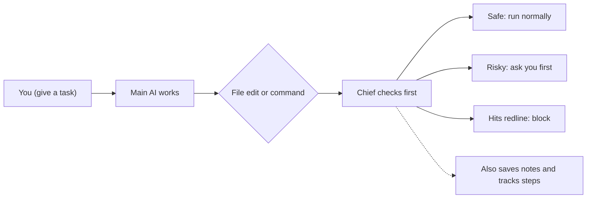
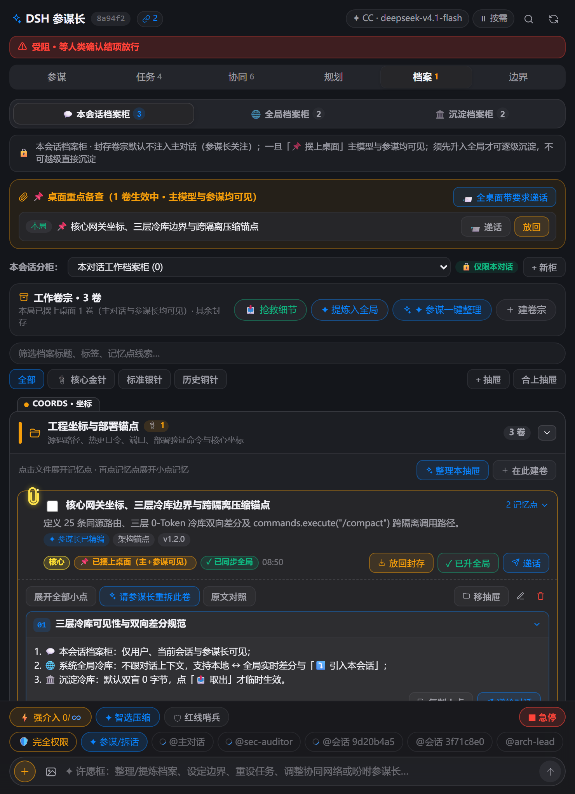
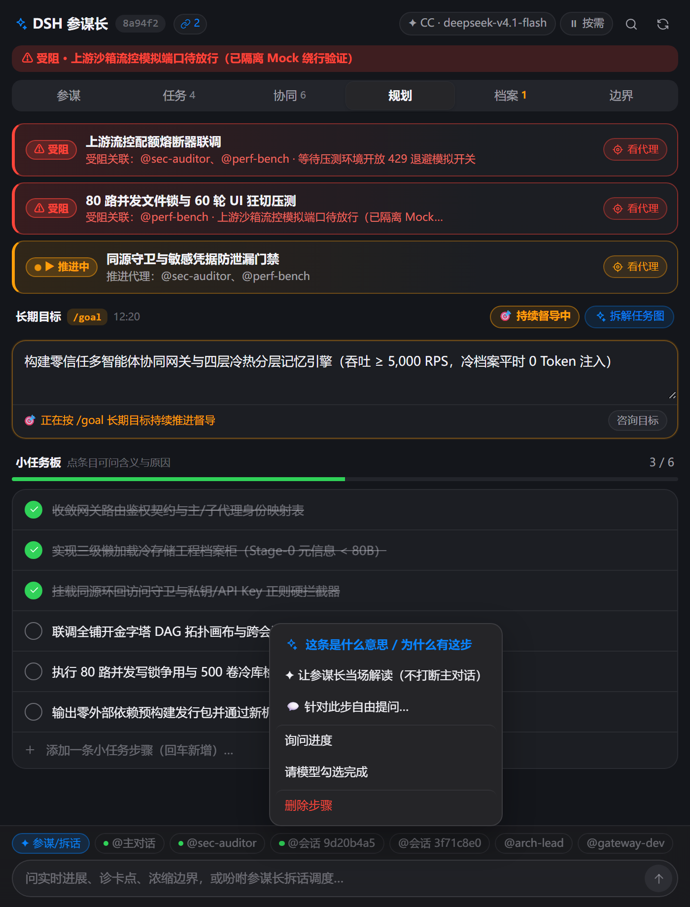
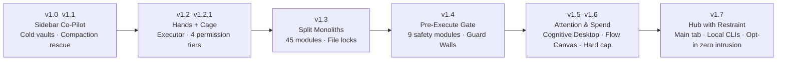
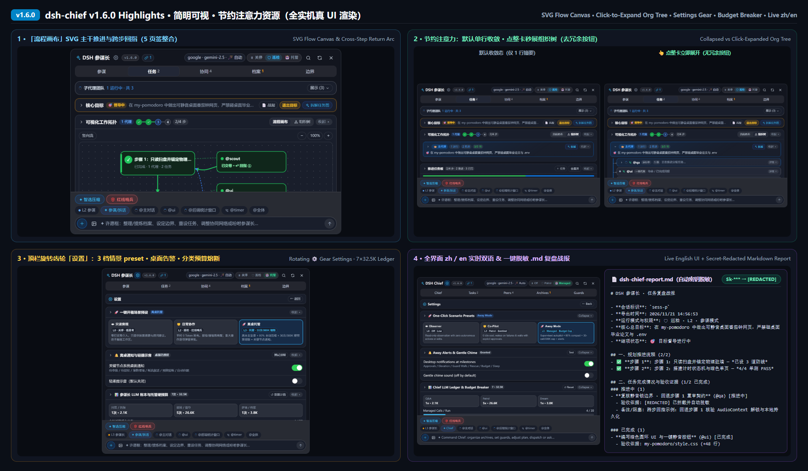
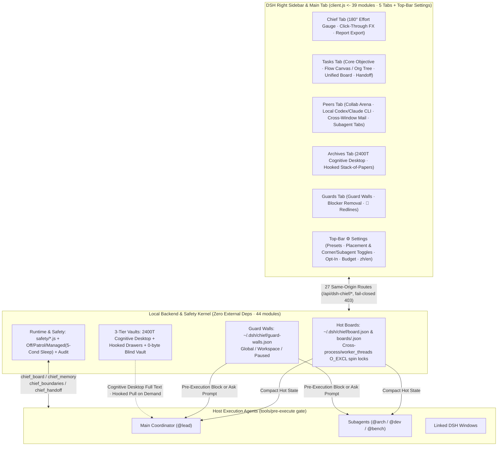

<div align="center">

# DSH Chief (`dsh-chief`)
**DeepSeek Harness (DSH) supervisor plugin for both the right sidebar and main conversation tab: opt-in per session with zero intrusion on plain chats, tracking tasks, layered memory, local external CLI harnesses, and pre-execute guardrails.**

[](https://dsh.deepseek.com)
[](https://github.com/gluztm/dsh-chief/releases)
[](https://www.npmjs.com/package/dsh-chief)
[](https://github.com/gluztm/dsh-chief/actions/workflows/ci.yml)
[](https://awesome-dsh-plugin.com/p/gluztm/dsh-chief/)
[](https://www.bilibili.com/video/BV1Fksq6iEw8)
[](https://github.com/deepseek-ai/dsh-superagent-prototype)
[](https://nodejs.org)
[](#)
[](LICENSE)


<sub>Read-only by default · Asks before editing workspace · One-command install</sub>

[简体中文 (`README.md`)](README.md) · **English** · [Evolution (`EVOLUTION.en.md`)](EVOLUTION.en.md) · [Changelog (`CHANGELOG.md`)](CHANGELOG.md) · [Architecture (`ARCHITECTURE.md`)](ARCHITECTURE.md)

[What is this?](#what-is-this) · [Quick Start](#quick-start-3-minutes) · [Pick a Preset](#which-preset-should-i-pick) · [Interface](#what-the-panel-looks-like) · [Glossary](#glossary) · [FAQ](#faq) · [Going Deeper](#going-deeper)

</div>

---

## What is this?

In DeepSeek Harness (DSH), the main chat AI reads code, edits files, and runs commands for you. `DSH Chief` sits in the right sidebar as an assistant and safety gate: it does not take over your main chat, and instead saves path notes, tracks multi-step plans, and checks file edits or shell commands before they execute.

New chats start read-only by default, so nothing in your project changes until you allow it.

**Who is it for:** People running multi-step tasks in DSH who want to stop accidental edits or deletions and avoid losing earlier findings when a long chat compacts.



---

## In One Sentence

- **Opt-in per session with zero intrusion**: Fresh normal chats and their subagents stay untouched by default—zero prompt injection, zero safety blocks, and zero stray board files—until you click "Enable for This Session" or use Chief (you can also restore global auto-enable in Settings).
- **Save before compacting**: When context fills up, Chief writes paths, commands, and errors to local archives before running `/compact`.
- **Keep tasks from stopping halfway**: Once you lock an objective, stalled steps get nudged forward, and 3 identical errors stop the loop.
- **Check edits and commands first**: In active sessions, tool calls check against your Guard Walls (pre-execute rules) before running and pause for approval when needed.
- **Read-only by default**: Even after enabling a session, Chief observes without touching workspace files until you raise the permission tier (`L0`–`L3`).
- **Keep prompt tokens low**: Only items pinned to the Cognitive Desktop (up to `2,400 tokens / 6 items`) go into each turn; everything else stays on disk until pulled.
- **Main page or sidebar + direct local Harnesses**: Open Chief as a full-screen `Chief` top conversation tab (hiding the duplicate host input bar), connect local `Codex` / `Claude Code` without `ccSwitch`, and open subagent chats as tabs without stacking split panes.

---

## Quick Start (3 minutes)

1. **Install the plugin** (replace `desktop` with `web` for the web profile, or search `dsh-chief` in DSH Plugin Market):
   ```bash
   dsh plugin --profile desktop add dsh-chief
   ```
2. **Open the panel**: Restart or reload DSH, then click `✦ DSH 参谋长` in the top-right workspace corner.
3. **Pick a preset**: Click the `⚙️` gear in the top bar. New users can start with **🤝 Daily Co-Pilot** (or leave defaults alone to stay read-only).
4. **Work normally**: Talk to your main agent as usual; whenever you want Chief to look something up, draft a rule, or organize notes, type plain English or Chinese in the sidebar input box.
5. **Stop anytime**: Click the red `⏹ 急停` button at the bottom right of the input bar to halt background activity immediately.

---

## Which preset should I pick?

Open the `⚙️` gear in the top bar to switch between these three built-in presets:

| Your situation | Pick this | What it does | Extra background calls? |
| :--- | :--- | :--- | :--- |
| Just want to watch without touching files | `👁 Observer` (`L0 · ⏸ Off`) | Read-only; answers only when you ask | No background model calls |
| Everyday coding (recommended) | `🤝 Daily Co-Pilot` (`L2 · 🛡 Patrol`, sentinel on) | Steps in only on errors or blocked rules; asks before major edits | None while idle |
| Leaving your desk while a task runs | `🚀 Away Mode` (`L3 · 🤖 Managed`) | Supervises continuously, auto-compacts at 80%, alerts at milestones (requires double confirmation) | Yes, stops at `30 calls / 300K tokens` by default |

---

## What the panel looks like


The sidebar has 5 tabs plus a top-bar Settings page:

| Location | What you do here |
| :--- | :--- |
| `Chief` tab | Send instructions in plain language, change permissions or run mode, export reports, or hit `⏹ 急停`. |
| `Tasks` tab | Lock your Core Objective, inspect Flow Canvas or Org Tree, click `Explain` on steps, and export handoffs. |
| `Peers` tab | Coordinate `@lead`, subagents, linked windows, and local `Codex` / `Claude Code` CLIs with dormant scan & cross-window mailbox. |
| `Archives` tab | Manage the pinned Cognitive Desktop and three folded drawers to control prompt tokens. |
| `Guards` tab | Set up Guard Walls (pre-execute rules), must-do checks, and global redlines. |
| Top-bar `⚙️` | Switch presets, placement (`Main Tab / Sidebar`), corner/subagent-tab toggles, session opt-in, alerts, budget caps, and `zh / en`. |

### 01 · Chief Cockpit (`参谋` Tab)
**In one sentence:** Give Chief plain-language instructions, switch permission and run tiers, or hit the red halt button from this tab.

- Use the bottom composer to delegate research, draft Guard Walls, or organize notes; toggle `⚡ 强介入`, `✦ 智选压缩`, `🛡 红线哨兵`, `L0–L3` tiers, and `⏹ 急停` on the control strip, or change `⏸ Off / 🛡 Patrol / 🤖 Managed` and the `180°` effort gauge in the top bar.
- When Dream Roam or auto-review dims the panel with a translucent overlay, **click anywhere on the overlay to dismiss it while the outer border stays lit to show background activity**.


### 02 · Flow Canvas & Org Tree (`任务 / Tasks` Tab)
**In one sentence:** Switch to Flow Canvas for SVG steps and return arcs, or click the Lead card in Org Tree to unfold subagent lanes.

- Switch between **Flow Canvas** (SVG step flow, nested subagent branches, and dashed cross-step return arcs) and **Org Tree** (collapsed to a one-line summary until you click the Lead card to show subordinate lanes), above the progress board and `分屏` live stream panes.

<div align="center">
  
</div>

### 03 · Cognitive Desktop & Vault Drawers (`档案` Tab)
**In one sentence:** Pin only active notes to the Cognitive Desktop (`2,400 Tokens / 6 items`) and keep everything else folded in three drawers with keyword hooks.

- The top **📌 Cognitive Desktop** bar tracks the `2,400 Tokens / 6 items` limit (the sole automatic per-turn prompt injection); below sit Session, System Global, and Precipitated drawers with folded cards showing titles, `🪝` keyword hooks, and who pulled each item.

<div align="center">
  
</div>

### 04 · Objective Lock & Step Explain (`Tasks` Tab)
**In one sentence:** Lock your Core Objective with `🎯 Set Objective` and click `Explain` on any step for a plain-language summary without pausing `@lead`.

- Click `🎯 Set Objective` before enabling Strong Intervention, inspect the collapsible Work Topology and Progress Task Board below, or click `Explain` on any step to hear what it does and what skipping it affects.

<div align="center">
  
</div>

### 05 · Cross-Window Peer Linking & Mailbox (`协同` Tab)
**In one sentence:** Link separate DSH windows to exchange progress and contracts, and wipe link caches as soon as you detach.

- Connects open DSH windows to share task state and mailbox messages across front-end UI and backend APIs; detaching clears link caches, external notes, and mailbox leftovers.
- Screenshots pasted into the composer save under `<cwd>/.dsh-chief/uploads/` so models read real image files.

<div align="center">
  
</div>

### 06 · Guard Walls, Pinned Redlines & Must-Do Checks (`边界` Tab)
**In one sentence:** Add pre-execute rules to Guard Walls at the top to block commands or file paths before they run, and manage must-do, forbidden, and note lists below.

- The top **🧱 Physical Guard Walls** area blocks dangerous commands or paths before execution: add rules manually or ask Chief to draft them, toggle `🌐 Global`, `📁 Workspace`, or `⏸ Paused`, and merge same-type rules.
- Below, `allowed`, `forbidden`, and `notes` separate global `📌` rules from session-only ones. No L0–L3 model can delete locked walls without an approved removal ticket.

<div align="center">
  
</div>

### 07 · Top-Bar Settings: Presets, Placement, Opt-In Controls & Budget Cap (`⚙️` Settings)
**In one sentence:** Click the `⚙️` gear in the top bar to pick a scenario preset, choose Main Tab vs. Sidebar placement and entry buttons, toggle session opt-in, set alert sounds and budget limits, or switch languages.

- Click `⚙️` between `DSH 参谋长` and the version badge to open **Settings**: choose from **3 Scenario Presets** (Observer / Co-Pilot / Away Mode), configure **Panel Placement** (`Sidebar + Main Tab / Main Tab Only / Sidebar Only`, composer shortcut & floating corner trigger toggles, `Sidebar Tab / New Split Pane` for subagent views, plus per-session and new-session auto-enable switches), toggle **7 Milestone Desktop Alerts & Chime**, track the **categorized LLM Ledger (`chat / review / dream`) & hard budget cap**, and switch `zh / en` live. `📌 Pin Lock` Session Handoff and redacted `.md` report export sit at the bottom of `Tasks`.
- Pick which archive scope carries into a new window (`None`, `Spotlight Only`, `Entire Drawer`, or `Full Session Cabinet`), while Strong Intervention resets to off for safety and `idle-guard` prevents stalled runs.

<div align="center">
  
</div>

---

## Glossary

| Term | Plain explanation |
| :--- | :--- |
| `Main chat (@lead)` | The main AI in the center DSH window that reads code, edits files, and runs commands. |
| `Chief` | The sidebar supervisor AI in this plugin that tracks progress, saves notes, and checks risky calls. |
| `Subagents` | Worker agents launched by `@lead` to run tasks in parallel (such as `@arch`, `@dev`, `@bench`). |
| `L0–L3 tiers` | Permission levels: L0 read-only default, L1 assistant, L2 asks before writes, L3 full delegation. |
| `Off / Patrol / Managed` | Header run modes: Off stays quiet, Patrol wakes on failures/blocks, Managed supervises continuously. |
| `Guard Walls` | Pre-execute rules checked before file writes or shell commands run, blocking or prompting you. |
| `Forbidden / Must Do` | Rules in the Guards tab listing blocked actions and required checks before completion. |
| `Cognitive Desktop` | The top pinned archive area (max `2,400 tokens / 6 items`)—the only notes injected every turn. |
| `Archive Vaults` | Three drawers (Session, Global, Precipitated) that keep unpinned notes at 0 prompt tokens. |
| `🪝 Hooks` | Keyword tags on folded notes so the model can pull exact items when needed. |
| `/compact` | DSH's built-in context summarizer; Chief saves details to archives first before triggering it. |
| `✦ Smart Compact` | Automatically saves key notes and triggers `/compact` at idle boundaries or thresholds. |
| `⚡ Strong Intervention` | Keeps pushing a locked objective forward if the model stalls, stopping after 3 identical errors. |
| `⏹ Halt (急停)` | The red button on the input bar that stops all background triggers immediately. |
| `Handoff Packet` | A pinned summary card used to start a clean new DSH window without re-explaining background. |
| `Dream Roam` | Background archive organizing and hook tagging during Managed mode, tracked in the `dream` ledger. |
| `Token` | The text unit used for context limits and model billing, roughly one word or 1–2 CJK characters. |

---

## FAQ

**Will it spend tokens in the background without me knowing?**
No. Under `⏸ Off` and `🛡 Patrol`, idle sessions make zero background LLM calls. Only `🤖 Managed` runs background checks, and it stops at a default cap of `30 calls / 300K tokens`; you can check exact counts by category (`chat / review / dream`) inside `⚙️ Settings`.

**Will it run hooks or block paths in ordinary chats where I never opened Chief?**
No. Starting with `v1.7.0`, new chats start unactivated by default—Chief skips prompt injection, pre-execute workspace checks, idle guards, and disk writes until you click **Enable for This Session** or invoke a Chief feature. If you prefer every new session protected automatically, turn on **Auto-enable Chief in new sessions** under `⚙️ Settings -> Panel Placement`.

**Can it edit or delete my files by mistake?**
New sessions default to `L0` read-only. In `L2`, important edits and commands pop up for per-action approval. Hard rules (disk formatting, force pushes, `git reset --hard`) stay blocked at every tier, and no L0–L3 model can delete Guard Walls you locked.

**How do I stop it right now?**
Click the red `⏹ 急停` button at the right end of the input strip to stop background activity immediately, or switch the header mode to `⏸ Off`.

**Where is my data stored? Does it upload anything?**
All boards, archives, Guard Walls, and audit logs live locally under `~/.dsh/chief/` with zero external dependencies and no telemetry. Detected API keys or private key snippets are redacted to `[REDACTED]` before storage.

**Which DSH and Node.js versions do I need?**
DSH `>= 0.2.2-rc.2` (`>= 0.2.2-rc.5` recommended for full file-tool and dialog support) and Node.js `>= 22.13.0`. On `0.2.0 ~ 0.2.2-rc.1`, the panel mounts but disables subagent dispatch and prompts you to upgrade. See the full compatibility table under Going Deeper below.

**What if planning or bug finding feels weak?**
Check two things: first, `dsh-chief` enforces guardrails and isolation, while code judgment depends on the model assigned to Chief—pick a strong reasoning model for complex work. Second, avoid stacking hundreds of conflicting global rule lines or another always-on memory plugin alongside `dsh-chief`.

**Can I use it if I don't write code?**
Yes. You can type plain instructions in the composer, switch presets with one click, and click `Explain` on any step in **Tasks** to read what it does and what skipping it affects.

---

## Going deeper

<details>
<summary>Architecture Evolution: From a Sidebar Notepad to a Multi-Agent Command Hub (v1.0 -> v1.7)</summary>

What began as a shared-JSON sidebar scratchpad (`dnb-`) grew through real daily friction into a zero-dependency command hub with **44 backend modules + 39 frontend modules**:

<div align="center">
  
</div>



Read the full engineering story and architectural tradeoffs in **[Architecture Evolution (`EVOLUTION.en.md`)](EVOLUTION.en.md)**.

</details>

<details>
<summary>What Changed in v1.7.0</summary>

- **Opt-In Per Session & Zero-Intrusion Bypass**: All 8 backend runtime hooks check per-session activation (`sessionEnabled`), leaving unactivated plain chats and their subagents completely untouched (zero prompt injection, zero pre-execute blocking, zero stray board files) with an in-panel opt-in banner plus per-session & global default toggles in Settings and automatic backward compatibility for legacy sessions.
- **Safety Guard Master Switches & False-Positive Fixes**: Adds human-only per-session and global Safety Guard toggles in Settings (confirm-gated and audited, independent of Redline Sentinel and custom Guard Walls), eliminates `destructive_command` false positives on non-executable heredocs and read-only queries, and normalizes benign `cursor.blocked` notes so resolved/approved remarks no longer trigger false red alarms.
- **Main Page Tab (`conversation.view`) & Subagent Tab Routing**: Registers a clean top `Chief` / `参谋长` conversation tab that hides the host bottom composer, fills the viewport safely (`--dsh-conversation-viewport-height` fallback for `0.2.2-rc.3`), offers independent composer & floating corner button toggles, and opens subagent views in the active right sidebar as tabs by default (without spawning stacked split panes).
- **Redesigned Collaboration System & Clean Standby Dock**: Native non-`ccSwitch` discovery & one-click dispatch for local `Codex` and `Claude Code` CLIs (with redlines + Guard Walls), cross-window `pair` mailbox classification, idle-static vs. active-breathing glow & flowing SVG links, one-click standby refresh scan, and strict filtering against `Mnemon` maintenance tasks, blank `DS Bot` shells, `.v4` subagents, and orphan dirs.
- **Light Theme Unification & Monolith Split**: Unified 8-tint card accents across all 5 tabs, adapted DSH light theme surfaces across every canvas and popover, and split all monoliths cleanly into **44 backend modules and 39 frontend modules**.

</details>

<details>
<summary>What Changed in v1.6.0</summary>



- **Flow Canvas & 5-Tab Layout**: Merged Plan into **Tasks** so the header holds five tabs (`Chief / Tasks / Peers / Archives / Guards`). **Flow Canvas** draws sequential stages, nested subagent lanes, and cross-step return arcs in SVG; **Org Tree** stays collapsed to one line until you click the Lead card.
- **Alerts, Usage Ledger & Budget Cap**: Fires desktop `Notification` alerts (and an optional two-note chime) on 7 milestones such as approvals, elevations, wall blocks, rescue wakes, auto-sleep, budget stops, and hazard halts, suppressing old events on first load. Tracks calls and tokens across `chat / review / dream` with a default `30 calls / 300K tokens` Managed limit (your direct `ask_chief` questions stay unblocked) and exports redacted `.md` reports.
- **Top-Bar Settings, 3 Presets & Bilingual UI**: Moved configuration to the `⚙️` gear between the title and `v1.6.0`, with **Observer / Co-Pilot / Away Mode** presets (entering L3/Managed requires two confirmation steps) and instant `Auto / 简体中文 / English` switching via `locale/zh.json` & `locale/en.json`.
- **Command Check & Mid-Turn Loop Guards**: Tells `--format` CLI flags apart from disk-format commands (`format C:` still stays blocked); adds mid-turn duplicate/error spin detection (`detectMidTurnSpin`) with `planWrite` exemption and blocks late background calls after a budget stop.

> Uses a Router + Workers split modeled after DeepSeek's **[SuperAgent (`dsh-superagent-prototype`)](https://github.com/deepseek-ai/dsh-superagent-prototype)**, keeping Chief state and prompts separate from the main chat.

</details>

<details>
<summary>Six Daily Problems It Fixes</summary>

### 1. Context compaction (`/compact`) wipes paths, commands, and errors
**In one sentence:** Chief saves verified file paths, ports, and errors into your session archive before asking DSH to compact.

- **What goes wrong**: When a long session compacts, the summary drops exact file paths, port numbers, and shell fixes you already found, so the model re-reads files again.
- **How `dsh-chief` handles it**: Supports `✦ 智选压缩` at idle boundaries, custom `10%–95%` or `>= 8,000` token thresholds, or typing `"压缩吧"`. It extracts details to your local session archive and checks the write before calling `/compact`. Compaction counters do not move if history is empty or compaction errors out.

### 2. Agents stop halfway ("I edited the file, please test it")
**In one sentence:** After you lock an objective, stalled steps keep getting pushed forward, three identical errors stop the run, and the red halt button stops background work right away.

- **What goes wrong**: Left unattended, an agent edits a single file and reports done without running tests or builds.
- **How `dsh-chief` handles it**: Requires locking a Core Objective before turning on Strong Intervention (`0 = ∞` turns with a 3-strike identical-error stop). In `🛡 Patrol` and `🤖 Managed`, stream drops automatically resume; L3 with Strong Intervention batches safe steps into a `🏁 One-Stop Report`, and final completion waits until `allowed` checks pass and you approve. Click the red `⏹ 急停` button at any time to stop background triggers.

### 3. Always-on memory plugins fill prompts and waste tokens
**In one sentence:** Only the few files on your Cognitive Desktop enter each turn; the rest stay out of the prompt until pulled by keyword.

- **What goes wrong**: Injecting kilobytes of old notes into every turn wastes context space and distracts the model from the files you are editing now.
- **How `dsh-chief` handles it**: Archives sit in three vaults (Session, System Global, Precipitated) shown as folded stack-of-papers cards. **Only items pinned to the Cognitive Desktop (`2,400 Tokens / 6 items`) enter the prompt automatically**. Other entries stay at 0 prompt tokens, exposing `🪝` keyword hooks so the model pulls them on demand with `archive.pull`, while Precipitated secrets stay hidden from both sides unless pulled.

### 4. Full autonomy feels unsafe, but chat-only mode leaves Chief idle (or bossy)
**In one sentence:** New chats start read-only, permissions stay separate from run modes, and AI tiers cannot remove Guard Walls you locked.

- **What goes wrong**: Granting full permission risks `git push --force`, recursive deletes, or reading `.env`, while strong supervisors often edit files themselves instead of directing the main agent.
- **How `dsh-chief` handles it**: Keeps permission tiers (`L0 advisor` read-only default / `L1 assistant` / `L2 strategist` per-action approval / `L3 chief`) separate from header run modes (`⏸ Off / 🛡 Patrol / 🤖 Managed`), paired with a pre-execute check:
  - **Every new session starts read-only**: Reads code, answers questions, and updates the board without editing files or interrupting the main thread.
  - **Pre-execute Guard Walls (`tools/pre-execute`)**: Before `@lead`, any subagent, or Chief writes a file or runs a command, calls check `~/.dsh/chief/guard-walls.json`. Walls toggle between `🌐 Global`, `📁 Workspace`, and `⏸ Paused`, merge same-type rules, or get drafted from plain text for your approval. Models in L0–L3 cannot remove or disable locked walls—if blocked, they can only submit a removal request for you to approve.
  - **Main agent does the editing**: Unless you ask Chief to edit files directly, it sends structured `[EXECUTION_REQUEST]` items to `@lead` instead of speaking as you. In a blank chat, it guides `@lead` to read the repo and draft a plan first, and asks clarifying `[INQUIRY]` questions quietly without pausing `@lead`.
  - **Resumes after approval & hard redlines**: `TaskLedger` picks up stalled steps once you click Allow. Hard blocks (compound shells, `node -e`/`python -c`, quote-backslash `.env` tricks, symlinks, NTFS ADS) apply in every tier and log to `~/.dsh/chief/chief-audit.jsonl`, alongside optional restrict-only JSON `policyPlugins`.

### 5. Dozens of subagents run out of sight and ignore verbal rules
**In one sentence:** Track `@lead` and subagents in one tree, message individual agents with `@` pills, and pin rules with `📌` so new tasks keep them.

- **What goes wrong**: Workers run in separate tabs, and rules mentioned in chat scroll out of context after ten turns.
- **How `dsh-chief` handles it**: Shows the coordinator and subagents in one tree with status controls, `@agent` steering pills on the bottom bar, plain-language step explanations, and one-click `分屏` live streams. Pin rules with `📌` in Guards so future tasks inherit them.

### 6. Long threads slow down, but opening a new window resets everything
**In one sentence:** `Off` and `Patrol` make zero idle background LLM calls, and pinned handoff cards carry your chosen archive scope into a new window.

- **What goes wrong**: After 100 turns you want a fresh window without re-explaining paths and status, and you do not want a background plugin making extra API calls while idle.
- **How `dsh-chief` handles it**: Defaults to `⏸ Off` / `🛡 Patrol` (0 idle LLM calls), follows your active session's model, and includes a `180°` fan thinking effort gauge with `🪄 Auto` depth. Click `解释` on any step for a plain-language breakdown, freeze handoff notes with `📌 定住防改`, and open a new linked window with only the archive scope you choose.

</details>

<details>
<summary>All Install Options & Host Compatibility</summary>

Search **`dsh-chief`** inside [dshmarket](https://github.com/dsh-market/dsh-market) / DSH Plugin Market, or install via CLI (replace `desktop` with `web` for the web profile):

```bash
# Option 1: Install latest release (v1.7.0) from npm
dsh plugin --profile desktop add dsh-chief

# Option 2: Install directly from GitHub main branch
dsh plugin --profile desktop add github:gluztm/dsh-chief

# Option 3: Install prebuilt GitHub Release tarball (v1.7.0)
dsh plugin --profile desktop add https://github.com/gluztm/dsh-chief/releases/download/v1.7.0/dsh-chief-1.7.0.tgz
```

| DeepSeek Harness (DSH) Version | Panel / Board / Vaults / Pre-Execute Walls | Named Subagent Tree (`task.dispatch` / `team.*`) | Notes |
| :--- | :---: | :---: | :--- |
| **`>= 0.2.2-rc.5` (current desktop target)** | Full support | Full support | Matches `dsh-tool-fs`, `str_replace_editor`, dynamic `reasoningEffort` switching, and native `{ kind: 'ask' }` dialogs |
| `0.2.2-rc.2 ~ 0.2.2-rc.4` | Full support | Full support | Provides native `subagents.resolveName`, `rootOf`, `namesOf`, and `tools/pre-execute` |
| `0.2.0 ~ 0.2.2-rc.1` | Panel works | Upgrade notice | Blocks unsafe `team.*` dispatch and prompts host upgrade |

</details>

<details>
<summary>Modular Architecture (v1.7.0)</summary>

**In one sentence:** `44` backend modules and `39` frontend modules run locally under `~/.dsh/chief/`, staying completely inactive in unactivated chats and injecting only the Cognitive Desktop in active ones.

`v1.7.0` spans **44 backend modules (including 9 isolated modules under `pkg/safety/`) and 39 frontend modules** with no `export let` bindings and no circular imports. See [ARCHITECTURE.md](ARCHITECTURE.md) for boundaries and contracts.



</details>

<details>
<summary>Tools Registered With the Model</summary>

| Tool Name | Purpose | Common Actions |
| :--- | :--- | :--- |
| **`chief_board`** | Task DAG updates, cold archive queries/pulls, peer & chief requests, inquiry replies, wall listing, effort tuning, compaction | `graph.plan`, `task.add`, `task.update`, `plan.set`, `cursor.set`, `mail.send`, `chief.request`, `inquiry.reply`, `wall.list`, `archive.save`, `archive.search`, `archive.pull`, `model.effort`, `bounds.propose`, `permission.request`, `context.compact` |
| **`chief_memory`** | Session-scoped hot items (`decisions`, `progress`, `verify`, `risks`) | `list`, `get`, `add`, `update`, `remove` |
| **`chief_boundaries`** | Global `📌` redlines, must-do checks (`allowed`), and notes | `get`, `set`, `add`, `pin`, `remove` |
| **`chief_handoff`** | Preview and render self-contained Markdown handoff packets | `preview` / session handoff |

</details>

<details>
<summary>Local Storage & Security Guarantees</summary>

**In one sentence:** All data writes use file locks inside `~/.dsh/chief/`, HTTP routes restrict access to localhost, and detected secrets are masked to `[REDACTED]` before storage.

- **Process & Worker-Thread Lock Safety**: `board-store.js`, `chief-state.js`, `archive-core.js`, and `safety/guard-walls.js` serialize writes with `O_EXCL` spin locks (handling transient Windows NTFS `EPERM`/`EACCES`/`EBUSY` retries) and `threadId`-scoped temporary files before atomic rename.
- **Isolated Safety Kernel & De-obfuscation**: `pkg/safety/` (9 modules) and `chief-executor.js` are checksum-locked and catch compound shells, inline scripts (`node -e` / `python -c` / `pwsh` / `iex` + Base64), quote-backslash credential obfuscation (without flagging `process.env.NODE_ENV` or `node .\env\setup.js`), `bounds.*` / wall human confirmation tokens, and single-use `capabilityScope` checks.
- **27 Loopback-Guarded HTTP Routes**: All `/api/dsh-chief/*` endpoints validate local origin/host headers and fail closed (`403`) if connection checks throw.
- **Secret Protection & Local-Only Data**: Refuses to store `sk-*`, `ghp_*`, Bearer tokens, `AIza*`, `AKIA*`, or private keys (redacting temporary notes to `[REDACTED]`). Boards, archives, guard walls, and `chief-audit.jsonl` stay locally under `~/.dsh/chief/` with no external dependencies or outbound telemetry.

</details>

---

## Contributors

| Contributor | Role |
| --- | --- |
| [gluztm](https://github.com/gluztm) | Creator, product design, and maintainer |
| [Gemini](https://github.com/gemini-code-assist) | Feature development, `pkg/safety/` kernel, Cognitive Desktop, orthogonal runtime modes, fan gauge & CI gates |
| [Codex](https://github.com/codex) | Modular architecture design, concurrency stress tests, and red-team boundary audits |
| [deepseek-ai](https://github.com/deepseek-ai) | DeepSeek Harness host runtime and SuperAgent workflow alignment |

---

## License

Licensed under **[GNU Affero General Public License v3.0 (`AGPL-3.0-only`)](LICENSE)**.
