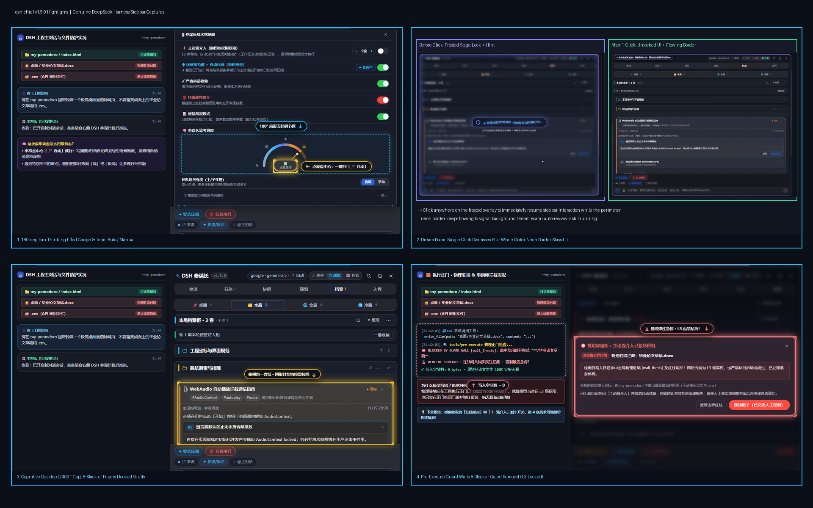
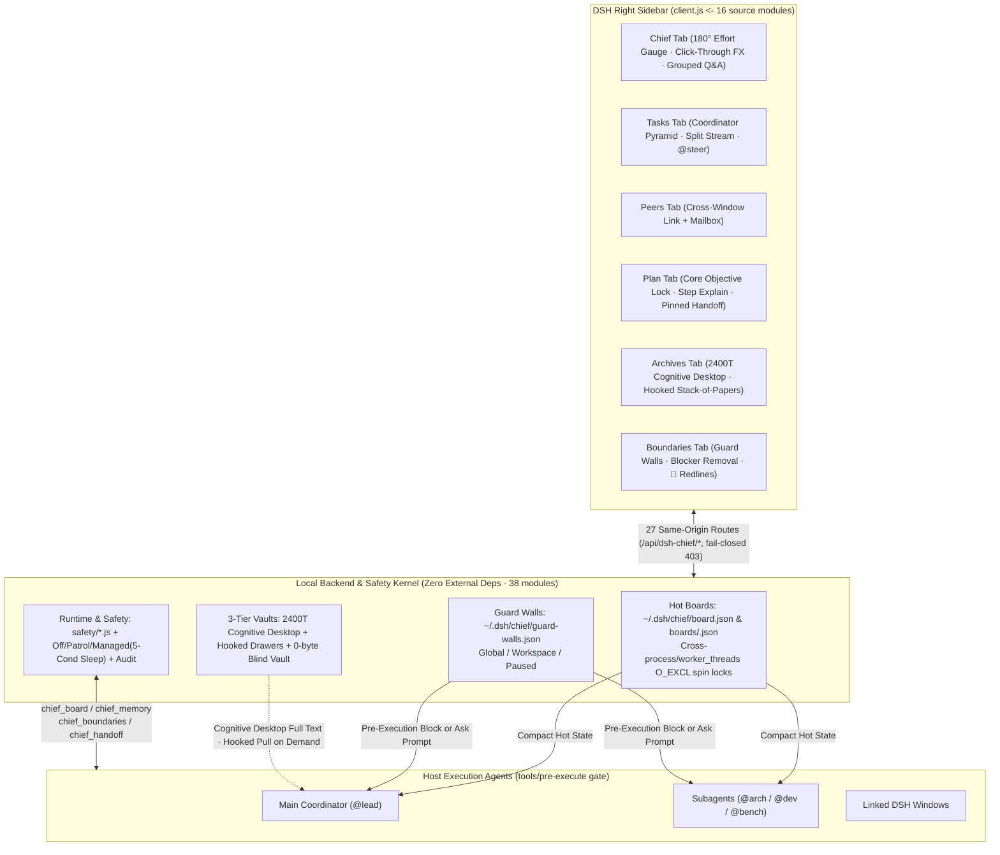

<div align="center">

**Right-sidebar supervisor, Cognitive Desktop, pre-execute Guard Walls & multi-agent gate for DeepSeek Harness (DSH)**  
<sub>Saves paths and findings before `/compact` wipes context, tracks subagent DAGs in one view, and enforces Guard Walls + per-action approvals before file edits or commands run.</sub>


<sub>Read-only by default · Per-action workspace approval · `dsh plugin --profile desktop add dsh-chief`</sub>

<br />



<br />


<br />

# DSH Chief (`dsh-chief`)
### DeepSeek Harness Right-Sidebar Supervisor, Zero-Token Archive Vault & Safety Gate

[](https://dsh.deepseek.com)
[](https://github.com/gluztm/dsh-chief/releases)
[](https://www.npmjs.com/package/dsh-chief)
[](https://github.com/gluztm/dsh-chief/actions/workflows/ci.yml)
[](https://awesome-dsh-plugin.com/p/gluztm/dsh-chief/)
[](https://www.bilibili.com/video/BV1DqsV6QEGi)
[](https://github.com/deepseek-ai/dsh-superagent-prototype)
[](https://nodejs.org)
[](#)
[](LICENSE)

> **Current release `v1.5.0`**: Adds the **Cognitive Desktop (`2,400 Tokens / 6 items` sole prompt-injected vault)** + top-down stack-of-papers drawers with 3-tier hook isolation, **orthogonal runtime control (`⏸ Off | 🛡 Patrol | 🤖 Managed`)** with background `🌙 Dream Roam` (**click anywhere on the frosted overlay to dismiss the blur and regain panel control while the flowing neon border stays lit to signal background work**), 5-condition auto-sleep + `L3` One-Stop Report, **`180°` fan-shaped thinking effort gauge** + Team `Auto / Manual` toggle, plain-language Consult mode, mandatory Core Objective lock for Strong Intervention, blocker-gated wall removal requests, full DSH light-theme support, and subagent entry hiding on DSH `0.2.2-rc.5`.  
> Shares the Router + Workers split from DeepSeek's **[SuperAgent (`dsh-superagent-prototype`)](https://github.com/deepseek-ai/dsh-superagent-prototype)** while keeping Chief state and prompts isolated from the main session.

[简体中文 (`README.md`)](README.md) · **English** · [Changelog (`CHANGELOG.md`)](CHANGELOG.md) · [Architecture (`ARCHITECTURE.md`)](ARCHITECTURE.md)

[v1.5.0 Highlights](#what-changed-in-v150) · [Problems Fixed](#daily-friction-this-plugin-fixes) · [Inside the Sidebar](#inside-the-sidebar) · [Architecture](#modular-architecture-v150) · [Installation](#installation--host-compatibility) · [Security](#local-storage--security-guarantees) · [Contributors](#contributors)

</div>

---

## What Changed in `v1.5.0`

- **🗂️ Cognitive Desktop & Stack-of-Papers Hook Isolation**: Eliminates full-text archive leaks into the main prompt — only documents explicitly pinned to the **📌 Cognitive Desktop (`2,400 Tokens / 6 items` cap)** are injected per turn. Session / Global / Precipitated drawers use collapsible paper-dossier cards with lightweight `🪝` keyword hooks so agents pull dossiers on demand, while un-flipped Precipitated records remain `0-byte` double-blind to AI.
- **🤖 Orthogonal Runtime Modes & Click-Through `🌙 Dream Roam`**: Header switches cleanly between `⏸ Off` (0 background calls), `🛡 Patrol` (0 idle cost; wakes only on guard blocks, errors, or stream interrupts), and `🤖 Managed` (active oversight + idle Dream Roam organization). Clicking anywhere on the frosted Dream Roam overlay immediately dismisses the blur/blocker so you can keep using the sidebar while the animated outer neon border continues to indicate background work. Auto-sleeps back to `Off` after all 5 idle checks clear.
- **🧠 `180°` Fan Thinking Effort Gauge & Team Control**: Drag along the 180° rainbow arc (`Off / Low / Medium / High / Max`) or tap the center hub for `🪄 Auto` (lowers effort on summaries/roam, raises effort for diagnostics & wall crafting), paired with a clean `Team Thinking Effort: Auto / Manual` toggle and per-reply effort badges.
- **🛡️ Sharpened Guardrails & Theme Fixes**: Strong Intervention now enforces locking a Core Objective before activation; `💡 Consult` answers honestly without forcing synthetic action buttons; blocker-only `wall_removal` requests require human approval across every L0–L3 tier; solid popover contrast fixes dark-mode transparency overlap; and `SidebarChiefTab` hides cleanly inside subagent threads alongside full DSH light-theme styling.

---

## Daily Friction This Plugin Fixes

If you run multi-step coding tasks inside DeepSeek Harness, these six problems tend to come up quickly.

### 1. Context compaction (`/compact`) wipes paths, commands, and errors
- **What goes wrong**: When a long session compacts, the summary drops exact file paths, port numbers, and shell fixes you already verified, so the model re-reads files from scratch.
- **How `dsh-chief` handles it**: Supports `✦ 智选压缩` at idle phase boundaries, custom `10%–95%` or `>= 8,000` token thresholds, or typing `"压缩吧"`.
- **Fixed order of operations**: It harvests notes into your local session archive and verifies the write before running `/compact` via DSH. Compaction counters only increment after a real, non-empty compaction succeeds.

### 2. Agents stop halfway ("I edited the file, please test it")
- **What goes wrong**: Left unattended or overnight, an agent updates one file and marks the task done without running checks or builds.
- **How `dsh-chief` handles it**: Requires locking a Core Objective before enabling Strong Intervention (`0 = ∞` turns with 3-strike identical-error circuit breakers), wakes cleanly across `🛡 Patrol` and `🤖 Managed` on stream interruptions, executes safe L3 steps into a merged `🏁 One-Stop Report`, and holds final completion until your `allowed` checks pass and you approve.
- Hit the red `⏹ 急停` button at any time to stop background drives and take back manual control.

### 3. Always-on memory plugins bloat prompts and burn tokens
- **What goes wrong**: Injecting kilobytes of old notes on every turn wastes context window and distracts the model from the current file.
- **How `dsh-chief` handles it**: Archives live in top-down stack-of-papers folders across three vaults (Session, System Global, Precipitated). **Only items pinned to the Cognitive Desktop (`2,400 Tokens / 6 items`) enter the prompt automatically; unpinned dossiers add 0 full-text tokens**, exposing only lightweight `🪝` keyword hooks for on-demand `archive.pull` retrieval while keeping Precipitated secrets double-blind.

### 4. Full autonomy feels unsafe, but chat-only mode leaves Chief idle (or bossy)
- **What goes wrong**: Clicking "allow everything" risks `git push --force`, destructive deletes, or reading `.env`, while high-tier supervisors often try to edit files themselves instead of letting your main agent work.
- **How `dsh-chief` handles it**: Separates permission tiers (`L0 advisor` read-only default / `L1 assistant` / `L2 strategist` per-action approval / `L3 chief`) from header runtime modes (`⏸ Off / 🛡 Patrol / 🤖 Managed`), backed by a pre-execution firewall.
  - **Every new session starts read-only**: Observes code, answers questions, and updates the board without touching your workspace.
  - **Pre-execution guard walls (`tools/pre-execute`)**: Before the main agent, any subagent, or Chief writes a file or runs a command, calls pass through `~/.dsh/chief/guard-walls.json`. Walls switch between `🌐 Global`, `📁 Workspace`, and `⏸ Paused`, merge same-type rules, or get drafted from plain language for your approval. Models in any L0–L3 tier can never mute or remove locked walls — genuine dead-end blockers can only submit a human-approved removal request.
  - **Lazy intervention & background check-ins**: Unless you explicitly ask Chief to edit files directly, it sends structured `[EXECUTION_REQUEST]` items to the main conversation instead of taking over or speaking as you. In a blank new chat, it guides `@lead` to inspect the repo and plan first, and asks clarifying `[INQUIRY]` questions quietly without pausing `@lead`.
  - **Auto-resume after approval & restrict-only policies**: `TaskLedger` picks up unfinished steps once you click Allow; hard rules (compound shells, `node -e`/`python -c`, quote-backslash `.env` tricks, symlinks, NTFS ADS) hold in every tier with logs written to `~/.dsh/chief/chief-audit.jsonl`, alongside optional restrict-only JSON `policyPlugins`.

### 5. Dozens of subagents run out of sight and ignore verbal rules
- **What goes wrong**: Workers live across scattered tabs, and rules mentioned in chat scroll out of context after ten turns.
- **How `dsh-chief` handles it**: Shows the main coordinator and subagents in one pyramid tree with status controls, `@agent` direct steering pills along the bottom bar, plain-language step explanations, and one-click `分屏` live streams. Pin rules with `📌` in Boundaries so every new task inherits them.

### 6. Long threads slow down, but opening a new window resets everything
- **What goes wrong**: After 100 turns you want a clean window without re-explaining workspace paths and task progress, and you do not want a background plugin quietly calling paid APIs every turn.
- **How `dsh-chief` handles it**: Defaults to `⏸ Off` / `🛡 Patrol` (0 idle LLM calls), mirrors your active session's provider/model, and exposes a `180°` fan effort gauge with `🪄 Auto` adaptive depth. Click `解释` on any plan step for plain-language explanations, freeze handoff notes with `📌 定住防改`, and deploy a linked window carrying only the archive scope you pick.

---

## Inside the Sidebar

### 01 · Chief Cockpit & Click-Through FX Stage (`参谋` Tab)
- Send tasks in plain language from the bottom input box, toggle `⚡ 强介入`, `✦ 智选压缩`, `🛡 红线哨兵`, `L0–L3` tiers, and `⏹ 急停`, or adjust `⏸ Off / 🛡 Patrol / 🤖 Managed` and the `180°` fan thinking effort gauge.
- When Dream Roam or auto-review raises the frosted working stage overlay, **a single click dismisses the blur so you keep full control while the glowing outer border continues to show Chief is active**.


---

### 02 · Coordinator & Subagent Pyramid Tree (`任务` Tab)
- Displays the root coordinator and active subagent lanes with dedicated coordinator/worker icons, inline status toggles, bottom `@steer` pills, and `分屏` live stream panes.

<div align="center">
  
</div>

---

### 03 · Cognitive Desktop & Stack-of-Papers Vaults (`档案` Tab)
- Features the pinned **📌 Cognitive Desktop** (`2,400 Tokens / 6 items` bar — sole per-turn prompt injection source) above Session, System Global, and Precipitated drawers with top-down stack-of-papers cards and `🪝` keyword hooks.

<div align="center">
  
</div>

---

### 04 · Objective Lock & Step Q&A (`规划` Top)
- Click `🎯 设为目标` to lock your Core Objective before Strong Intervention, or click `解释` on any step to get a plain-language breakdown without interrupting `@lead`.

<div align="center">
  
</div>

---

### 05 · Cross-Window Peer Linking & Mailbox (`协同` Tab)
- Connect multiple open DSH windows to share live progress and coordinate ports/contracts, with automatic cache and mailbox purge on detach.
- Screenshots pasted into the cockpit are saved under `<cwd>/.dsh-chief/uploads/` so models inspect real files instead of guessing.

<div align="center">
  
</div>

---

### 06 · Guard Walls, Pinned Redlines & Must-Do Checks (`边界` Tab)
- The top **🧱 Physical Guard Walls** section blocks dangerous commands or paths before execution: add rules manually or let Chief draft them from plain text, switch `🌐 Global`, `📁 Workspace`, or `⏸ Paused`, and merge same-type walls.
- Below that, `allowed`, `forbidden`, and `notes` separate global `📌` rules from session-only ones. No L0–L3 model can delete locked walls without an approved blocker removal ticket.

<div align="center">
  
</div>

---

### 07 · Session Handoff & Deployment (`规划` Bottom)
- Edit the Markdown handoff packet directly and freeze it via `📌 定住防改`.
- Choose which archive scope follows into a new session (`None`, `Spotlight Only`, `Entire Drawer`, or `Full Session Cabinet`), while Strong Intervention safely resets to off.

<div align="center">
  
</div>

---

## Two Things to Know Before Enabling Tools

> [!NOTE]
> Keep these two constraints in mind when using Wishing Box tools, `⚡ Strong Intervention`, or `✦ 智选压缩`:
>
> 1. **Guardrails set the safety floor; your LLM sets the ceiling**  
>    The plugin guarantees 0-token vault isolation, permission gating, verified pre-compact saves, loop breakers, guard walls, and `⏹ 急停`. Planning accuracy and code judgment still depend on the model assigned to Chief. Use a strong reasoning model for real engineering work.
> 2. **Avoid stacking heavy external prompt injections**  
>    Skip stacking hundreds of conflicting global rule lines or always-on memory plugins alongside `dsh-chief`. Keep only essentials on the **Cognitive Desktop** and store reference notes in the hooked drawers instead.

---

## Modular Architecture (`v1.5.0`)

`v1.5.0` spans **38 backend modules (including 9 isolated modules under `pkg/safety/`) and 16 frontend modules** with zero `export let` bindings and zero circular imports. See [ARCHITECTURE.md](ARCHITECTURE.md) for boundaries and module contracts.



---

## Installation & Host Compatibility

Search **`dsh-chief`** inside [dshmarket](https://github.com/dsh-market/dsh-market) / DSH Plugin Market, or install via CLI (replace `desktop` with `web` for the web profile):

```bash
# Option 1: Install latest release (v1.5.0) from npm
dsh plugin --profile desktop add dsh-chief

# Option 2: Install directly from GitHub main branch
dsh plugin --profile desktop add github:gluztm/dsh-chief

# Option 3: Install prebuilt GitHub Release tarball (v1.5.0)
dsh plugin --profile desktop add https://github.com/gluztm/dsh-chief/releases/download/v1.5.0/dsh-chief-1.5.0.tgz
```

### Host Version Compatibility

| DeepSeek Harness (DSH) Version | Panel / Board / Vaults / Pre-Execute Walls | Named Subagent Tree (`task.dispatch` / `team.*`) | Notes |
| :--- | :---: | :---: | :--- |
| **`>= 0.2.2-rc.5` (current desktop target)** | Full support | Full support | Matches `dsh-tool-fs`, `str_replace_editor`, dynamic `reasoningEffort` switching, and native `{ kind: 'ask' }` dialogs |
| `0.2.2-rc.2 ~ 0.2.2-rc.4` | Full support | Full support | Provides native `subagents.resolveName`, `rootOf`, `namesOf`, and `tools/pre-execute` |
| `0.2.0 ~ 0.2.2-rc.1` | Panel works | Upgrade notice | Blocks unsafe `team.*` dispatch and prompts host upgrade |

---

## Tools Registered With the Model

| Tool Name | Purpose | Common Actions |
| :--- | :--- | :--- |
| **`chief_board`** | Task DAG updates, cold archive queries/pulls, peer & chief requests, inquiry replies, wall listing, effort tuning, compaction | `graph.plan`, `task.add`, `task.update`, `plan.set`, `cursor.set`, `mail.send`, `chief.request`, `inquiry.reply`, `wall.list`, `archive.save`, `archive.search`, `archive.pull`, `model.effort`, `bounds.propose`, `permission.request`, `context.compact` |
| **`chief_memory`** | Session-scoped hot items (`decisions`, `progress`, `verify`, `risks`) | `list`, `get`, `add`, `update`, `remove` |
| **`chief_boundaries`** | Global `📌` redlines, must-do checks (`allowed`), and notes | `get`, `set`, `add`, `pin`, `remove` |
| **`chief_handoff`** | Preview and render self-contained Markdown handoff packets | `preview` / session handoff |

---

## Local Storage & Security Guarantees

- **Process & Worker-Thread Lock Safety**: `board-store.js`, `chief-state.js`, `archive-core.js`, and `safety/guard-walls.js` serialize writes with `O_EXCL` spin locks (handling transient Windows NTFS `EPERM`/`EACCES`/`EBUSY` retries) and `threadId`-scoped temporary files before atomic rename.
- **Isolated Safety Kernel & De-obfuscation**: `pkg/safety/` (9 modules) and `chief-executor.js` are checksum-locked and catch compound shells, inline scripts (`node -e` / `python -c` / `pwsh` / `iex` + Base64), quote-backslash credential obfuscation (zero false positives on `process.env.NODE_ENV` or `node .\env\setup.js`), `bounds.*` / wall human confirmation tokens, and single-use `capabilityScope` checks.
- **27 Loopback-Guarded HTTP Routes**: All `/api/dsh-chief/*` endpoints validate local origin/host headers and fail closed (`403`) if connection checks throw.
- **Secret Protection & Zero Telemetry**: Refuses to persist `sk-*`, `ghp_*`, Bearer tokens, `AIza*`, `AKIA*`, or private keys (auto-redacting to `[REDACTED]` when sweeping temporary notes). All boards, archives, guard walls, and `chief-audit.jsonl` stay locally under `~/.dsh/chief/`.

---

## Contributors

| Contributor | Role |
| --- | --- |
| [gluztm](https://github.com/gluztm) | Creator, product design, and maintainer |
| [Gemini](https://github.com/gemini-code-assist) | Feature development, `pkg/safety/` kernel, Cognitive Desktop, orthogonal runtime modes, fan gauge & CI gates |
| [Codex](https://github.com/codex) | Modular architecture design, concurrency stress tests, and red-team boundary audits |
| [deepseek-ai](https://github.com/deepseek-ai) | DeepSeek Harness host runtime and SuperAgent workflow alignment |

---

## License

Licensed under **[GNU Affero General Public License v3.0 (`AGPL-3.0-only`)](LICENSE)**.
