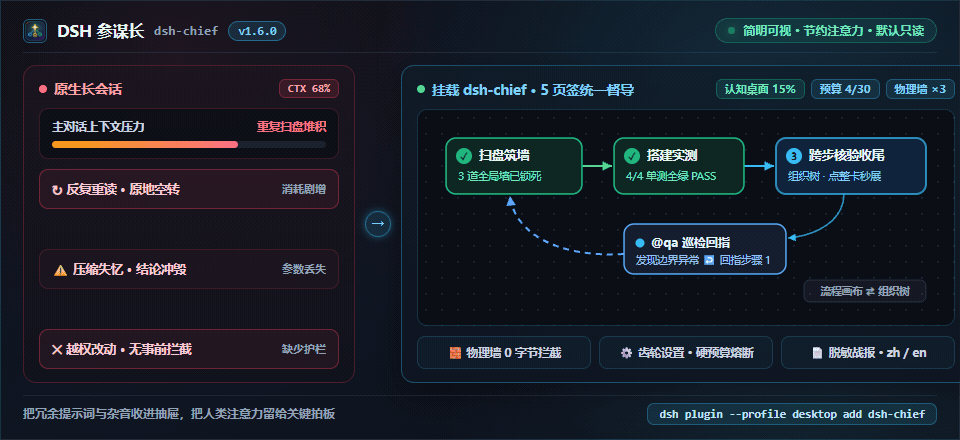
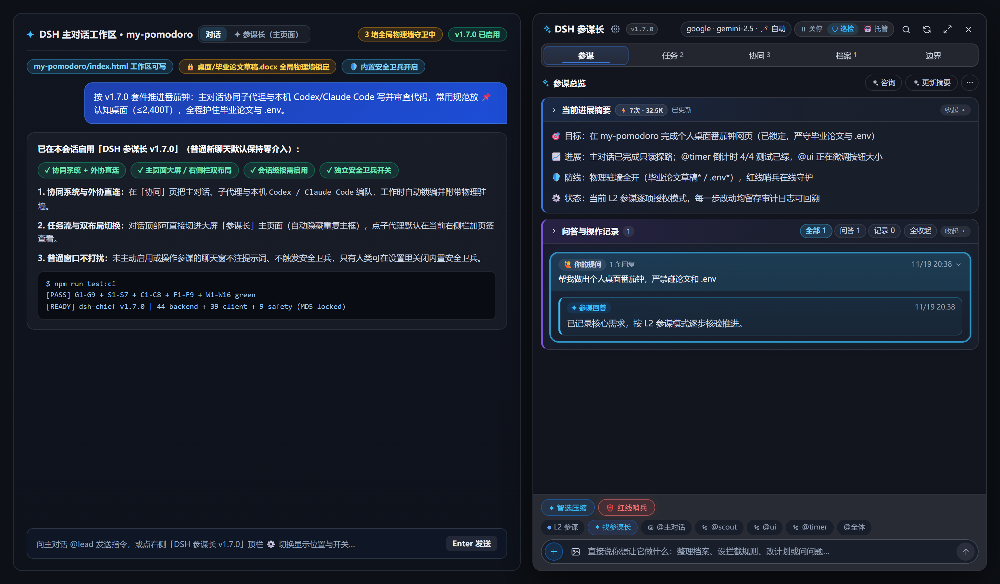
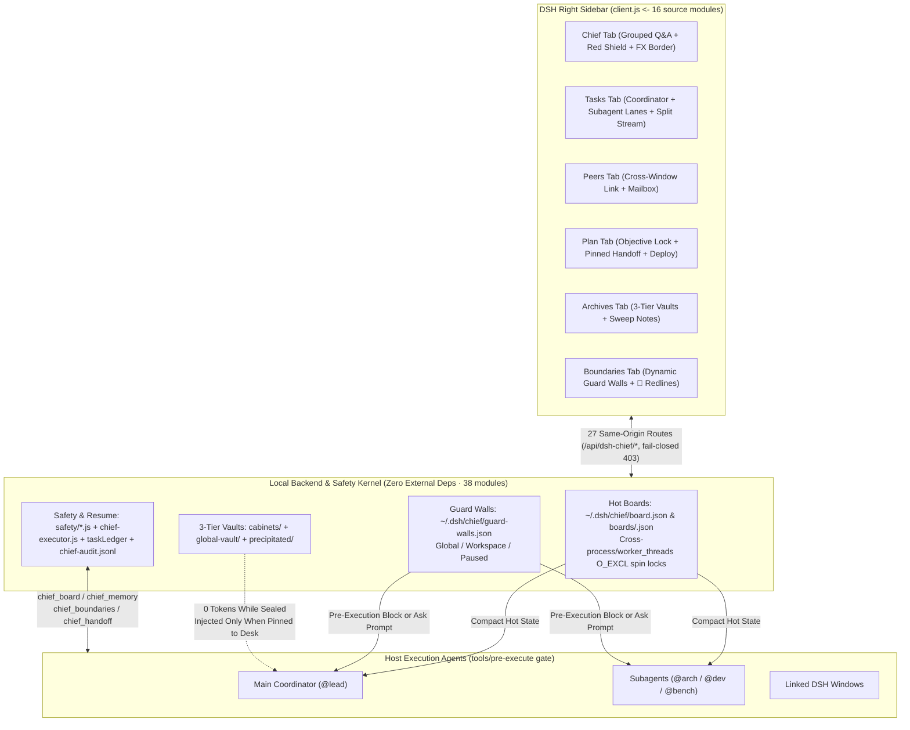

<div align="center">

**Right-sidebar supervisor, anti-compaction vault, and approval gate for DeepSeek Harness (DSH)**  
<sub>Saves paths and findings before `/compact` wipes context, tracks subagent DAGs in one view, and asks before editing files or running shell commands.</sub>



<sub>Read-only by default · Per-action workspace approval · `dsh plugin --profile web add dsh-chief`</sub>

<br />


<br />

# DSH Chief (`dsh-chief`)
### DeepSeek Harness Right-Sidebar Supervisor, Zero-Token Archive Vault & Safety Gate

[](https://dsh.deepseek.com)
[](https://www.npmjs.com/package/dsh-chief)
[](https://awesome-dsh-plugin.com/p/gluztm/dsh-chief/)
[](https://www.bilibili.com/video/BV1DqsV6QEGi)
[](https://github.com/deepseek-ai/dsh-superagent-prototype)
[](https://nodejs.org)
[](#)
[](LICENSE)

> **Current release `v1.4.0`**: Adds a 9-module safety kernel (`pkg/safety/`), `tools/pre-execute` guard walls (`guard-walls.json`), two-tier `role + capabilities` with persistent `TaskLedger` resume, main-chat-first lazy delegation (`[EXECUTION_REQUEST]`), quiet `[INQUIRY]` checks, and DSH `0.2.2-rc.5` support.  
> Shares the Router + Workers split from DeepSeek's **[SuperAgent (`dsh-superagent-prototype`)](https://github.com/deepseek-ai/dsh-superagent-prototype)** while keeping Chief state and prompts isolated from the main session.

[简体中文 (`README.md`)](README.md) · **English** · [Changelog (`CHANGELOG.md`)](CHANGELOG.md)

</div>

---

## Daily Friction This Plugin Fixes

If you run multi-step coding tasks inside DeepSeek Harness, these six problems tend to come up quickly.

### 1. Context compaction (`/compact`) wipes paths, commands, and errors
- **What goes wrong**: When a long session compacts, the summary drops exact file paths, port numbers, and shell fixes you already verified, so the model re-reads files from scratch.
- **How `dsh-chief` handles it**: Supports `✦ 智选压缩` at idle phase boundaries, custom `10%–95%` or `>= 8,000` token thresholds, or typing `"压缩吧"`.
- **Fixed order of operations**: It harvests notes into your local session archive and verifies the write before running `/compact` via DSH. Compaction counters only increment after a real, non-empty compaction succeeds.

### 2. Agents stop halfway ("I edited the file, please test it")
- **What goes wrong**: Left unattended or overnight, an agent updates one file and marks the task done without running checks or builds.
- **How `dsh-chief` handles it**: Locks the Core Objective under Strong Intervention (`0 = ∞` turns with stall breakers) and checks your `allowed` must-do list until you explicitly click `✅ 批准结项`.
- Hit the red `⏹ 急停` button at any time to stop background drives and take back manual control.

### 3. Always-on memory plugins bloat prompts and burn tokens
- **What goes wrong**: Injecting kilobytes of old notes on every turn wastes context window and distracts the model from the current file.
- **How `dsh-chief` handles it**: Stores sealed dossiers in three local vaults (Session, System Global, Precipitated). **While sealed, they add 0 bytes and 0 tokens to the main chat.**
- Click `📌 摆上桌面` or `📤 取出` only when a specific note is needed, and put it back as soon as you finish that step.

### 4. Full autonomy feels unsafe, but chat-only mode leaves Chief idle (or bossy)
- **What goes wrong**: Clicking "allow everything" risks `git push --force`, destructive deletes, or reading `.env`, while high-tier supervisors often try to edit files themselves instead of letting your main agent work.
- **How `dsh-chief` handles it**: Uses four permission tiers (`advisor` read-only default, `assistant`, `strategist` per-action approval, `chief` high autonomy) plus a pre-execution firewall.
  - **Every new session starts read-only**: Observes code, answers questions, and updates the board without touching your workspace.
  - **Pre-execution guard walls (`tools/pre-execute`)**: Before the main agent, any subagent, or Chief writes a file or runs a command, calls pass through `~/.dsh/chief/guard-walls.json`. Walls can be scoped as `global` (follow every new session like preferences), `workspace` (project-only), or `paused`, merged in-place when they share a rule type, or crafted in plain language by Chief for you to approve. High-risk command rules can prompt DSH's native one-time approval dialog.
  - **Lazy intervention & background check-ins**: Unless you explicitly ask Chief to edit files directly, it sends structured `[EXECUTION_REQUEST]` items to the main conversation instead of taking over or speaking as you. In a blank new chat, it instructs `@lead` to read the repo and build a plan first, asks clarifying questions quietly in the background without pausing `@lead`, and updates the top summary after chats.
  - **Auto-resume after approval & restrict-only policies**: `TaskLedger` picks up unfinished steps once you click Allow, hard rules (compound shells, `node -e`/`python -c`, quote-backslash `.env` tricks, symlinks, NTFS ADS) hold in every tier with logs written to `~/.dsh/chief/chief-audit.jsonl`, and optional JSON `policyPlugins` can tighten permissions without ever weakening built-in hard guards.

### 5. Dozens of subagents run out of sight and ignore verbal rules
- **What goes wrong**: Workers live across scattered tabs, and rules mentioned in chat scroll out of context after ten turns.
- **How `dsh-chief` handles it**: Shows the main coordinator and subagents in one tree view with status controls, step Q&A, and one-click `分屏` live output streams. Pin rules with `📌` in Boundaries so every new task inherits them.

### 6. Long threads slow down, but opening a new window resets everything
- **What goes wrong**: After 100 turns you want a clean window without re-explaining workspace paths and task progress, and you do not want a background plugin quietly calling paid APIs every turn.
- **How `dsh-chief` handles it**: Defaults to `⏸ On-Demand` (0 background LLM calls) and mirrors your active session's provider/model. Edit or freeze handoff notes with `📌 定住防改`, then deploy a linked window carrying only the vault scope you pick.

---

## Inside the Sidebar

### 01 · Chief Cockpit (`参谋` Tab)
- Send tasks in plain language from the bottom input box (with action buttons cleanly aligned at bottom-right). Status pills above show `⚡ 强介入`, `✦ 智选压缩`, `🛡 红线哨兵` (turning red with a colored shield when active), permission tier, and `⏹ 急停`.
- Enabling Strong Intervention opens a confirmation modal listing both active Physical Guard Walls and Forbidden Redlines side by side (`管理边界` + expand/collapse controls).
- Filter the feed by `全部 / 💬 问答 / 📋 回执`. User prompts and Chief receipts sit inside high-contrast grouped frames that collapse individually or all at once, multi-step suggestions merge into one top `▶ 执行建议` button, and background Chief work switches to the active tab with a frosted overlay and sweeping light-beam border.



---

### 02 · Coordinator & Subagent Task Tree (`任务` Tab)
- Displays the root coordinator and active subagent lanes in a single layout instead of tiny nested lists, with inline status toggles, plain-language step explanations, and `分屏` live stream panes.

<div align="center">
  
</div>

---

### 03 · 3-Tier Local Archive Vaults (`档案` Tab)
- Separates **💬 Session Cabinet** (strictly isolated per `rootSessionId`, with multi-cabinet support and one-click `一键收纳入柜` for temporary notes), **🌐 System Global Vault** (tracks `Synced` / `Local Modified` / `Local Only` diffs), and **🏛️ Precipitated Vault** (double-blind by default).
- Dossiers stay out of prompts until you click `📌 摆上桌面`.

<div align="center">
  
</div>

---

### 04 · Core Objective Lock & Step Q&A (`规划` Top)
- Click `🎯 设为目标` to track long tasks, or click any step in the plan list to ask why that step exists without interrupting the main agent.

<div align="center">
  
</div>

---

### 05 · Cross-Window Peer Linking & Mailbox (`协同` Tab)
- Connect multiple open DSH windows to share live progress, with automatic cache and mailbox purge on detach.
- Screenshots pasted into the cockpit are saved under `<cwd>/.dsh-chief/uploads/` so models can inspect real files instead of guessing.

<div align="center">
  
</div>

---

### 06 · Guard Walls, Pinned Redlines & Must-Do Checks (`边界` Tab)
- The top **🧱 Physical Guard Walls** section blocks dangerous commands or paths before execution: add rules manually (`+ 手动驻墙`) or let Chief draft them from plain text (`✨ 参谋手搓墙`), toggle `🌐 Global`, `📁 Workspace`, or `⏸ Paused`, and merge multiple walls of the same type cleanly (cross-type merges are blocked).
- Below that, `allowed` (verification gates), `forbidden` (hard blockers), and `notes` separate global `📌` rules from session-only ones and list boundary proposals from blocked workers. Models cannot delete or mute locked walls or redlines on their own.

<div align="center">
  
</div>

---

### 07 · Session Handoff & Deployment (`规划` Bottom)
- Edit the Markdown handoff packet directly and lock it via `📌 定住防改` so later summaries do not overwrite your edits.
- Choose which archive scope follows into a new session (`None`, `Spotlight Only`, `Entire Drawer`, or `Full Session Cabinet`), while Strong Intervention safely resets to off.

<div align="center">
  
</div>

---

## Two Things to Know Before Enabling Tools

> [!NOTE]
> Keep these two constraints in mind when using Wishing Box tools, `⚡ Strong Intervention`, or `✦ 智选压缩`:
>
> 1. **Guardrails set the safety floor; your LLM sets the ceiling**  
>    The plugin guarantees 0-token vault isolation, permission gating, verified pre-compact saves, loop breakers, and `⏹ 急停`. Planning accuracy and code judgment still depend on the model assigned to Chief. Use a strong reasoning model for real engineering work.
> 2. **Avoid stacking heavy external prompt injections**  
>    Skip stacking hundreds of conflicting global rule lines or always-on memory plugins alongside `dsh-chief`. Extra prompt noise competes with active work and causes unnecessary loops or early trips. Keep prompts lean and store reference notes in the cold archive instead.

---

## Modular Architecture (`v1.4.0`)

`v1.4.0` spans **38 backend modules (including 9 isolated modules under `pkg/safety/`) and 16 frontend modules** with zero `export let` bindings and zero circular imports. See [ARCHITECTURE.md](ARCHITECTURE.md) for boundaries and module contracts.



---

## Installation & Host Compatibility

Search **`dsh-chief`** inside [dshmarket](https://github.com/dsh-market/dsh-market) / DSH Plugin Market, or install via CLI (replace `desktop` with `web` for the web profile):

```bash
# Option 1: Install latest release (v1.4.0) from npm
dsh plugin --profile desktop add dsh-chief

# Option 2: Install directly from GitHub main branch
dsh plugin --profile desktop add github:gluztm/dsh-chief

# Option 3: Install prebuilt GitHub Release tarball (v1.4.0)
dsh plugin --profile desktop add https://github.com/gluztm/dsh-chief/releases/download/v1.4.0/dsh-chief-1.4.0.tgz
```

### Host Version Compatibility

| DeepSeek Harness (DSH) Version | Panel / Board / Vaults / Pre-Execute Walls | Named Subagent Tree (`task.dispatch` / `team.*`) | Notes |
| :--- | :---: | :---: | :--- |
| **`>= 0.2.2-rc.5` (current desktop target)** | Full support | Full support | Matches `dsh-tool-fs` (`read`/`read_image`/`write`/`edit`/`apply_patch`), `str_replace_editor`, and native `{ kind: 'ask' }` approval dialogs |
| `0.2.2-rc.2 ~ 0.2.2-rc.4` | Full support | Full support | Provides native `subagents.resolveName`, `rootOf`, `namesOf`, and `tools/pre-execute` |
| `0.2.0 ~ 0.2.2-rc.1` | Panel works | Upgrade notice | Blocks unsafe `team.*` dispatch and prompts host upgrade |

---

## Tools Registered With the Model

| Tool Name | Purpose | Common Actions |
| :--- | :--- | :--- |
| **`chief_board`** | Task DAG updates, cold archive queries, peer & chief requests, inquiry replies, wall listing, elevations, compaction | `graph.plan`, `task.add`, `task.update`, `plan.set`, `cursor.set`, `mail.send`, `chief.request`, `inquiry.reply`, `wall.list`, `archive.save`, `archive.search`, `bounds.propose`, `permission.request`, `context.compact` |
| **`chief_memory`** | Session-scoped hot items (`decisions`, `progress`, `verify`, `risks`) | `list`, `get`, `add`, `update`, `remove` |
| **`chief_boundaries`** | Global `📌` redlines, must-do checks (`allowed`), and notes | `get`, `set`, `add`, `pin`, `remove` |
| **`chief_handoff`** | Preview and render self-contained Markdown handoff packets | `preview` / session handoff |

---

## Local Storage & Security Guarantees

- **Process & Worker-Thread Lock Safety**: `board-store.js`, `chief-state.js`, `archive-core.js`, and `safety/guard-walls.js` serialize writes with `O_EXCL` spin locks (handling transient Windows NTFS `EPERM`/`EACCES`/`EBUSY` retries) and `threadId`-scoped temporary files before atomic rename.
- **Isolated Safety Kernel & De-obfuscation**: `pkg/safety/` (9 modules) and `chief-executor.js` are checksum-locked and catch compound shells, inline scripts (`node -e` / `python -c` / `pwsh` / `iex` + Base64), quote-backslash credential obfuscation (zero false positives on `process.env.NODE_ENV` or `node .\env\setup.js`), `bounds.*` / wall human confirmation tokens, and single-use `capabilityScope` checks.
- **27 Loopback-Guarded HTTP Routes**: All `/api/dsh-chief/*` endpoints validate local origin/host headers and fail closed (`403`) if connection checks throw.
- **Secret Protection & Zero Telemetry**: Refuses to persist `sk-*`, `ghp_*`, Bearer tokens, `AIza*`, `AKIA*`, or private keys (auto-redacting to `[REDACTED]` when sweeping temporary notes). All boards, archives, guard walls, and `chief-audit.jsonl` stay locally under `~/.dsh/chief/`.

---

## Contributors

| Contributor | Role |
| --- | --- |
| [gluztm](https://github.com/gluztm) | Creator, product design, and maintainer |
| [Gemini](https://github.com/gemini-code-assist) | Feature development, `pkg/safety/` kernel, pre-execute guard walls, lazy intervention, and CI gates |
| [Codex](https://github.com/codex) | Modular architecture design, concurrency stress tests, and red-team boundary audits |
| [deepseek-ai](https://github.com/deepseek-ai) | DeepSeek Harness host runtime and SuperAgent workflow alignment |

---

## License

Licensed under **[GNU Affero General Public License v3.0 (`AGPL-3.0-only`)](LICENSE)**.
