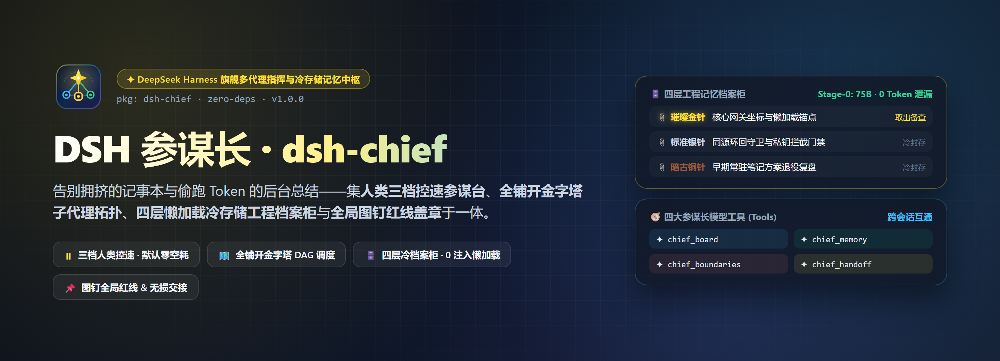
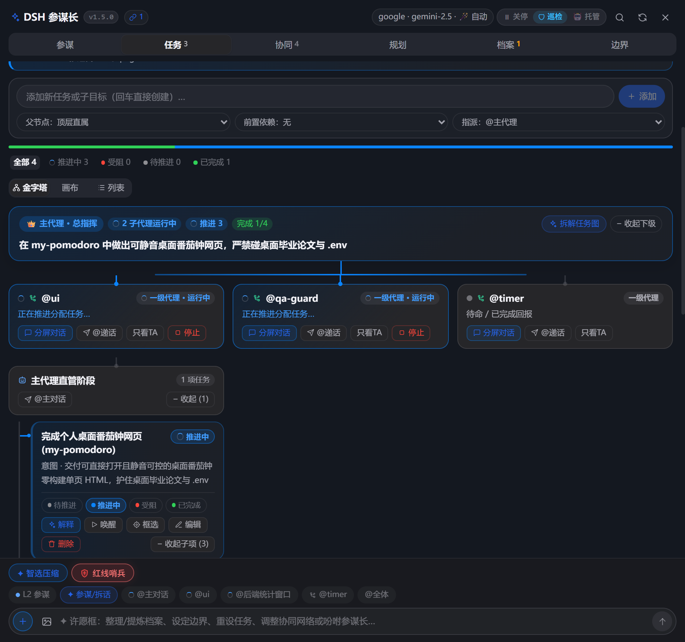
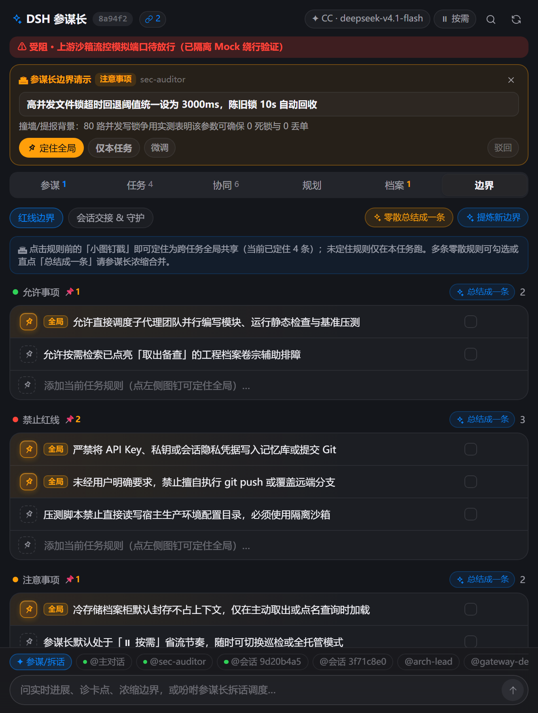

<div align="center">



<br />

# ✦ DSH Chief (`dsh-chief` · DSH 参谋长)
### Multi-Agent Command Cockpit · SuperAgent Cross-Session Synergy · 4-Tier Cold Archive Vault for DeepSeek Harness

[](https://dsh.deepseek.com)
[](https://www.npmjs.com/package/dsh-chief)
[](https://awesome-dsh-plugin.com/p/gluztm/dsh-chief/)
[](https://www.bilibili.com/video/BV1DqsV6QEGi)
[](https://github.com/deepseek-ai/dsh-superagent-prototype)
[](https://nodejs.org)
[](#)
[](#03--three-tier-archive-vaults-desk-spotlight--0-token-precipitated-cold-vault-档案-tab)
[](LICENSE)

> **Stop babysitting your AI agents — state your intent in the Wishing Box for Wish-Driven One-Stop Execution (`v1.2.0`)**: inspired by DeepSeek's official **[SuperAgent (`dsh-superagent-prototype`)](https://github.com/deepseek-ai/dsh-superagent-prototype)** *Router + Isolated Workers* architecture, `dsh-chief` turns scattered chats into a full right-docked Chief of Staff cockpit—executing workspace tools even from a blank new session, locking Core Objectives, spreading Pyramid Subagent lanes, holding pinned redlines, co-managing cross-isolation **`✦ 智选压缩`**, isolating 0-token cold vaults, and gating goal closure behind human approval.

[简体中文 (`README.md`)](README.md) · **English** · [Changelog (`CHANGELOG.md`)](CHANGELOG.md)

</div>

---

## 🔗 Deep Synergy with Official DeepSeek SuperAgent & Native DSH Runtime

DeepSeek's official **[`dsh-superagent-prototype`](https://github.com/deepseek-ai/dsh-superagent-prototype)** highlights two core bottlenecks in multi-agent engineering: the **Human Attention Bottleneck** across concurrent sessions and **Context Pollution** from accumulated history—solving them via a persistent **Router** coordinating isolated **Worker** sessions.

**`dsh-chief` brings that exact Router–Worker command paradigm into an interactive right-sidebar cockpit natively wired into DSH:**

1. **Visual Router–Worker Orchestration**: Supervise your Root Coordinator, spawned Subagents, and linked independent DSH Worker windows from one **Full-Spread Pyramid DAG** and unified **Collaboration Directory**.
2. **Native DSH Split-Pane Subagent Stream (`subagentchat`)**: Click `分屏对话` on any pyramid node or directory row to invoke DSH's native `sidebarRight.openResource('dsh-resource://subagentchat/...')` split-pane live viewer.
3. **Panel-Native Goal Supervision, Must-Do Gate & Human Approval Gate**: Click **`🎯 设为目标`** right inside the `规划` (Plan) tab to lock the Core Objective as Chief's top-level command destination. When objectives change, stale checklists are flagged for clean reset; once achieved, `allowed` must-do items are verified and the session remains in `goal` mode until you explicitly click **Approve & Close (`✅ 批准结项`)** or **Reject & Continue (`↩ 驳回继续`)**.
4. **Wishing Box 4-Tier Executor & Cross-Isolation `✦ 智选压缩` Co-Managed Compaction**:
   - **4-Tier Permission-Gated Executor (`chief-executor.js`)**: Ask the Wishing Box directly to inspect files, run safe workspace commands, update boards/archives, or orchestrate subagents under **`read-only` / `workspace-write` / `auto-review` / `danger-full-access`**, backed by DSML/XML tool-call sanitization, `workspaceRegistry` blank-session resolution, and `pending-transfer.json` staging.
   - **Composer `+` Tactical Cockpit**: Toggle Active Intervention (supporting unlimited turns `0 = ∞` and high-risk **`⏹ 急停`** confirmation), Auto-Compact Harvest (configurable **`10%–95%`** with `<25%` amber guard or **`>= 8,000`** token thresholds), Strict Verify, Redline Sentinel, Concise Briefs, or **`✦ 智选压缩`**—which settles to idle at clean phase boundaries, harvests details into the Session Cabinet, executes host `/compact` across Cordis isolation, and posts visible receipts in Chief chat.
5. **Three-Tier Archive Isolation, Desk Spotlight, 0-Token System Global Cold Vault, Bidirectional Diff & Pinnable Handoff**:
   - **Three-Tier Archive Isolation**: **💬 Session Cabinet** (1:1 per `rootSessionId`; visible to User, Session & Chief; blank chats never leak history), **🌐 System Global Cold Vault** (system-level 0-Token cold storage that **never follows conversation context or auto-migrates legacy session cabinets**; supports **Desk Spotlight** («置上桌面»), 1-click **Distill to Global**, lossless download via `⤵️ 引入本会话`, per-session `👁️ 供本会话参谋参阅`, and live **Local ↔ Global bidirectional diff**), and **🏛️ Precipitated Cold Vault** (cross-session **0-Token double-blind** until explicitly unsealed with `📤 取出`, with batch multi-archive combinatorial relay);
   - **Peer Linking Warning & Clean Detach**: Joining a peer cluster shows a mutual context-pollution warning, automatically shares progress while linked, and purges cached Chief narratives, external team facts, and pre-step injections upon detach;
   - **Color-Coded Collapsible Drawer Mailbox**: Deduplicates `@all` broadcasts and organizes mails into color-coded collapsible drawers (`Broadcast`, `Cross-Session Pair/Multi`, `Internal`);
   - **Editable & Pinnable Handoff**: Edit handoff packets manually, freeze auto-rendered previews cleanly with **`📌 定住防改`** (disabling Chief digest auto-sync while pinned), and receive a pre-deploy warning modal if handoff notes lag behind recent progress.

---

## 💡 Why `dsh-chief` Is Fundamentally Different (6 Real Pain Points Solved)

Ordinary Todo lists only give you another manual scratchpad, while always-on memory plugins silently stuff thousands of stale tokens into every prompt. **`dsh-chief` flips "human babysitting AI" into Wish-Driven One-Stop Execution (`许愿式一站式跑通`)**—directly targeting the six daily pain points of multi-agent engineering:

| Daily Pain Point | Typical Todo / Always-On Memory Plugins | ✦ How `dsh-chief` Solves It |
| :--- | :--- | :--- |
| **1. Half-Finished "You Test It" Hand-Offs**<br>Models stop halfway and declare done while humans hover to nag | Static text checklists; agents self-declare completion | **🎯 Core Objective Lock + `⚡ Strong Intervention (0 = ∞ turns)` + Must-Do Verification + Human Approval Gate**: blocks closure until `allowed` items are verified and you click **`✅ 批准结项`**, with high-risk prompts & one-click **`⏹ 急停`** |
| **2. "Lobotomy" Amnesia After Compaction**<br>Context compacts mid-task and newly found paths, commands, and errors vanish | No verified pre-compact disk snapshot; history wipes cleanly | **🗜️ Harvest-Verify + `✦ 智选压缩` Cross-Isolation `/compact`**: triggers at clean phase boundaries after settling idle (`smartCompact`), custom **`10%–95%` / `>= 8k`** thresholds, or direct `"压缩吧"` command—verifying Session Cabinet disk writes before silent compaction & chat receipt |
| **3. Prompt Bloat Mudding the Model's Brain**<br>Always-injected memory floods system prompts with old noise and burns quota | Blindly injects stale notes on every single turn | **🏛️ 3-Tier 0-Token Cold Vaults (Session / System Global / Double-Blind Precipitated)**: **0 bytes / 0 tokens while sealed**; flip out via `📤 取出` or spotlight via `置上桌面`, seal back to zero anytime, with live Local ↔ Global diff |
| **4. Chat-Only "Mascot Copilot"**<br>Checking a file or running a quick check interrupts the main coding flow | Pure chat replies or blind background summaries with no real workspace tools | **✦ Wishing Box 4-Tier Agentic Executor (`chief-executor`)**: respects `read-only` / `workspace-write` / `auto-review` / `danger-full-access` right in the sidebar; works even on **blank new sessions** via `workspaceRegistry` resolution & `pending-transfer.json` staging |
| **5. Cramped Subagent Maze & Forgotten Rules**<br>Subagent graphs scroll blindly and verbal guardrails fade within ten turns | Narrow list views and chat-only constraints | **📐 Full-Spread Pyramid DAG + Native `subagentchat` Split-Pane + `📌` Global Thumbtack Redlines**: inspect/steer/split-stream in place while pinned rules stay active across tasks |
| **6. Context-Cap Window Loss & Silent Token Drain**<br>New tabs wipe setup and background loops hit wrong metered API channels | Single-window silos; unaligned model routing burns quota | **🚀 Cross-Window Linking + Editable/`📌`-Frozen Handoff + Channel Alignment + `⏸ On-Demand` Default (0 background calls)**: clones Chief config + scoped archives cleanly and purges peer leaks immediately upon detach |

---

## 📸 Visual Tour (7 High-DPI Views)

### 01 · Right-Docked Executive Chief Cockpit (`参谋` Tab)
Docked alongside your live conversation: displays exact `Provider · Model` channel alignment, the `⏸ On-Demand` human-paced toggle, structured status briefings, pending boundary approvals, and natural-language `@target` dispatch chips.


---

### 02 · Full-Spread Pyramid Subagent DAG (`任务` Tab)
No cramped mini-viewports: the Root Coordinator sits at the top while subagent squads spread out across structured columns with direct inline controls for status transitions, plain-language explanation, task dispatch, and split-screen subagent chat inspection.

<div align="center">
  
</div>

---

### 03 · Three-Tier Archive Vaults, Desk Spotlight & 0-Token Precipitated Cold Vault (`档案` Tab)
Enforces strict visibility isolation across **💬 Session Cabinet**, **🌐 System Global Cold Vault**, and **🏛️ Precipitated Cold Vault**:
- **4-Tier Dossier Structure**: **Cabinets → Filing Drawers** → **Color-Coded Paperclipped Dossiers** (**Luminous Gold `#ffe033`**, **Brushed Silver `#cbd5e1`**, **Dark Antique Copper `#7c4329`**) → **Structured Memory Points** → **Unfoldable Sub-point Details**.
- **Pre-Compaction Harvest (`📥 抢救细节`) & Double-Blind Cold Vault (`🏛️ 沉淀档案柜`)**: Extracts exact file paths, shell commands, and decisions into the Session Cabinet manually (`压缩吧` / `/compact`), at `10%–95%` / `>= 8,000`-token thresholds, or via **`✦ 智选压缩`** across Cordis service isolation. Generalizable lessons in the **0-Token Precipitated Vault** remain **double-blind to both Chief and Lead** until explicitly unsealed via **「📤 取出」 (`flipOut`)** and re-hidden immediately via **「📥 封回」 (`sealBack`)**, with batch **combinatorial relay** across vaults.
- **Desk Spotlight, 0-Token System Global Cold Vault & Local ↔ Global Diff**: Stored in `global-vault/vault-chief-global.json` outside conversation context (**0 Token by default**; never auto-migrates legacy session cabinets). Displays live bidirectional diffs (`仅本地` / `已同步` / `本地已改` / `全局独有`), lets you spotlight dossiers on the Desk («置上桌面»), distill/push session dossiers (`🌐 存入全局` / `↻ 更新至全局`), import into a session (`⤵️ 引入本会话`), or toggle Chief visibility per session (`👁️ 供本会话参谋参阅` / `📥 收回冷存`).

<div align="center">
  
</div>

---

### 04 · Panel-Native Goal Supervision, Human Approval Gate & 1-Click Chief Deployment (`规划` Tab)
Combines a core objective box with a **`🎯 设为目标`** supervision toggle, stale-checklist reset warnings on goal edits, and a strict **Human Approval Gate** (completion proposals stay in `goal` mode until you click `✅ 批准结项` or `↩ 驳回继续`). Zone 3 integrates **Cross-Session Handoff & 1-Click Chief Deployment** with 4 archive migration policies (`none`, `mounted`, `drawer`, `all`)—keeping precipitated cold vaults strictly isolated.

<div align="center">
  
</div>

---

### 05 · Cross-Window Linking, Composer `+` Tactical Cockpit & Image Persistence (`协同` & Input Bar)
Link multiple independent DSH root sessions into one shared bus, upload or paste screenshots persisted directly into `<cwd>/.dsh-chief/uploads/` (with automatic text-only Chief fallback carrying verified raw file paths to your multimodal lead agent), and control **Active Strong Intervention**, **Auto-Compact Thresholds**, **Strict Verification**, **Redline Sentinel**, and the red **`⏹ 急停`** emergency stop inside the **`+`** Tactical Cockpit.

<div align="center">
  
</div>

---

### 06 · `📌` Global Thumbtack Redlines & Guard Preferences (`边界` Tab)
Pin critical safety rules with `📌` globally or keep them task-scoped, review subagent boundary proposals in one click, consolidate scattered rules via DSH Chief, and tune per-turn injection and `idle-guard` preferences under **守护偏好**.

<div align="center">
  
</div>

---

### 07 · Pre-Compaction Safety & Self-Contained Handoff Previews
When context usage reaches your configured threshold while idle, `dsh-chief` harvests recent technical details to disk, verifies readability on disk, and only then triggers compaction—or lets you generate and inspect a full self-contained Markdown handoff packet before spawning a fresh session.

<div align="center">
  
</div>

---

## ⚠️ Usage Notes & Two Critical Disclaimers

> [!IMPORTANT]
> Before enabling Wishing Box execution, **`⚡ Strong Intervention`**, or **`✦ 智选压缩`**, keep these two engineering realities in mind:
>
> 1. **Floor Guaranteed by Plugin Guardrails — Ceiling Decided by Your Underlying LLM**: `dsh-chief` enforces your safety floor (0-token vault isolation, 4-tier permission gates, disk-verified pre-compaction harvesting, turn circuit breakers, and high-risk emergency halts). However, **the ceiling of planning rigor, multi-step tool accuracy, and supervision intelligence depends entirely on the LLM you assign to the Chief**. Heavy multi-agent orchestration calls for a strong reasoning model—never expect frontier judgment from an ultra-tiny lightweight model.
> 2. **Avoid Flooding the Model's Brain With Heavy External Prompt Injections**: Do **not** stack bloated System Prompts, hundreds of conflicting project Rules, or always-injected memory plugins alongside `dsh-chief`. **Excessive prompt injections muddy the model's working memory and fracture attention**, frequently clashing with Chief supervision and causing loops or early trips. Keep global prompts lean and store low-frequency knowledge inside `dsh-chief`'s **0-Token Cold Vaults** for on-demand retrieval.
>
> Always define a clear Core Objective and at least one Forbidden Redline before enabling Strong Intervention, and click the red **`⏹ 急停`** button above the composer anytime for instant manual takeover.

---

## ⚡ Quick Installation (Zero External Dependencies)

Search for **`dsh-chief`** inside [dshmarket](https://github.com/dsh-market/dsh-market) / DSH Plugin Market, or install via CLI (replace `desktop` with `web` if using the web profile):

```bash
# Install via npm registry (fastest with China npm mirrors & auto-update notifications)
dsh plugin --profile desktop add dsh-chief

# Or install the latest prebuilt GitHub Release tarball (zero build scripts)
dsh plugin --profile desktop add https://github.com/gluztm/dsh-chief/releases/latest/download/dsh-chief.tgz

# Or pin the exact v1.2.0 Release tarball
dsh plugin --profile desktop add https://github.com/gluztm/dsh-chief/releases/download/v1.2.0/dsh-chief-1.2.0.tgz

# Or install directly via GitHub shorthand
dsh plugin --profile desktop add github:gluztm/dsh-chief
```

Refresh the DSH Web UI and click the **✦ `DSH 参谋长`** icon in the right-hand sidebar header.

### Host Version Compatibility Matrix

| DeepSeek Harness (DSH) Version | Sidebar Panel / Board / Vaults / Bounds | Named Subagent Tree (`task.dispatch` / `team.steer` / `team.interrupt`) | Notes |
| :--- | :---: | :---: | :--- |
| **`>= 0.2.2-rc.2` (`rc.3+` recommended)** | ✅ Full support | ✅ Full support | Provides `subagents.resolveName` / `rootOf` / `namesOf` and flat `startActivation` |
| `0.2.0 ~ 0.2.2-rc.1` | ✅ Panel works normally | ⚠️ Unavailable (guided prompt) | Pre-refactor `subagents` API; panel displays a non-blocking warning and guards `team.*` cleanly |

---

## 🛠️ Model Tool Suite (4 Tools)

| Tool Name | Purpose | Key Actions |
| :--- | :--- | :--- |
| **`chief_board`** | Task DAG orchestration, step checklists, cold archive queries, and inter-agent mail | `graph.plan`, `task.add`, `task.update`, `plan.set`, `cursor.set`, `mail.send`, `archive.save`, `archive.search`, `bounds.propose` |
| **`chief_memory`** | Session-scoped hot digest entries (progress, decisions, verification, risks) | `list`, `get`, `add`, `update`, `remove` |
| **`chief_boundaries`** | Global pinned redlines (`📌`) and task-scoped working boundaries | `get`, `set`, `add`, `pin`, `remove` |
| **`chief_handoff`** | Self-contained Markdown handoff packet generation across sessions | `preview` / structured session relay |

---

## 🛡️ Security & Local-Only Privacy

- **Loopback + Same-Origin Guard**: Every `/api/dsh-chief/*` endpoint enforces loopback client verification and same-origin `Origin`/`Host` validation.
- **Automatic Secret Blocking**: Rejects accidental persistence of `sk-*`, `ghp_*`, Bearer tokens, and OpenSSH private keys across boards, facts, and archives.
- **100% Local Storage**: All state lives exclusively on disk under `~/.dsh/chief/` (`board.json`, `boards/`, `archives.json`, `chief-state.json`) with zero external runtime dependencies and zero telemetry.

---

## 📄 License

Licensed under the **[GNU Affero General Public License v3.0 (`AGPL-3.0-only`)](LICENSE)**.
