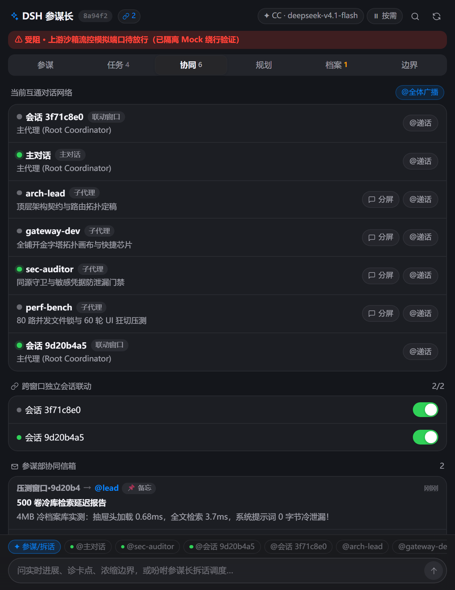

<div align="center">


<br />

# ✦ DSH Chief (`dsh-chief` · DSH 参谋长)
### Multi-Agent Command Cockpit · SuperAgent Cross-Session Synergy · 4-Tier Cold Archive Vault for DeepSeek Harness

[](https://dsh.deepseek.com)
[](https://github.com/deepseek-ai/dsh-superagent-prototype)
[](https://nodejs.org)
[](#)
[](#03--4-tier-cold-engineering-archive-cabinet-档案-tab)
[](LICENSE)

> **Turn scattered chat tabs into a unified Chief of Staff command center**: inspired by DeepSeek's official **[SuperAgent (`dsh-superagent-prototype`)](https://github.com/deepseek-ai/dsh-superagent-prototype)** *Router + Isolated Workers* architecture to eliminate the human attention bottleneck and context pollution—natively integrated with **DeepSeek Harness (DSH)** split-pane subagent streams, `/goal` supervision, live `steer` injection, and workspace session switching.

[简体中文 (`README.md`)](README.md) · **English** · [Changelog (`CHANGELOG.md`)](CHANGELOG.md)

</div>

---

## 🔗 Deep Synergy with Official DeepSeek SuperAgent & Native DSH Runtime

DeepSeek's official **[`dsh-superagent-prototype`](https://github.com/deepseek-ai/dsh-superagent-prototype)** highlights two core bottlenecks in multi-agent engineering: the **Human Attention Bottleneck** across concurrent sessions and **Context Pollution** from accumulated history—solving them via a persistent **Router** coordinating isolated **Worker** sessions.

**`dsh-chief` brings that exact Router–Worker command paradigm into an interactive right-sidebar cockpit natively wired into DSH:**

1. **Visual Router–Worker Orchestration**: Supervise your Root Coordinator, spawned Subagents, and linked independent DSH Worker windows from one **Full-Spread Pyramid DAG** and unified **Collaboration Directory**.
2. **Native DSH Split-Pane Subagent Stream (`subagentchat`)**: Click `分屏对话` on any pyramid node or directory row to invoke DSH's native `sidebarRight.openResource('dsh-resource://subagentchat/...')` split-pane live viewer.
3. **Native DSH `/goal` Long-Horizon Supervision**: Dedicated dual-tier `/goal` objective + step board paired with `idle-guard` to prevent premature agent stops before tasks are verified.
4. **Native DSH `steer` / `followup` Injection & Exact Provider Alignment**: Dispatches live `steer`, `followup`, or `silent` mailbox messages straight through DSH's `agents` runtime while matching the exact `provider/model` channel of your active session.
5. **Native Workspace Navigation & Zero-Leak Context Preservation**: Spawns clean worker/handoff sessions and switches the active viewport via `uiWorkspace.openSession`, while keeping long-term engineering postmortems sealed at **0 prompt bytes** inside the 4-Tier Cold Archive Cabinet until explicitly taken out.

---

## 💡 Why `dsh-chief` Is Fundamentally Different

Ordinary Todo lists and always-injected memory plugins break down on complex, multi-subagent engineering sessions:
1. **Silent Background Token Drain & Wrong Provider Routing**: Auto-summarizing after every turn burns quota in the background and often matches bare model names onto expensive metered channels instead of your active subscription provider.
2. **Context Bloat from Long Notes**: Dumping dozens of debugging notes straight into the system prompt wastes thousands of tokens per turn and degrades model focus.
3. **Cramped Drag-Scroll Canvas**: Subagent graphs trapped inside tiny scroll boxes force constant panning just to see what is blocked.
4. **Forgotten Guardrails & Context Loss Across Windows**: Safety rules buried in chat vanish after compaction, and independent DSH windows cannot coordinate.

**`dsh-chief` («DSH 参谋长») replaces ad-hoc scratchpads with a full right-docked Chief of Staff cockpit:**

| Capability | Typical Todo / Always-On Memory Plugins | ✦ DSH Chief (`dsh-chief`) |
| :--- | :--- | :--- |
| **Briefing Pace & Channel Alignment** | Blind per-turn background LLM calls; bare-name provider mismatches | **3-Gear Human-Paced Control** (`⏸ On-Demand` **0 background calls by default**, `⚡ Smart`, `🤖 Auto`) + exact `provider/model` channel matching |
| **Subagent Task Topology** | Flat lists or cramped drag-scroll viewports | **Full-Spread Pyramid DAG**: Root Coordinator at the apex, subagent lanes laid out cleanly with inline status, explain, dispatch & split-stream buttons |
| **Long-Term Engineering Memory** | Stuffed into every system prompt or flat unindexed notes | **4-Tier Cold Archive Cabinet**: `Drawers → Gold/Silver/Dark-Copper Paperclipped Dossiers → Memory Points → Unfoldable Sub-points` (**0 prompt tokens while sealed**) |
| **Plan Readability & Step Q&A** | Static technical checklists | **Dual-Tier `/goal` + Interactive Step Board**: click any step to ask *"What does this step mean / why is it needed?"* or get an instant Chief explanation without interrupting the main agent |
| **Cross-Session & Subagent Relay** | Isolated to a single window | **Cross-Window Peer Linking + 3-Mode Relay Bus** (`steer`, `followup`, `silent`) across root coordinators and subagents |
| **Redline Governance & Handoff** | Verbal rules lost on compaction; manual copy-paste handoffs | **`📌` Global Thumbtack Redlines** (global vs. task-scoped) + human approval banner + **1-click self-contained Session Handoff** + `idle-guard` |

---

## 📸 Visual Tour (7 High-DPI Views)

### 01 · Right-Docked Executive Chief Cockpit (`参谋` Tab)
Docked alongside your live conversation: displays exact `Provider · Model` channel alignment, the `⏸ On-Demand` human-paced toggle, structured status briefings, pending boundary approvals, and natural-language `@target` dispatch chips.


---

### 02 · Full-Spread Pyramid Subagent DAG (`任务` Tab)
No cramped mini-viewports: the Root Coordinator sits at the top while subagent squads spread out across structured columns with direct inline controls for status transitions, plain-language explanation, task dispatch, and split-screen subagent chat inspection.

<div align="center">
  
</div>

---

### 03 · 4-Tier Cold Engineering Archive Cabinet (`档案` Tab)
Store hundreds of long-term engineering postmortems and coordinates with **zero idle prompt overhead**:
- **4-Tier Hierarchy**: **Filing Drawers** → **Color-Coded Paperclipped Dossiers** (high-contrast **Luminous Gold `#ffe033`**, **Brushed Silver `#cbd5e1`**, and **Dark Antique Copper `#7c4329`**) → **Structured Memory Points** → **Click-to-Unfold Sub-point Details**.
- **3-Stage Lazy Loading**: `Stage-0` (`/snapshot`) carries `< 80B` of counts; sealed dossiers inject **0 bytes** into system prompts until explicitly taken out (`取出备查`) or queried via `archive.search`.
- **Lossless Chief Curation**: One-click curation refines points and summaries while preserving 100% of raw markdown text.

<div align="center">
  
</div>

---

### 04 · Dual-Tier `/goal` Supervisor & Click-to-Ask Step Board (`规划` Tab)
Pairs a dedicated `/goal` long-running objective box with an interactive step checklist. Click any step to open the glass popover menu and ask what a step means or request an immediate inline explanation from DSH Chief without interrupting the lead agent.

<div align="center">
  
</div>

---

### 05 · Cross-Window Session Linking & Relay Network (`协同` Tab)
Link multiple independent DSH root sessions (e.g., UI workspace + benchmark workspace) with one toggle to share a live agent directory and cross-session collaboration mailbox.

<div align="center">
  
</div>

---

### 06 · `📌` Global Thumbtack Redlines & Rule Consolidation (`边界` Tab)
Pin critical safety rules with `📌` so they enforce globally across all sessions, keep task-specific rules scoped locally, approve or refine subagent boundary proposals in one click, and consolidate scattered rules via DSH Chief.

<div align="center">
  
</div>

---

### 07 · One-Click Self-Contained Session Handoff & Idle Guard (`边界` → `会话交接 & 守护`)
Generate a self-contained Markdown handoff packet (goal, hierarchical task tree, active cursor, blockers, and pinned boundaries), spawn a fresh session, and switch the frontend view automatically—backed by `idle-guard` to prevent premature turn termination.

<div align="center">
  
</div>

---

## ⚡ Quick Installation (Zero External Dependencies)

```bash
# Fast install from prebuilt GitHub Release tarball (~240 KB, zero build scripts)
dsh plugin --profile desktop add https://github.com/gluztm/dsh-chief/releases/download/v1.0.0/dsh-chief-1.0.0.tgz

# Or install directly via GitHub shorthand (replace `desktop` with `web` if using web profile)
dsh plugin --profile desktop add github:gluztm/dsh-chief
```

Refresh the DSH Web UI and click the **✦ `DSH 参谋长`** icon in the right-hand sidebar header.

---

## 🛠️ Model Tool Suite (4 Tools)

| Tool Name | Purpose | Key Actions |
| :--- | :--- | :--- |
| **`chief_board`** | Task DAG orchestration, step checklists, cold archive queries, and inter-agent mail | `graph.plan`, `task.add`, `task.update`, `plan.set`, `cursor.set`, `mail.send`, `archive.save`, `archive.search`, `bounds.propose` |
| **`chief_memory`** | Session-scoped hot digest entries (progress, decisions, verification, risks) | `list`, `get`, `add`, `update`, `remove` |
| **`chief_boundaries`** | Global pinned redlines (`📌`) and task-scoped working boundaries | `get`, `set`, `add`, `pin`, `remove` |
| **`chief_handoff`** | Self-contained Markdown handoff packet generation across sessions | `preview` / structured session relay |

---

## 🛡️ Security & Local-Only Privacy

- **Loopback + Same-Origin Guard**: Every `/api/dsh-chief/*` endpoint enforces loopback client verification and same-origin `Origin`/`Host` validation.
- **Automatic Secret Blocking**: Rejects accidental persistence of `sk-*`, `ghp_*`, Bearer tokens, and OpenSSH private keys across boards, facts, and archives.
- **100% Local Storage**: All state lives exclusively on disk under `~/.dsh/chief/` (`board.json`, `boards/`, `archives.json`, `chief-state.json`) with zero external runtime dependencies and zero telemetry.

---

## 📄 License

Licensed under the **[GNU Affero General Public License v3.0 (`AGPL-3.0-only`)](LICENSE)**.
