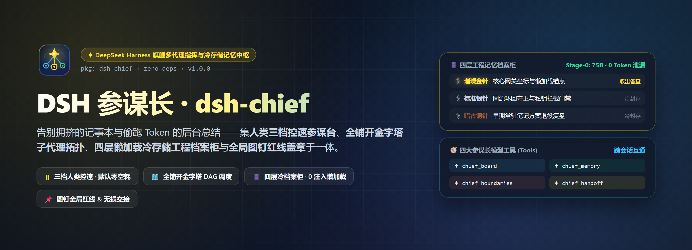
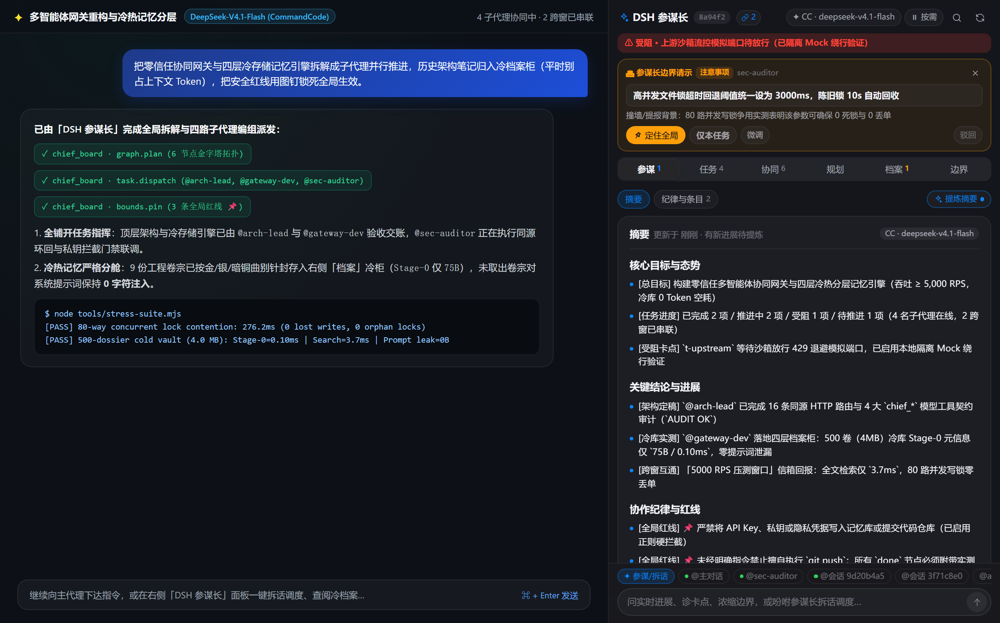
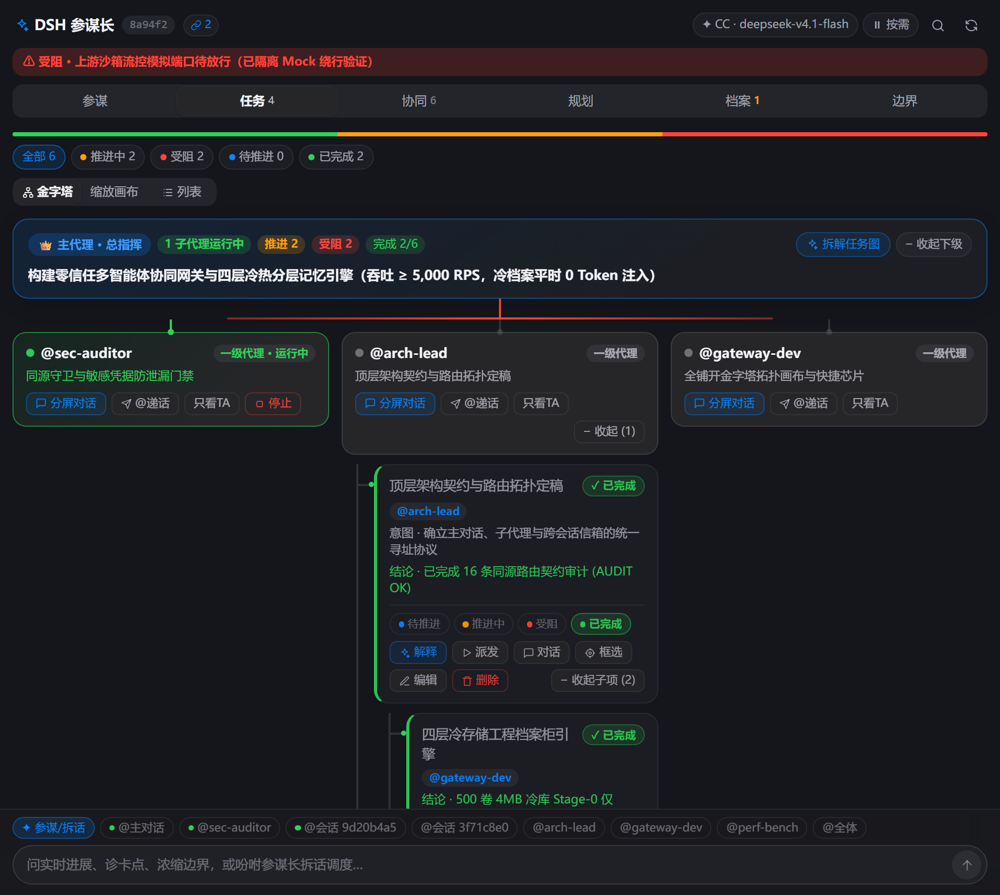
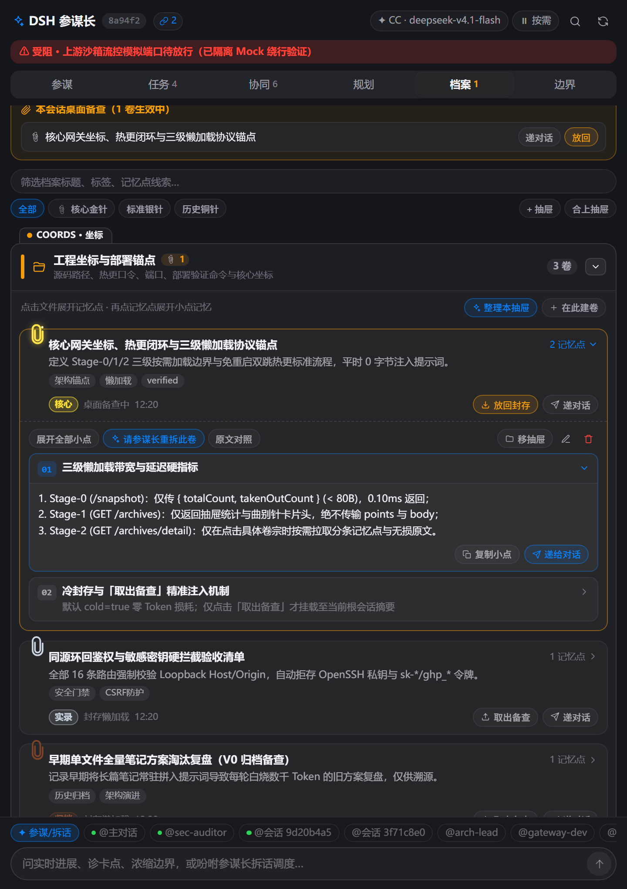
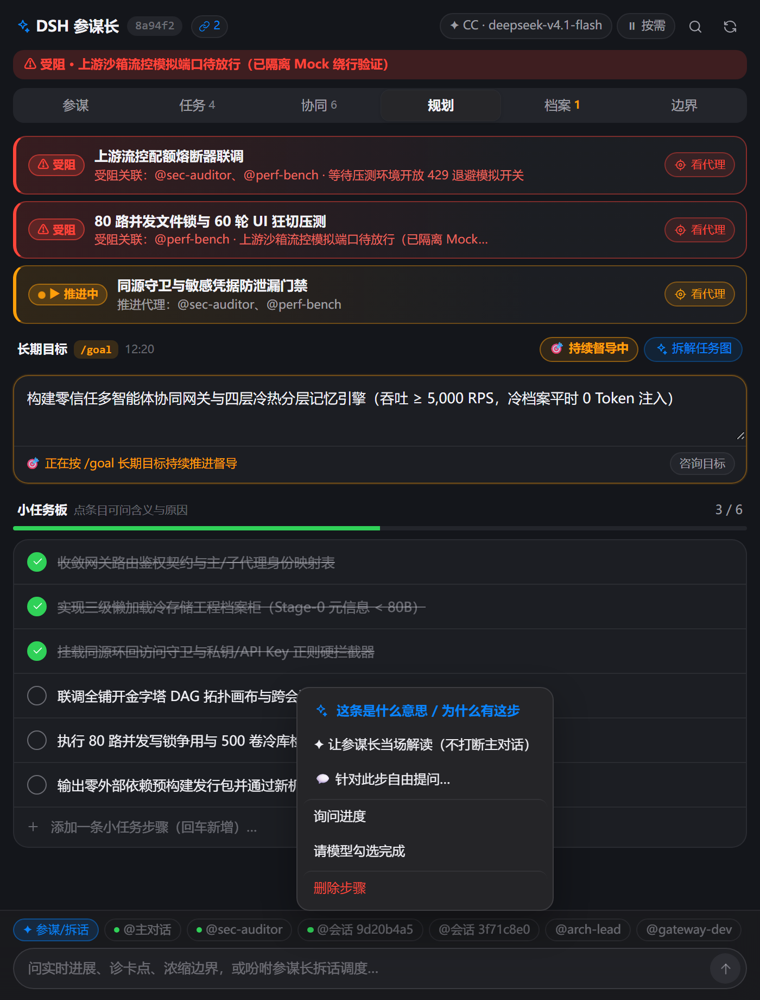
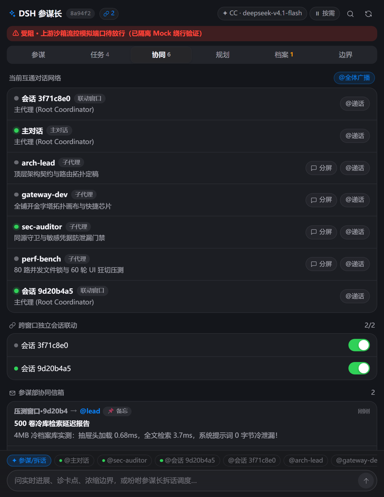
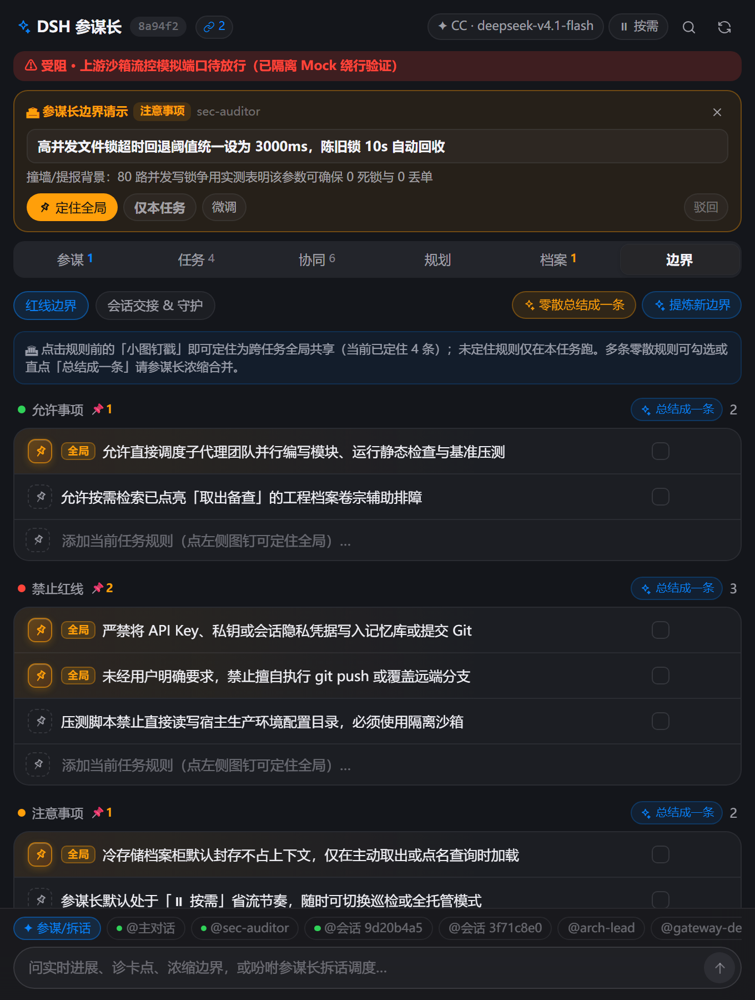
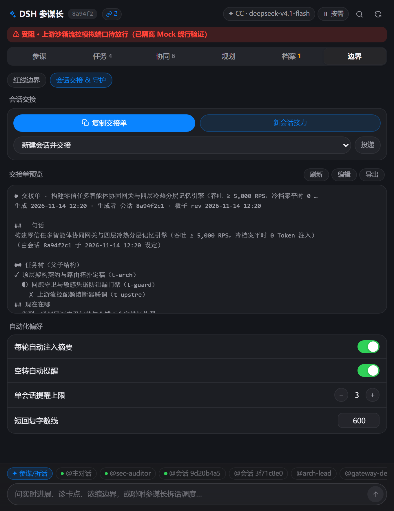
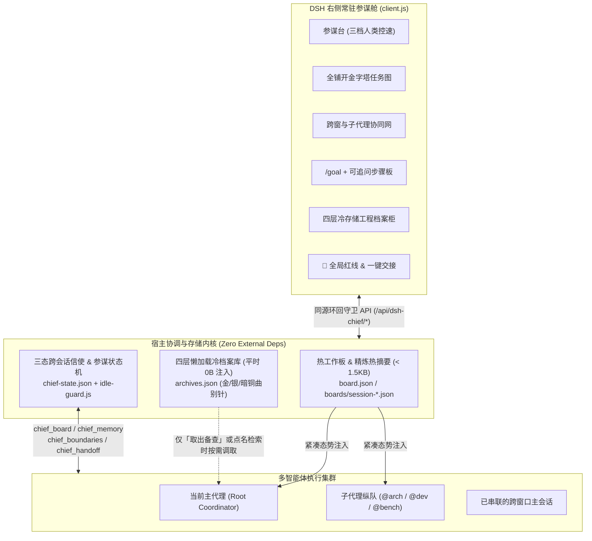

<div align="center">



<br />

# ✦ DSH 参谋长 (`dsh-chief`)
### DeepSeek Harness 多智能体参谋指挥舱 · SuperAgent 跨窗统筹 · 四层冷存储工程档案柜

[](https://dsh.deepseek.com)
[](https://github.com/deepseek-ai/dsh-superagent-prototype)
[](https://nodejs.org)
[](#)
[](#03--四层冷存储工程档案柜档案页签)
[](LICENSE)

> **把散装聊天窗升级为智能体总司令部**：深度呼应 DeepSeek 官方 **[SuperAgent (`dsh-superagent-prototype`)](https://github.com/deepseek-ai/dsh-superagent-prototype)** 的「Router 统筹 + Workers 隔离执行」注意力减负范式，并与 **DeepSeek Harness (DSH)** 原生子代理分屏、`/goal` 长程目标、实时 `steer` 切入及跨会话导航无缝联动。

**简体中文** · [English (`README.en.md`)](README.en.md) · [更新日志 (`CHANGELOG.md`)](CHANGELOG.md)

</div>

---

## 🔗 与 DeepSeek 官方 SuperAgent 范式及 DSH 原生能力深度联动

DeepSeek 官方开源的 **[`dsh-superagent-prototype`](https://github.com/deepseek-ai/dsh-superagent-prototype)** 指出了多智能体研发中最核心的两大难题：**人类注意力瓶颈（Human Attention Bottleneck）**与**长上下文污染（Context Pollution）**，并提出了「常驻统筹层（Router）+ 隔离执行层（Workers）」的双层解耦架构。

**`dsh-chief`（DSH 参谋长）正是将这一理念直接搬进 DSH 右侧边栏的可视化指挥中枢，并与 DSH 宿主底层能力全链路打通：**

1. **SuperAgent「统筹 + 工人」可视化落地**：无需在十几个并发会话与子代理黑盒间来回切换——参谋长常驻右侧栏充当你的全局统筹台（Router Cockpit），将当前主代理、下辖各路子代理（Subagents）以及跨窗口独立 Worker 会话收拢进同一张**全铺开金字塔拓扑图**与**协同通讯录**中。
2. **原生联动 DSH 子代理分屏实时流（`subagentchat`）**：在金字塔节点或协同列表上点击「`分屏对话`」，直接调用 DSH 原生 `sidebarRight.openResource('dsh-resource://subagentchat/...')`，在右侧分屏即时拉开对应子代理的实时推理流。
3. **原生联动 DSH `/goal` 长程持续督导**：规划页独立承载 `/goal` 总纲并与底部步骤板双层联动，配合 `idle-guard` 空转完结守护，防止模型在多步长任务中途「口头交差」提前停机。
4. **原生联动 DSH Agent 运行时三态注入与多渠道对齐**：跨会话信使总线直连宿主 `agents` 服务，支持 `插话 (steer，下一步立即切入)` / `递话 (followup，排队唤醒)` / `备忘 (silent，静默投递信箱)`，并精确读取当前会话的完整 `provider/model` 标识（如区分 `CommandCode` 与官方按量渠道），杜绝同名模型串渠道误扣费。
5. **原生联动 DSH 工作区导航与冷热上下文隔离**：一键交接通过宿主 `uiWorkspace.openSession` 创建干净的隔离接力会话并自动切走前端画面；四层「工程档案柜」平时对提示词保持 **0 字节注入**，彻底守住干净上下文边界。

---

## 💡 为什么需要「DSH 参谋长」？（它与普通看板/记忆插件有何本质不同）

在真实的大型工程与多子代理（Subagents）协作中，普通「待办小本本」或「全量注入式记忆插件」往往会撞上四大痛点：
1. **后台偷跑 Token、跨渠道乱选模型**：每轮对话结束都在后台偷偷调用大模型做全量总结，甚至把免费/订阅渠道的同名模型误匹配到高价按量渠道。
2. **记忆越存越慢、污染上下文**：把几十篇排障笔记一股脑塞进 System Prompt，每轮白烧数千 Token，还会严重干扰模型对当前任务的注意力。
3. **小画布拖拽迷宫**：子代理一多，任务图缩在巴掌大的滚动视口里来回拖拉，根本看不清谁卡住了、谁做完了。
4. **口头立规矩转头就忘、换窗口就失忆**：聊天里交代的安全红线一压缩就丢；不同窗口的主对话各自为战，切新会话还得手写长篇背景。

**`dsh-chief`（DSH 参谋长）不是一个简单的“记事本”，而是一套完整的右侧栏多智能体指挥部：**

| 核心维度 | 普通 Todo / 常驻记忆插件 | ✦ DSH 参谋长 (`dsh-chief`) |
| :--- | :--- | :--- |
| **参谋节奏与渠道对齐** | 后台每轮盲目触发总结，同名模型易串渠道扣费 | **人类三档控速**（默认 `⏸ 按需` **0 自动调用**，可选 `⚡ 巡检` / `🤖 托管`），严格对齐完整 `provider/model` 渠道 |
| **多代理拓扑可视性** | 扁平列表或狭窄视口，频繁横向/纵向拖动 | **全铺开金字塔 DAG 指挥图**：主代理居中统帅、子代理分列纵队，状态切换/解释/派发/分屏看流全部原地铺开 |
| **长期工程记忆架构** | 常驻塞入提示词（费 Token）或纯扁平长文难翻阅 | **四层冷存储「工程档案柜」**：`抽屉 → 金/银/暗铜曲别针卷宗 → 记忆点 → 可展开小点记忆`；平时 **0 字节注入提示词**，仅在「取出备查」时挂载 |
| **规划可读性与互动** | 冰冷的技术步骤列表，非底层开发者难看懂意图 | **上 `/goal` 总纲 + 下步骤板**：点击任意步骤即可一键追问「**这条是什么意思 / 为什么有这步**」或请参谋长当场白话解读 |
| **跨会话与子代理协同** | 仅限单会话内部，窗口之间完全割裂 | **跨窗口独立会话串联 + 三态信使总线**：支持 `插话 (steer)` / `递话 (followup)` / `备忘 (silent)` 直达任意子代理或联动窗口 |
| **红线治理与长程接力** | 规则混在聊天记录里，换会话靠人工复制粘贴 | **`📌` 图钉全局红线盖章**（跨任务永久生效 vs 仅本任务生效）+ **一键生成自包含交接单并自动切入新会话** + **空转完结守护** |

---

## 📸 全景实机导览（7 大核心视窗）

### 01 · 常驻右侧栏参谋指挥舱（`参谋` 页签）
与宿主对话区并排常驻：顶部实时呈现当前跟随的 `Provider · 模型` 渠道、人类三档控速开关（默认 `⏸ 按需` 零后台损耗）与子代理/联动窗口徽标；中部展示结构化战场简报与待盖章的边界请示；底部一句话即可向 `@主对话`、`@子代理` 或 `@跨窗会话` 拆话调度。



---

### 02 · 全铺开金字塔子代理拓扑（`任务` 页签）
彻底告别局促的小窗拖拽：`👑 主代理·总指挥` 坐镇顶端，下辖各路子代理横向铺开为清晰纵队；每张任务卡原地集成 **状态一键流转、白话解释、指派执行、子代理分屏实时盯流**，谁在推进、谁被卡住一眼洞穿。

<div align="center">
  
</div>

---

### 03 · 四层冷存储「工程档案柜」（`档案` 页签）
像真正的工程档案室一样分层保管长期技术资产，彻底根治「长记忆烧光上下文」顽疾：
- **四层收纳结构**：**分类抽屉**（拉开抽屉）→ **三色曲别针卷宗**（高对比度 **璀璨金针 `#ffe033` 核心必读** / **标准银针 `#cbd5e1` 常规实录** / **暗古铜针 `#7c4329` 历史归档**）→ **分条记忆点** → **点击逐条展开小点记忆**。
- **三级懒加载 · 默认 0 Token 空耗**：`Stage-0` 快照仅传输 `< 80B` 计数元信息，封存状态下对系统提示词保持 **100% 零注入**；只有当你主动点击「**取出备查**」或模型点名调用 `archive.search` 时才精准调取，用完点「**放回封存**」立即归零。
- **参谋长无损整理**：支持一键「请参谋长整理收纳 / 重拆此卷」，自动提炼结构化记忆点并 **100% 无损保留原始 Markdown 正文**。

<div align="center">
  
</div>

---

### 04 · 双层 `/goal` 长期目标与可追问小任务板（`规划` 页签）
上方独立承载 `/goal` 长期督导总纲，下方实时同步细粒度执行步骤。对模型写下的某一步技术操作有疑问？**直接左键/右键点击该步骤**，即可呼出交互菜单：一键询问主代理「**这条是什么意思 / 为什么有这步**」，或让 **DSH 参谋长当场白话解读（不打断主对话当前推理流）**。

<div align="center">
  
</div>

---

### 05 · 跨窗口独立会话串联与三态信使网络（`协同` 页签）
打破单窗口孤岛：一键拨动开关即可将多个独立 DSH 主窗口（例如「前端交互窗口」与「后端压测窗口」）接入同一协同集群，共享统一通讯录与协同信箱，随时发起 `插话`、`递话`、`备忘` 或一键打开子代理右侧分屏。

<div align="center">
  
</div>

---

### 06 · `📌` 图钉全局红线盖章与智能浓缩（`边界` 页签 · 红线边界）
- **双层作用域精准隔离**：点击规则左侧的 **`📌` 小图钉** 即可将其升格为跨所有任务生效的「**全局共享铁律**」；未钉住的规则仅在当前会话树生效，绝不污染其他无关项目。
- **撞墙请示与一键浓缩**：子代理实战踩坑后可通过 `bounds.propose` 提交新边界草案，由你在面板上一键选择「`📌 定住全局` / `仅本任务` / `微调` / `驳回`」；零散规则过多时还可勾选并点击「**✨ 零散总结成一条**」交由参谋长精炼合并。

<div align="center">
  
</div>

---

### 07 · 一键自包含会话交接与空转守护（`边界` 页签 · 会话交接 & 守护）
长对话上下文逼近上限时，点击「**新建会话并交接**」即可将当前目标、父子任务树、当前游标、阻塞卡点与有效红线打包为一份**自包含 Markdown 交接单**，自动创建新对话并将前端视口无缝切换过去继续接力；内置 `idle-guard` 空转完结守护，防止模型在任务未闭环时提前停机交差。

<div align="center">
  
</div>

---

## 🏗️ 冷热记忆分舱与多代理协同架构



---

## ⚡ 快速安装（零外部依赖）

### 方式一：通过 DSH 插件市场或 CLI 一键安装（推荐）

在已安装 [dshmarket](https://github.com/dsh-market/dsh-market) 或官方「发现」页中搜索 **`dsh-chief`**（或 **DSH 参谋长**）一键安装；或直接使用命令行安装：

```bash
# 直接从 GitHub Release 预构建包极速安装（约 240 KB，零编译步骤）
dsh plugin --profile desktop add https://github.com/gluztm/dsh-chief/releases/download/v1.0.0/dsh-chief-1.0.0.tgz

# 或通过 GitHub 仓库标识安装（若使用 web profile，将 desktop 替换为 web）
dsh plugin --profile desktop add github:gluztm/dsh-chief
```

安装完成后刷新 DSH Web 页面，点击工作区右侧边栏顶部的 **✦ `DSH 参谋长`** 图标即可展开面板。

### 方式二：源码克隆与本地联接调试（适合二次开发）

```bash
git clone https://github.com/gluztm/dsh-chief.git
```

本插件采用**零外部运行时依赖（Zero Runtime Dependencies）**纯原生 ES Module 架构，无需 `npm build` 即可直接挂载调试。

---

## 🛠️ 模型工具矩阵（4 Tools）

装入后自动向模型暴露 4 个结构化协同工具（动作层均做类型宽容解析，兼容原生 JSON 数组与扁平文本传参）：

| 工具名 | 核心职责 | 典型高频动作 (`action`) |
| :--- | :--- | :--- |
| **`chief_board`** | 驱动任务拓扑、规划步骤、冷档案检索与跨代理信箱 | `graph.plan`、`task.add`、`task.update`、`plan.set`、`cursor.set`、`mail.send`、`archive.save`、`archive.search`、`bounds.propose` |
| **`chief_memory`** | 读写会话级高密度热记忆条目（决策/进展/验证/风险） | `list`、`get`、`add`、`update`、`remove` |
| **`chief_boundaries`** | 读取与维护全局图钉红线（`📌`）及当前任务工作边界 | `get`、`set`、`add`、`pin`、`remove` |
| **`chief_handoff`** | 导出当前多代理全局态势与自包含 Markdown 交接单 | `preview` / 直接生成新会话接力包 |

---

## 📊 实测工程指标与纯本地安全承诺

- **高并发写锁防撕裂**：`board.json` 与 `archives.json` 均受基于 `wx` 原子排他文件锁 + 陈旧锁自动剥离机制保护；实测 **80 路并发混合写锁争用 + 60 轮高频 UI 页签切页压测** **0 丢单、0 JSON 损坏、0 残留锁**。
- **冷库零泄漏与亚毫秒响应**：实测挂载 **500 卷（4.0 MB）** 工程档案压测下，`Stage-0` 快照元信息仅 **`75 Bytes`（耗时 `0.10ms`）**，全文检索 **`< 4ms`**，未取出卷宗对模型提示词 **0 字符泄漏**。
- **严格同源环回与防泄密门禁**：
  - 所有 `/api/dsh-chief/*` 接口均强制执行 **Loopback 环回地址 + 同源 `Origin/Host` 双重校验**，拒绝任何跨站诱导调用。
  - 内置敏感凭据正则硬拦截器，自动拒绝将 `sk-*`、`ghp_*`、Bearer Token 或 OpenSSH 私钥写入工作板、参谋记忆或冷档案库。
  - **100% 纯本地存储**：所有数据仅保存在本机 `~/.dsh/chief/` 目录下，零遥测、零第三方云上报。

---

## 📄 开源许可 (License)

本项目基于 **[GNU Affero General Public License v3.0 (`AGPL-3.0-only`)](LICENSE)** 开源发布。  
在遵循相同开源协议并保留版权与修改声明的前提下，欢迎自由使用、审计、分支改进与提交社区 PR！
