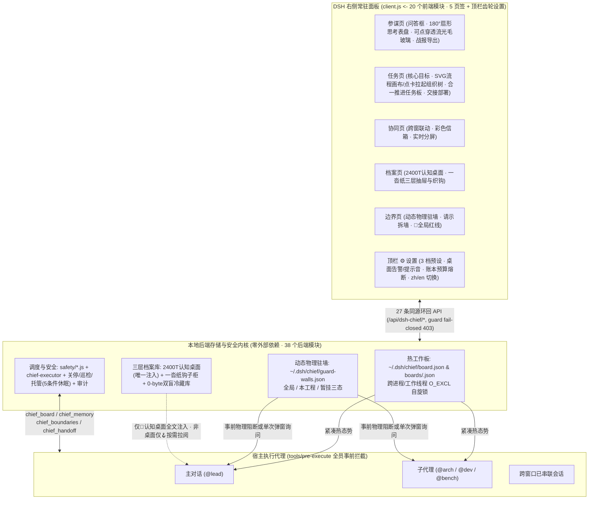

<div align="center">

**DeepSeek Harness（DSH）右侧栏插件：盯任务进度、管上下文压缩、在模型改文件和跑命令前先拦一道。**  
<sub>长对话 `/compact` 前先把路径和报错记到本地，一屏看清子代理分工，高风险操作先过拦截规则与审批弹窗。</sub>


<sub>新对话默认只读 · 改工作区前先询问 · `dsh plugin --profile desktop add dsh-chief`</sub>

<br />


<br />


<br />

# DSH 参谋长 (`dsh-chief`)
### DeepSeek Harness 右侧栏面板：管任务、存档案、拦越权

[](https://dsh.deepseek.com)
[](https://github.com/gluztm/dsh-chief/releases)
[](https://www.npmjs.com/package/dsh-chief)
[](https://github.com/gluztm/dsh-chief/actions/workflows/ci.yml)
[](https://awesome-dsh-plugin.com/p/gluztm/dsh-chief/)
[](https://www.bilibili.com/video/BV1Fksq6iEw8)
[](https://github.com/deepseek-ai/dsh-superagent-prototype)
[](https://nodejs.org)
[](#)
[](LICENSE)

> **当前版本 `v1.6.0`**：把原来的「规划」页并入「任务」页，顶部收成 5 个页签，并新增「流程画布」SVG 视图与点整卡展开的「组织树」。离桌托管增加了 7 类节点桌面通知、按调用类型分账的 LLM 账本（默认 30 次 / 300K tokens 停机）和脱敏 `.md` 复盘报告导出，顶栏齿轮 `⚙️` 设置页里提供 3 档预设与中英切换。原有的 `2,400 Tokens / 6 份` 认知桌面、`180°` 思考强度表盘和执行前拦截规则照常保留，支持 DSH `0.2.2-rc.5`。  
> 协同分工参考了 **[SuperAgent (`dsh-superagent-prototype`)](https://github.com/deepseek-ai/dsh-superagent-prototype)** 的 Router + Workers 模型，侧边栏状态和主对话上下文互相隔离。

**简体中文** · [English (`README.en.md`)](README.en.md) · [更新日志 (`CHANGELOG.md`)](CHANGELOG.md) · [架构设计 (`ARCHITECTURE.md`)](ARCHITECTURE.md)

[一句话看懂](#一句话看懂) · [v1.6.0 改了什么](#v160-改了什么) · [解决哪些问题](#解决哪些具体问题) · [界面说明](#界面与功能说明) · [模块结构](#模块结构与数据流-v160) · [安装与兼容](#安装与宿主版本兼容) · [本地存储与安全](#本地存储与安全边界) · [贡献者](#贡献者)

</div>

---

## 一句话看懂

- **压缩前先存档**：对话快满时，先把路径、命令和报错记进本地档案，再调用 `/compact`。
- **不让任务半途而废**：锁定目标后，模型中途停下会被提醒继续；同一个错连续 3 次就停下。
- **改文件、跑命令前先过一道检查**：命中你设的「物理驻墙」（执行前的拦截规则）就拦下，或弹窗问你。
- **默认只读**：新对话里只看不改，权限需要你手动调高（`L0`–`L3`）。
- **记忆不白耗 Token**：只有放上「认知桌面」的资料（最多 `2,400 Tokens / 6 份`）每轮发给模型，其余用到时再查。
- **子代理一屏看**：谁在做什么、卡在哪，在「任务」页一张图里看。
- **换窗口不丢背景**：生成交接单，开新窗口接着做。
- **离开时有上限**：托管模式默认 30 次调用 / 300K Token 后自动停，关键节点发桌面通知。

---

## v1.6.0 改了什么

- **流程画布与 5 页签合一**：把原来的「规划」并进「任务」页，顶部精简为 **参谋 / 任务 / 协同 / 档案 / 边界** 5 个页签。「流程画布」用 SVG 画出顺序步骤、嵌套子代理和跨步回指线；「组织树」默认收起，点击 `👑 主代理` 整张卡片即可展开或折叠下属详情。
- **离桌托管配套提醒与预算上限**：待审批、提权、被拦截、断流续跑、自动休眠、触达预算、急停等 7 个节点会发桌面通知，可选开启提示音（新会话静默建基线，不重放旧通知）。`llmLedger` 按问答、巡检、梦境漫游分账，托管模式下默认达到 `30 次 / 300K tokens` 就停机（你在输入框主动提问不受此限），并可一键导出或复制脱敏后的 `.md` 复盘报告。
- **顶栏设置页、3 档预设与中英切换**：点顶栏标题旁的 `⚙️` 图标打开设置页，提供 **只读旁观 / 日常协作 / 离桌托管** 三档预设（切到离桌托管有双重风险确认），支持 `自动 / 简体中文 / English` 实时切换。
- **命令检查与空转拦截补强**：区分 `--format` 参数和真正的磁盘格式化命令（`format C:` 仍直接拦下）；增加回合中途重复报错空转检测，防止后台超时或触发上限后继续发送请求。

---

## 解决哪些具体问题

写代码和跑长会话时常会碰到下面这六类麻烦，面板分别对应做了拦截和状态保存。

### 1. 上下文一压缩（`/compact`）就忘了前面查出来的路径和命令
**一句话**：压缩前先把关键路径、端口和报错存进本会话档案，再让宿主执行压缩。

- **常见状况**：对话长了触发压缩，刚找到的配置路径、端口号、报错行号和回滚命令被摘要删掉，模型回头又重新读文件。
- **做法**：支持 `✦ 智选压缩`、自定义 `10%–95%` 或 `>= 8,000` Token 触发线，也能直接在右侧输入「压缩吧」。执行顺序固定为「先提取细节写入本会话档案柜并核验落盘 → 再静默调用宿主 `/compact`」。没有历史消息或压缩报错时，计数不会增加。

### 2. 长任务跑到一半停下，或者丢下一句“改好了你自己测”
**一句话**：锁好目标后，模型没跑完检查就被督导接着推，同错 3 次停下，随时可点红钮急停。

- **常见状况**：无人值守跑多步改动时，模型往往改完一处就汇报完成，漏掉测试和构建验证。
- **做法**：必须先填并锁定核心目标，再开 `⚡ 主动强介入`（`0 = ♾️` 表示不限轮数，同一个错连续 3 轮就触发停止）。在 `🛡 巡检` / `🤖 托管` 下断流会自动唤醒续跑，`L3 + 强介入` 可以把安全步骤跑完后汇总成 `🏁 一站式战报`，但未通过必做检查或未经你点 `✅ 批准结项` 不会标记完工。想立刻收回控制权，点输入栏红色 `⏹ 急停` 打断后台驱动即可。

### 3. 常驻记忆插件每轮塞几千字进提示词，烧 Token 还带偏模型
**一句话**：只有放上「认知桌面」的少数档案每轮带进提示词，其余档案平时 0 Token 放抽屉里按关键词拉取。

- **常见状况**：普通记忆插件每轮把几十条旧笔记塞进 System Prompt，主模型被无关旧账干扰，Token 消耗也高。
- **做法**：档案分放进 **本会话柜 / 全局柜 / 沉淀冷藏柜**，平时像一沓纸收在抽屉里。只有摆上置顶 `📌 认知桌面`（上限 `2,400 Tokens / 6 份`）的卷宗才会每轮直接发给主对话；其余资料挂好 `🪝` 关键词钩子，AI 需要时自己调 `archive.pull` 按标签拉取，未翻牌的资料对 AI 保持 `0` 字节隔离。

### 4. 权限全放开怕误删误推，全锁死又什么都做不了
**一句话**：新对话默认只读，靠四档权限和执行前物理拦截两道关来管，AI 自己关不掉你设的拦截规则。

- **常见状况**：次次手动确认很烦，全放开又怕模型跑出 `git push --force`、删目录或读 `.env`；或者参谋权限高了以后抢着自己改代码，把主对话晾在一边。
- **做法**：底部四档权限（`L0` 只读顾问 · 默认 / `L1` 助手 / `L2` 参谋逐项授权 / `L3` 参谋长）与顶栏三态模式（`⏸ 关停 / 🛡 巡检 / 🤖 托管`）分开控制，工具落地前还有事前拦截：
  - **新对话默认只读**：只看代码、出方案、记看板，不碰工作区文件，也不插话打断主对话。
  - **工具执行前的「物理驻墙」**：主对话、子代理和参谋只要调用终端命令或读写文件，执行前都要先过宿主 `tools/pre-execute` 检查和你的物理驻墙（执行前的拦截规则）。每堵墙都能切成 `🌐 全局`、`📁 本工程` 或 `⏸ 暂挂`，同类墙可一键合并；不会写正则可以让参谋起草草案，你点确认后才生效。即使在 `L3` 档位下，AI 也无权私自删除或停用已锁定的驻墙，真撞死只能提交审批单等你点批。
  - **优先让主对话干活**：没指定让参谋亲自改文件时，它只给主对话派发任务，不会冒充你在主框发消息；新开的空白窗口里，它会先让主模型只读看代码、排计划；半途缺情报时在后台顺口问主对话一句，不打断当前动作。
  - **批准后自动续跑 & 固定红线**：`TaskLedger` 会记下卡住的步骤，你点允许或提权后接着跑完。几条硬红线（删盘、强推、`git reset --hard`、复合管道、内联 `node -e`/`python -c`、`".\\"env` 变形、NTFS ADS 流与 `-EncodedCommand`）在任何档位都会直接拦下并写进 `~/.dsh/chief/chief-audit.jsonl`，也支持挂载只紧不松的 JSON 策略插件进一步限缩工具或目录。

### 5. 子代理开了一堆，不知道谁卡住、谁在空转
**一句话**：主代理和子代理在同一个树状视图里看进度，点 `@递话` 单独纠偏，重要规矩可以用图钉跨任务固定。

- **常见状况**：多个子代理并行干活时散在不同标签页里，挨个点进去看输出很费劲，对话里交代的规矩聊几轮就被冲掉。
- **做法**：任务页把主代理和子代理画在一张图里，支持原地改状态、点 `💬 分屏` 直接看实时修改流、点底栏代理图标发 `@递话` 纠偏；边界页点亮 `📌` 图钉就能把全局红线跨任务固定下来。

### 6. 对话聊太长变慢变贵，换新窗口又得从头交代背景
**一句话**：平时巡检和关停状态不额外调后台模型，想换窗口时定住交接单就能带去新窗口接着干。

- **常见状况**：聊过 100 轮想重开干净窗口，怕丢背景、模型配置和刚梳理完的任务分工；也怕后台总结插件一直走按量付费通道。
- **做法**：顶栏模型选择器支持「跟随主对话」，旁边是 `180°` 扇形思考强度表盘（`关停` 和 `巡检` 空闲时没有任何后台调用）。任务页里看不懂的步骤点「解释」会给出大白话解读；点交接卡 `📌 定住防改` 锁住核对过的交接单后，可以一键新开窗口并自选要带过去的档案层级，还能导出脱敏 `.md` 复盘报告。

---

## 界面与功能说明

### 01 · 参谋主面板（`参谋` 页签）
**一句话**：在这里用大白话给参谋发指令、调权限与托管挡位，急了直接点红色急停。

- 底部输入框用来委派探路、让参谋起草物理驻墙或整理档案；左下控制条放了 `⚡ 强介入`、`✦ 智选压缩`、`🛡 红线哨兵`、`L0–L3` 权限和红色 `⏹ 急停`；顶栏管 `⏸ 关停 / 🛡 巡检 / 🤖 托管` 与模型/扇形思考强度。
- 后台运行「🌙 梦境漫游」或自动审查时，面板会出现彩色外框和半透明毛玻璃遮罩。**点一下遮罩任意位置就能收起模糊遮罩恢复操作，外框继续亮着提示后台还在跑**。


---

### 02 · 流程画布与组织树（`任务` 页签）
**一句话**：用「流程画布」看步骤和回指关系，点 `👑 主代理` 整卡展开或收起子代理「组织树」。

- **双视角工作拓扑**：可在「**流程画布**」（主干步骤 + 子代理分支 + 跨步异常虚线回指弧）和「**组织树**」（默认单行收起省空间，点击整张主代理卡片展开/收起下属 `@subagent` 详情）之间切换，下方接推进任务板、`分屏` 实时流和跨会话交接。

<div align="center">
  
</div>

---

### 03 · 认知桌面与三层档案柜（`档案` 页签）
**一句话**：只把最常用的几份放上「认知桌面」，其余分三层收进抽屉按钩子按需取用。

- 顶部是置顶 `📌 认知桌面` 和 `2,400 Tokens / 6 份` 实时进度条（这是唯一每轮随对话注入主模型的地方，超出按优先级自动退入观察队列）；下面是 **💬 本局档案柜**、**🌐 全局档案柜**、**🏛️ 冷藏档案柜**。
- 三层抽屉采用叠放卡片样式：平时只露标题和 `🪝` 关键词钩子，点开后显示详情、操作栏以及已被哪些代理拉阅。

<div align="center">
  
</div>

---

### 04 · 目标锁定与步骤「解释」（`任务` 页签）
**一句话**：先点 `🎯 设为目标` 锁住方向，碰到看不懂的步骤点「解释」让参谋翻成大白话。

- 顶部点 `🎯 设为目标` 开启目标督导（开强介入前必须锁定），下面接可折叠拓扑图和推进任务板；任意步骤都能点「解释」，让参谋用通俗语言说清这步在做什么、跳过有什么影响，不会打断主对话正在跑的流程。

<div align="center">
  
</div>

---

### 05 · 跨窗口协同与信箱（`协同` 页签）
**一句话**：把几个独立打开的 DSH 窗口连起来互通进度，断开就清掉缓存和信箱。

- 支持把多个独立的 DSH 窗口连起来互通进度和接口约定（前后端联动）；断开协同会清掉缓存、外部记忆与离线信箱残留。
- 粘贴进输入框的截图原图会存进 `<cwd>/.dsh-chief/uploads/`，避免纯文本模型靠猜。

<div align="center">
  
</div>

---

### 06 · 物理驻墙、必做项与全局红线（`边界` 页签）
**一句话**：把不能碰的文件或命令写进顶部「物理驻墙」，在执行前直接拦住，下面分三栏管日常规矩。

- 顶部「🧱 物理驻墙」区支持 `+ 手动驻墙` 或 `✨ 参谋手搓墙`，可以切 `🌐 全局`、`📁 本工程`、`⏸ 暂挂`，同类规则可一键合并。
- 下方分 `必做事项 (allowed)`、`禁止红线 (forbidden)`、`注意事项 (notes)` 三栏；`L0–L3` 模型都无权私自删掉锁定的驻墙与红线，真撞死只能提交审批单等你点允许。

<div align="center">
  
</div>

---

### 07 · 顶栏设置页：情景预设、托管预算与双语切换（`⚙️` 设置页）
**一句话**：点顶栏齿轮 `⚙️` 一键选预设、配桌面提醒和预算上限，或者随时切换中英文界面。

- 点顶栏 `DSH 参谋长` 与版本号之间的 `⚙️` 图标打开设置页，内有 **3 档情景预设**（只读旁观 / 日常协作 / 离桌托管）、**7 类关键节点桌面告警与轻柔提示音**、**按 `chat / review / dream` 分类的 LLM 账本与预算上限**，以及 `zh / en` 实时切换；跨会话交接单（`📌 定住防改`）和导出脱敏 `.md` 复盘报告收口在 `任务` 页签底部。
- 支持一键新开窗口并继承当前工作区 `workspaceId`、参谋配置与指定的档案范围（强介入默认置关），搭配 `idle-guard` 防止任务假死。

<div align="center">
  
</div>

---

## 使用前建议了解的两件事

> [!NOTE]
> 开启高权限、`⚡ 主动强介入` 或 `✦ 智选压缩` 前，下面两点直接决定使用体感：
>
> 1. **插件管护栏，模型决定能力上限**  
>    **一句话**：安全边界和防空转由插件兜住，但拆任务准不准、找 Bug 稳不稳还是看你选的模型。  
>    插件负责保证档案按需读取、四档审批、压缩前落盘复核、同错熔断、物理驻墙和 `⏹ 急停` 这些护栏；但写复杂工程时，建议给参谋长选推理能力强的主力模型，不要只配轻量小模型。
> 2. **少叠互相打架的提示词注入**  
>    **一句话**：只把当下要用的放上「认知桌面」，少挂每轮强灌大段文本的外部规则或记忆插件。  
>    不要一边用本插件，一边在项目里叠上百条互相对着干的全局 Rules 或每轮塞大段旧账的记忆插件。无关上下文太多会分散当前注意力，还容易和参谋长的指令冲突。低频资料放进档案柜，只把最常用的摆上认知桌面，主对话才干净。

---

## 模块结构与数据流 (`v1.6.0`)

**一句话**：38 个后端模块加 20 个前端模块，本地数据全部留在 `~/.dsh/chief/`，只有「认知桌面」里的内容会每轮注入主对话。

`v1.6.0` 包含 **38 个后端模块（含 `pkg/safety/` 下 9 个独立安全模块）+ 20 个前端模块**（无环依赖、无 `export let` 可变导出），方便审查与长期维护。详情见 [ARCHITECTURE.md](ARCHITECTURE.md)。



---

## 安装与宿主版本兼容

在已装好 [dshmarket](https://github.com/dsh-market/dsh-market) 的 DSH 里直接搜 **`dsh-chief`** 或 **`DSH 参谋长`** 就能点安装，也可以用命令行（网页版把 `desktop` 换成 `web`）：

```bash
# 方式 1：通过 npm 安装最新版（v1.6.0）
dsh plugin --profile desktop add dsh-chief

# 方式 2：从 GitHub 仓库直接安装（与 main 最新代码同步）
dsh plugin --profile desktop add github:gluztm/dsh-chief

# 方式 3：安装 GitHub Release 预构建包（v1.6.0）
dsh plugin --profile desktop add https://github.com/gluztm/dsh-chief/releases/download/v1.6.0/dsh-chief-1.6.0.tgz
```

装好后重启或刷新 DSH 客户端，点工作区右上角 **✦ `DSH 参谋长`** 图标打开面板。

### 宿主版本兼容表

| DeepSeek Harness (DSH) 版本 | 面板 / 看板 / 三层档案柜 / 事前物理墙 | 命名子代理树 (`task.dispatch` / `team.*`) | 说明 |
| :--- | :---: | :---: | :--- |
| **`>= 0.2.2-rc.5`（当前桌面主力版）** | 完整可用 | 完整可用 | 已适配 `dsh-tool-fs`（`read`/`read_image`/`write`/`edit`/`apply_patch`）、`str_replace_editor`、热调 `reasoningEffort` 及原生 `{ kind: 'ask' }` 弹窗 |
| `0.2.2-rc.2 ~ 0.2.2-rc.4` | 完整可用 | 完整可用 | 宿主原生提供 `subagents.resolveName` / `rootOf` / `namesOf` 与 `tools/pre-execute` 物理拦截 |
| `0.2.0 ~ 0.2.2-rc.1` | 正常挂载 | 提示升级 | 旧版无命名子代理 API，面板会自动拦截高风险调用并提示升级 |

---

## 注册给模型的 4 个工具

插件向模型注册 4 个结构化工具，动作参数兼容严格 JSON 与常见文本写法：

| 工具名 | 用途 | 常用动作 (`action`) |
| :--- | :--- | :--- |
| **`chief_board`** | 驱动任务板、拉取与检索冷档案、跨代理与直呼参谋、回复问询、查询物理墙、调挡与提权、触发压缩 | `graph.plan`、`task.add`、`task.update`、`plan.set`、`cursor.set`、`mail.send`、`chief.request`、`inquiry.reply`、`wall.list`、`archive.save`、`archive.search`、`archive.pull`、`model.effort`、`bounds.propose`、`permission.request`、`context.compact` |
| **`chief_memory`** | 读写会话级热记忆（决策 / 进展 / 验证 / 风险） | `list`、`get`、`add`、`update`、`remove` |
| **`chief_boundaries`** | 读写全局 `📌` 红线、必做项（`allowed`）与注意事项 | `get`、`set`、`add`、`pin`、`remove` |
| **`chief_handoff`** | 预览并生成独立自包含的跨会话 Markdown 交接单 | `preview` / 会话接力 |

---

## 本地存储与安全边界

**一句话**：文件写入带锁且只存在本地 `~/.dsh/chief/`，接口只认本机回环来源，疑似密钥在入库前自动替换成 `[REDACTED]`。

- **跨进程与多线程文件锁**：`board-store.js`、`chief-state.js`、`archive-core.js`、`safety/guard-walls.js` 落盘使用 `O_EXCL` 加抖动重试的文件锁（涵盖 Windows NTFS 瞬态 `EPERM/EACCES/EBUSY`）以及带 `threadId` 的原子临时文件替换，并发写入不容易丢记录。
- **独立安全内核与反变形检测**：`pkg/safety/`（9 个模块）与 `chief-executor.js` 通过 MD5 校验守护，覆盖复合管道、内联脚本（`node -e` / `python -c` / `pwsh` / `iex` + Base64）、引号/反斜杠凭据变形、`bounds.*` / 物理驻墙人类确认令牌以及单次授权 `capabilityScope` 绑定，同时对正常的 `process.env.NODE_ENV` 与 `node .\env\setup.js` 放行。
- **27 条接口同源环回校验**：全部 `/api/dsh-chief/*` 接口先检查 Loopback 来源与 `Origin/Host`，连接检查异常时默认返回 `403`。
- **凭据防误存与本地运行**：不保存 `sk-*`、`ghp_*`、Bearer Token、`AIza*`、`AKIA*` 与私钥片段；收纳含疑似密钥的便签时会自动替换成 `[REDACTED]`。状态、档案、物理驻墙与审计日志都留在本地 `~/.dsh/chief/`，不依赖外部包，也不向外发送数据。

---

## 贡献者

| 贡献者 | 主要工作 |
| --- | --- |
| [gluztm](https://github.com/gluztm) | 项目发起人、产品定义与长期维护 |
| [Gemini](https://github.com/gemini-code-assist) | 功能研发、`pkg/safety/` 独立安全内核、认知桌面与三态总控、180° 扇形思考表盘及自动化门禁 |
| [Codex](https://github.com/codex) | 模块化架构设计、高并发压测、红队穿透测试与边界审查 |
| [deepseek-ai](https://github.com/deepseek-ai) | DeepSeek Harness 宿主运行时与 SuperAgent 协同机制支持 |

---

## 开源协议

基于 **[GNU Affero General Public License v3.0 (`AGPL-3.0-only`)](LICENSE)** 开源。
