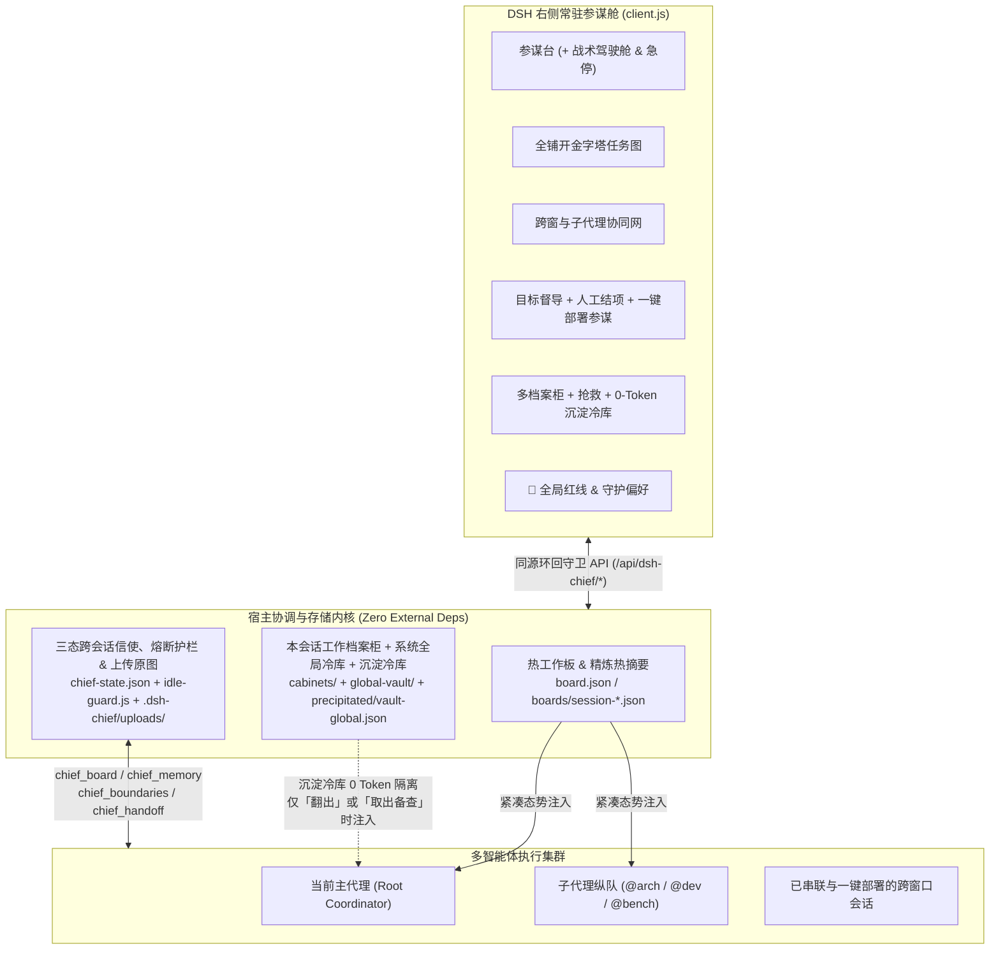

<div align="center">


<br />

# ✦ DSH 参谋长 (`dsh-chief`)
### DeepSeek Harness 多智能体参谋指挥舱 · SuperAgent 跨窗统筹 · 四层冷存储工程档案柜

[](https://dsh.deepseek.com)
[](https://github.com/deepseek-ai/dsh-superagent-prototype)
[](https://nodejs.org)
[](#)
[](#03--四层冷存储工程档案柜档案页签)
[](LICENSE)

> **把散装聊天窗升级为智能体总司令部**：深度呼应 DeepSeek 官方 **[SuperAgent (`dsh-superagent-prototype`)](https://github.com/deepseek-ai/dsh-superagent-prototype)** 的「Router 统筹 + Workers 隔离执行」注意力减负范式，并与 **DeepSeek Harness (DSH)** 原生子代理分屏、面板原生「🎯 目标督导 + 人工拍板结项」、实时 `steer` 切入、压缩前实证抢救、多档案柜沉淀冷库及跨会话一键部署无缝联动。

**简体中文** · [English (`README.en.md`)](README.en.md) · [更新日志 (`CHANGELOG.md`)](CHANGELOG.md)

</div>

---

## 🔗 与 DeepSeek 官方 SuperAgent 范式及 DSH 原生能力深度联动

DeepSeek 官方开源的 **[`dsh-superagent-prototype`](https://github.com/deepseek-ai/dsh-superagent-prototype)** 指出了多智能体研发中最核心的两大难题：**人类注意力瓶颈（Human Attention Bottleneck）**与**长上下文污染（Context Pollution）**，并提出了「常驻统筹层（Router）+ 隔离执行层（Workers）」的双层解耦架构。

**`dsh-chief`（DSH 参谋长）正是将这一理念直接搬进 DSH 右侧边栏的可视化指挥中枢，并与 DSH 宿主底层能力全链路打通：**

1. **SuperAgent「统筹 + 工人」可视化落地**：无需在十几个并发会话与子代理黑盒间来回切换——参谋长常驻右侧栏充当你的全局统筹台（Router Cockpit），将当前主代理、下辖各路子代理（Subagents）以及跨窗口独立 Worker 会话收拢进同一张**全铺开金字塔拓扑图**与**协同通讯录**中。
2. **原生联动 DSH 子代理分屏实时流（`subagentchat`）**：在金字塔节点或协同列表上点击「`分屏对话`」，直接调用 DSH 原生 `sidebarRight.openResource('dsh-resource://subagentchat/...')`，在右侧分屏即时拉开对应子代理的实时推理流。
3. **原生「🎯 目标督导」与人工拍板结项（Goal Approval Gate）**：在「规划」页点击「`🎯 设为目标`」即可开启持续目标督导（不再依赖聊天 `/goal` 指令），变更目标时智能提示重置陈旧步骤；目标达成后由参谋长提交实证请示，**必须经过人类点击「`✅ 批准结项`」才会退出目标模式**，未获批准前随时支持驳回继续推进。
4. **输入栏 `+` 战术驾驶舱与「✦ 智选」协同压缩**：点击输入栏左侧居中的 **`+`** 打开战术驾驶舱，按需组合「`⚡ 主动强介入`」「`🗜 压缩前抢救 + 自动压缩（硬性安全底线锁定 50%–95%）`」「`✓ 严格实证核验`」「`🛡 红线越界哨兵`」与「`📝 极简战报`」；开启 **`✦ 智选`** 后，硬性上下文百分比阈值不再干扰运行，改为由**参谋长与主对话在阶段收口处协同把控压缩时机**（先抢救关键细节入本会话档案柜，再安静压缩）。
5. **三层档案柜严格可见性隔离 + 系统级 0-Token 全局冷库 + 本地↔全局双向差分 + 彩色抽屉信箱 + 可手改/定住交接单**：
   - **三层工程档案柜权限与隔离**：**💬 本会话档案柜**（按 `rootSessionId` 1:1 严格隔离，用户 + 本会话 + 参谋长可见；新建空白对话绝不串柜）、**🌐 系统全局档案柜**（系统级 0-Token 全局冷库，**不跟对话上下文、不迁移旧会话档案**；主对话彻底不可见，参谋长仅在您点击「`👁️ 供本会话参谋参阅`」或参谋主动检索问答时读取；支持本地 ↔ 全局双向差分与「`⤵️ 引入本会话`」）、**🏛️ 沉淀档案柜**（跨对话 0-Token 冷封存，**未点「`📤 取出`」前对参谋长与主对话双盲**，点「`📥 封回`」即刻归零）；
   - **互通网络入网警告与脱离净化**：接入前弹窗提醒防污染，入网后自然共享进展；一旦断开联动，立即清空协同摘要缓存并过滤残余外部记忆与信箱；
   - **彩色可折叠抽屉信箱**：按全网广播（自动去重）、多方协同、双边往来与各对话内部信箱分色收纳；
   - **可手改可定住交接单**：规划页支持手改交接单、一键 **`📌 定住防改`**（即便是 `[自动渲染]` 状态也会自动固化当前快照并禁止参谋长覆写，同时 `同步交接单` 开关自动禁用），交接前若检测到交接单未写入最新进展会弹窗劝等更新。

---

## 💡 为什么需要「DSH 参谋长」？（它与普通看板/记忆插件有何本质不同）

在真实的大型工程与多子代理（Subagents）协作中，普通「待办小本本」或「全量注入式记忆插件」往往会撞上四大痛点：
1. **后台偷跑 Token、跨渠道乱选模型**：每轮对话结束都在后台偷偷调用大模型做全量总结，甚至把免费/订阅渠道的同名模型误匹配到高价按量渠道。
2. **记忆越存越慢、上下文压缩突然失忆**：把几十篇排障笔记一股脑塞进 System Prompt 烧光 Token；或者对话一旦自动压缩，刚刚敲定的文件路径、命令与边界瞬间丢失。
3. **小画布拖拽迷宫**：子代理一多，任务图缩在巴掌大的滚动视口里来回拖拉，根本看不清谁卡住了、谁做完了。
4. **口头立规矩转头就忘、换窗口就丢参谋**：聊天里交代的安全红线转头就忘；切到新会话还得重新配置参谋长模型、纪律和档案。

**`dsh-chief`（DSH 参谋长）不是一个简单的“记事本”，而是一套完整的右侧栏多智能体指挥部：**

| 核心维度 | 普通 Todo / 常驻记忆插件 | ✦ DSH 参谋长 (`dsh-chief`) |
| :--- | :--- | :--- |
| **参谋节奏与战术驾驶舱** | 后台每轮盲目触发总结，无法精细控速与急停 | **三档节奏**（默认 `⏸ 按需` **0 自动调用**、`👁 巡检`、`🤖 托管`）+ 输入栏 **`+` 战术驾驶舱**（主动强介入 + 轮数熔断 + `⏹ 急停` / 严格核验 / 红线哨兵 / 自动压缩前抢救） |
| **多代理拓扑可视性** | 扁平列表或狭窄视口，频繁横向/纵向拖动 | **全铺开金字塔 DAG 指挥图**：主代理居中统帅、子代理分列纵队，状态切换/解释/派发/分屏看流全部原地铺开 |
| **长期工程记忆与沉淀冷库** | 常驻塞入提示词（费 Token）或易随对话压缩丢失 | **项目多档案柜 + 四层档案 + 跨会话沉淀冷库**：`抽屉 → 金/银/暗铜曲别针卷宗 → 记忆点 → 小点记忆`；支持「`📥 抢救细节`」防压缩失忆与「`⏬ 沉淀`」封入冷库（**全会话 0 Token 物理隔离**，点「`📂 翻出`」才注入） |
| **规划可读性与目标拍板** | 冰冷的技术步骤列表，目标完成与否模型自说自话 | **核心目标督导 + 人工拍板结项 + 可追问小任务板**：点击任意步骤即可一键白话解读；目标达标后必须等待人类「`✅ 批准结项`」或「`↩ 驳回继续`」 |
| **跨会话协同与原图协同** | 仅限单会话，换窗失忆；纯文本参谋遇图片直接报错 | **跨窗口独立会话串联 + 一键接力部署参谋（4 档档案策略）** + **工作区 `.dsh-chief/uploads/` 原图持久化**（纯文本参谋自动降级并带路径铁律转发） |
| **红线治理与空转守护** | 规则混在聊天记录里，换会话靠人工复制粘贴 | **`📌` 图钉全局红线盖章**（跨任务永久生效 vs 仅本任务生效）+ **子代理边界请示与浓缩** + **`idle-guard` 空转完结守护** |

---

## 📸 全景实机导览（7 大核心视窗）

### 01 · 常驻右侧栏参谋指挥舱（`参谋` 页签）
与宿主对话区并排常驻：顶部实时呈现当前跟随的 `Provider · 模型` 渠道、人类三档控速开关（默认 `⏸ 按需` 零后台损耗）与子代理/联动窗口徽标；中部展示结构化战场简报与待盖章的边界请示；底部一句话即可向 `@主对话`、`@子代理` 或 `@跨窗会话` 拆话调度。


---

### 02 · 全铺开金字塔子代理拓扑（`任务` 页签）
彻底告别局促的小窗拖拽：`👑 主代理·总指挥` 坐镇顶端，下辖各路子代理横向铺开为清晰纵队；每张任务卡原地集成 **状态一键流转、白话解释、指派执行、子代理分屏实时盯流**，谁在推进、谁被卡住一眼洞穿。

<div align="center">
  
</div>

---

### 03 · 三层工程档案柜、抢救细节与 0-Token 沉淀冷库（`档案` 页签）
按 **💬 本会话档案柜 · 🌐 系统全局档案柜 · 🏛️ 沉淀档案柜** 严格划分可见性与隔离边界，彻底解决「长记忆烧光上下文」「对话互串」与「压缩突然失忆」三大顽疾：
- **四层收纳结构**：**多档案柜 → 分类抽屉**（拉开抽屉）→ **三色曲别针卷宗**（**璀璨金针 `#ffe033` 核心必读** / **标准银针 `#cbd5e1` 常规实录** / **暗古铜针 `#7c4329` 历史归档**）→ **分条记忆点** → **点击逐条展开小点记忆**。
- **📥 压缩前抢救与 🏛️ 沉淀档案柜（0 Token 双盲隔离）**：支持手动或配合「`✦ 智选` / 硬阈值 `50%–95%`」自动执行「`📥 抢救细节`」提取文件路径、命令与关键结论落盘进本会话柜；通过「`⏬ 沉淀可复用经验`」将通用踩坑提炼进 **0-Token 沉淀档案柜**。**沉淀档案柜对参谋长与主对话默认双盲、0 字节读取隔离**，仅点击「`📤 取出供本会话与参谋参阅`」才临时生效，点击「`📥 封回冷库`」即刻归零。
- **🌐 系统级 0-Token 全局冷库与双向差分**：**系统全局档案柜**保存在系统级冷库目录（`global-vault/vault-chief-global.json`），**默认不挂任何会话上下文、0 Token、不自动迁移旧版会话档案**；实时计算「**仅本地 / 已同步 / 本地已改 / 全局独有**」双向差分，支持从本会话「`🌐 存入全局` / `↻ 更新至全局`」、从全局「`⤵️ 引入本会话`」，以及点击「`👁️ 供本会话参谋参阅` / `📥 收回冷存`」控制当前会话参谋长是否参阅。

<div align="center">
  
</div>

---

### 04 · 目标督导、人工拍板结项与跨会话一键部署参谋（`规划` 页签）
上方承载**核心目标与 `🎯 目标督导` 开关**，目标变更时智能提示是否清空陈旧步骤；目标达成后保持督导态等待您亲自拍板「`✅ 批准结项`」或「`↩ 驳回继续`」。中部小任务板点击任意步骤可一键追问白话解读；底部集成**「🚀 跨会话接力 & 一键部署参谋」**，新建窗口或投递给已有会话时可选四档工作档案迁移策略（冷库保持绝对隔离），并无缝部署继承参谋长专职模型与纪律配置。

<div align="center">
  
</div>

---

### 05 · 跨窗口独立会话串联与原图落盘防幻觉（`协同` & 输入栏 `+` 驾驶舱）
打破单窗口孤岛：一键拨动开关即可将多个独立 DSH 主窗口（例如「前端交互窗口」与「后端压测窗口」）接入同一协同集群；输入框支持拖拽或粘贴截图（**原图直接落盘至工作区 `.dsh-chief/uploads/`**，纯文本参谋模型自动降级并附真实路径交由多模态主对话执行）；左侧 **`+` 战术驾驶舱**集中管控强介入、自动压缩前抢救、严格实证核验、红线哨兵与红色 **`⏹ 急停`**。

<div align="center">
  
</div>

---

### 06 · `📌` 图钉全局红线盖章与守护偏好（`边界` 页签）
- **双层作用域精准隔离**：点击规则左侧的 **`📌` 小图钉** 即可将其升格为跨所有任务生效的「**全局共享铁律**」；未钉住的规则仅在当前会话树生效，绝不污染其他无关项目。
- **撞墙请示、智能浓缩与守护偏好**：「红线边界」支持 `bounds.propose` 一键定住全局、浓缩精简；「守护偏好」专注管理每轮注入开关、`idle-guard` 空转提醒阈值与短回复检测线。

<div align="center">
  
</div>

---

### 07 · 自包含跨会话接力包预览与空转守护
长对话上下文逼近上限或开启自动压缩阈值时，系统先抢救工程细节入柜并核验落盘后再执行压缩；主动切换窗口时，「规划」页底部的跨会话接力可生成**自包含 Markdown 交接单**并自动切换视口，配合 `idle-guard` 防止任务未闭环前意外停机。

<div align="center">
  
</div>

---

## ⚠️ 使用须知与免责声明

> [!IMPORTANT]
> 请在使用「`+` 战术驾驶舱」「`⚡ 主动强介入`」「自动压缩前抢救」等自主干预特性前务必知悉以下两点：
>
> 1. **底层大模型能力与上下文质量依赖**：参谋长的一切自动审查、强介入驱动、压缩前抢救与红线拦截能力均高度依赖您为参谋长配置的底层大模型能力与上下文质量，不同模型在规划严谨度与遵循指令上的表现存在客观差异。
> 2. **宿主系统提示词与 Rules 指令冲突风险**：若主会话或当前项目中挂载了过多的系统提示词（System Prompt）、Rules 或硬性规则，可能与本插件的自主干预逻辑产生指令冲突，进而导致介入循环异常、提前熔断或执行偏离预期。
>
> 建议在启用「主动强介入」前明确填写「核心目标」与至少一条「禁止红线」，必要时随时点击输入栏上方的红色 **「⏹ 急停」** 按钮中断后台自驱。

---

## 🏗️ 冷热记忆分舱与多代理协同架构



---

## ⚡ 快速安装（零外部依赖）

### 方式一：通过 DSH 插件市场或 CLI 一键安装（推荐）

在已安装 [dshmarket](https://github.com/dsh-market/dsh-market) 或官方「发现」页中搜索 **`dsh-chief`**（或 **DSH 参谋长**）一键安装；或直接使用命令行安装：

```bash
# 直接从 GitHub Release 预构建包极速安装（约 300 KB，零编译步骤）
dsh plugin --profile desktop add https://github.com/gluztm/dsh-chief/releases/download/v1.1.0/dsh-chief-1.1.0.tgz

# 或通过 GitHub 仓库标识安装（若使用 web profile，将 desktop 替换为 web）
dsh plugin --profile desktop add github:gluztm/dsh-chief
```

安装完成后刷新 DSH Web 页面，点击工作区右侧边栏顶部的 **✦ `DSH 参谋长`** 图标即可展开面板。

### 宿主版本兼容性矩阵

| DeepSeek Harness (DSH) 版本 | 面板 / 看板 / 档案柜 / 边界 | 命名子代理树 (`task.dispatch` / `team.steer` / `team.interrupt`) | 说明 |
| :--- | :---: | :---: | :--- |
| **`>= 0.2.2-rc.2`（推荐 `rc.3+`）** | ✅ 完整支持 | ✅ 完整支持 | 完整提供 `subagents.resolveName` / `rootOf` / `namesOf` 与扁平 `startActivation` |
| `0.2.0 ~ 0.2.2-rc.1` | ✅ 正常挂载 | ⚠️ 不可用（提示升级） | 旧版重构前子代理接口；插件启动与面板会给出升级提示并安全拦截 `team.*` 调用 |

### 方式二：源码克隆与本地联接调试（适合二次开发）

```bash
git clone https://github.com/gluztm/dsh-chief.git
```

本插件采用**零外部运行时依赖（Zero Runtime Dependencies）**纯原生 ES Module 架构，无需 `npm build` 即可直接挂载调试。

---

## 🛠️ 模型工具矩阵（4 Tools）

装入后自动向模型暴露 4 个结构化协同工具（动作层均做类型宽容解析，兼容原生 JSON 数组与扁平文本传参）：

| 工具名 | 核心职责 | 典型高频动作 (`action`) |
| :--- | :--- | :--- |
| **`chief_board`** | 驱动任务拓扑、规划步骤、冷档案检索与跨代理信箱 | `graph.plan`、`task.add`、`task.update`、`plan.set`、`cursor.set`、`mail.send`、`archive.save`、`archive.search`、`bounds.propose` |
| **`chief_memory`** | 读写会话级高密度热记忆条目（决策/进展/验证/风险） | `list`、`get`、`add`、`update`、`remove` |
| **`chief_boundaries`** | 读取与维护全局图钉红线（`📌`）及当前任务工作边界 | `get`、`set`、`add`、`pin`、`remove` |
| **`chief_handoff`** | 导出当前多代理全局态势与自包含 Markdown 交接单 | `preview` / 直接生成新会话接力包 |

---

## 📊 实测工程指标与纯本地安全承诺

- **高并发写锁防撕裂**：`board.json` 与 `archives.json` 均受基于 `wx` 原子排他文件锁 + 陈旧锁自动剥离机制保护；实测 **80 路并发混合写锁争用 + 60 轮高频 UI 页签切页压测** **0 丢单、0 JSON 损坏、0 残留锁**。
- **冷库零泄漏与亚毫秒响应**：实测挂载 **500 卷（4.0 MB）** 工程档案压测下，`Stage-0` 快照元信息仅 **`75 Bytes`（耗时 `0.10ms`）**，全文检索 **`< 4ms`**，未取出卷宗对模型提示词 **0 字符泄漏**。
- **严格同源环回与防泄密门禁**：
  - 所有 `/api/dsh-chief/*` 接口均强制执行 **Loopback 环回地址 + 同源 `Origin/Host` 双重校验**，拒绝任何跨站诱导调用。
  - 内置敏感凭据正则硬拦截器，自动拒绝将 `sk-*`、`ghp_*`、Bearer Token 或 OpenSSH 私钥写入工作板、参谋记忆或冷档案库。
  - **100% 纯本地存储**：所有数据仅保存在本机 `~/.dsh/chief/` 目录下，零遥测、零第三方云上报。

---

## 📄 开源许可 (License)

本项目基于 **[GNU Affero General Public License v3.0 (`AGPL-3.0-only`)](LICENSE)** 开源发布。  
在遵循相同开源协议并保留版权与修改声明的前提下，欢迎自由使用、审计、分支改进与提交社区 PR！
