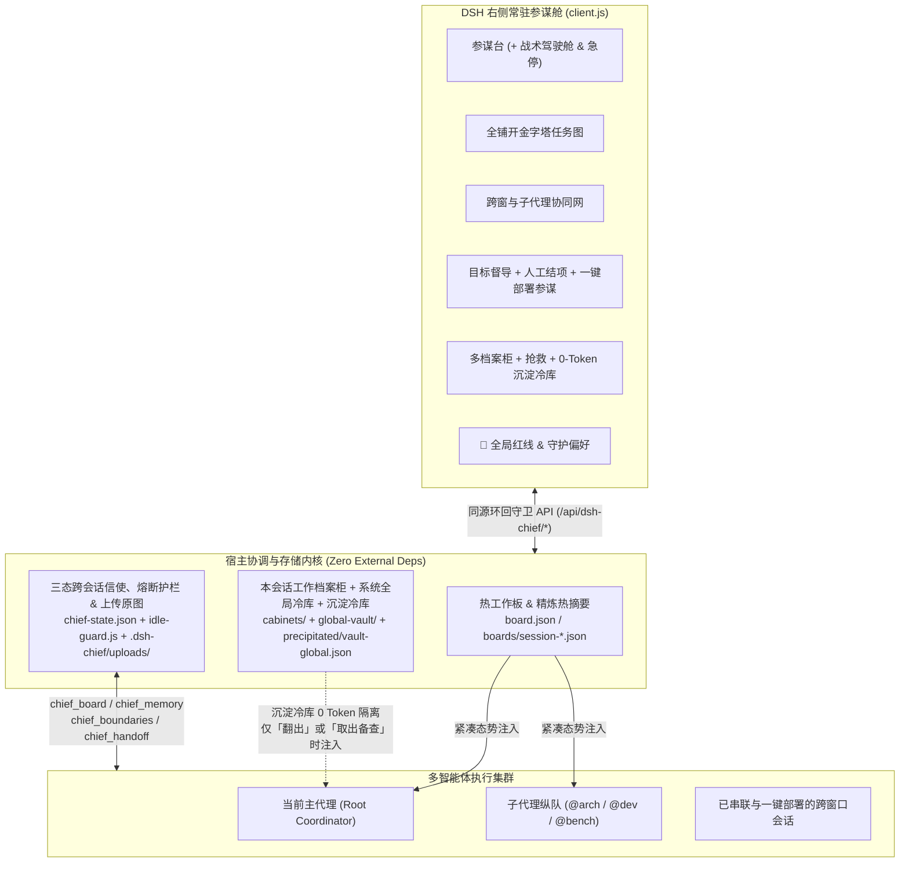

<div align="center">


<br />

# ✦ DSH 参谋长 (`dsh-chief`)
### DeepSeek Harness 多智能体参谋指挥舱 · SuperAgent 跨窗统筹 · 四层冷存储工程档案柜

[](https://dsh.deepseek.com)
[](https://www.npmjs.com/package/dsh-chief)
[](https://awesome-dsh-plugin.com/p/gluztm/dsh-chief/)
[](https://www.bilibili.com/video/BV1DqsV6QEGi)
[](https://github.com/deepseek-ai/dsh-superagent-prototype)
[](https://nodejs.org)
[](#)
[](#03--三层工程档案柜桌面聚光灯与-0-token-沉淀冷库档案页签)
[](LICENSE)

> **告别给 AI 当“全职保姆、传话筒与记事员”——向右侧「✦ 许愿框」许下意图，一站式跑通全流程（v1.2.0 实权参谋长版）**：深度呼应 DeepSeek 官方 **[SuperAgent (`dsh-superagent-prototype`)](https://github.com/deepseek-ai/dsh-superagent-prototype)** 的「Router 统筹 + Workers 隔离执行」范式，将零散对话升级为**许愿式一站式总司令部**——从空白新对话下场勘察、核心目标锁定、金字塔多子代理协同、四档实权执行、红线守门、`✦ 智选压缩` 静默抢救、三层 0-Token 冷库取用，到实测必做清单后呈请人类拍板结项，全链路闭环。

**简体中文** · [English (`README.en.md`)](README.en.md) · [更新日志 (`CHANGELOG.md`)](CHANGELOG.md)

</div>

---

## 🔗 与 DeepSeek 官方 SuperAgent 范式及 DSH 原生能力深度联动

DeepSeek 官方开源的 **[`dsh-superagent-prototype`](https://github.com/deepseek-ai/dsh-superagent-prototype)** 指出了多智能体研发中最核心的两大难题：**人类注意力瓶颈（Human Attention Bottleneck）**与**长上下文污染（Context Pollution）**，并提出了「常驻统筹层（Router）+ 隔离执行层（Workers）」的双层解耦架构。

**`dsh-chief`（DSH 参谋长）正是将这一理念直接搬进 DSH 右侧边栏的可视化指挥中枢，并与 DSH 宿主底层能力全链路打通：**

1. **SuperAgent「统筹 + 工人」可视化落地**：无需在十几个并发会话与子代理黑盒间来回切换——参谋长常驻右侧栏充当你的全局统筹台（Router Cockpit），将当前主代理、下辖各路子代理（Subagents）以及跨窗口独立 Worker 会话收拢进同一张**全铺开金字塔拓扑图**与**协同通讯录**中。
2. **原生联动 DSH 子代理分屏实时流（`subagentchat`）**：在金字塔节点或协同列表上点击「`分屏对话`」，直接调用 DSH 原生 `sidebarRight.openResource('dsh-resource://subagentchat/...')`，在右侧分屏即时拉开对应子代理的实时推理流。
3. **原生「🎯 目标督导」与人工拍板结项（Goal Approval Gate + Must-Do 核验）**：在「规划」页点击「`🎯 设为目标`」即可开启持续目标督导（强介入模式下直接锁定核心目标作为最高指挥终点）；变更目标时智能提示重置陈旧步骤；目标达成后不仅核验「必做事项 (`allowed`)」，还**必须经过人类点击「`✅ 批准结项`」才会退出目标模式**，未获批准前随时支持驳回继续推进。
4. **「✦ 许愿框」四档权限实权执行 & `✦ 智选压缩` 跨隔离静默抢救**：
   - **四档实权权限门禁（`chief-executor.js`）**：直接在右侧许愿框中即可让参谋长按当前档位（`👁 仅可查看` / `工作区内修改` / `自动审查 EXP` / `完全权限`）读写检索代码、执行安全命令、维护看板/档案与调度团队；内置全变体工具标签防泄漏过滤与空白新对话工作区感知。
   - **输入栏 `+` 战术驾驶舱与 `✦ 智选压缩`**：按需开启「`⚡ 主动强介入`（支持 `0 = 无限轮` + 高危急停弹窗）」「`🗜 自动压缩前抢救`（支持 `10%–95%` 百分比阈值与 `>= 8k` Token 阈值）」「`✓ 严格实证核验`」「`🛡 红线越界哨兵`」与「`📝 极简战报`」；开启 **`✦ 智选压缩`** 后，系统自动跳过硬阈值并在阶段收口等待主代理空闲后，跨 Cordis 隔离先抢救细节入柜再静默 `/compact` 并留存对话回执。
5. **三层档案柜严格可见性隔离 + 桌面聚光灯 + 本地↔全局双向差分 + 彩色抽屉信箱 + 可手改/定住交接单**：
   - **三层工程档案柜权限与隔离**：**💬 本会话档案柜**（按 `rootSessionId` 1:1 严格隔离，用户 + 本会话 + 参谋长可见；新建空白对话绝不串柜）、**🌐 系统全局档案柜**（系统级 0-Token 全局冷库，**不跟对话上下文、不迁移旧会话档案**；支持一键「`置上桌面`」聚光灯与本地 ↔ 全局双向差分 /「`⤵️ 引入本会话`」/「`提炼并上推全局`」）、**🏛️ 沉淀档案柜**（跨对话 0-Token 冷封存，**未点「`📤 取出`」前对参谋长与主对话双盲**，支持多选批量组合递话，点「`📥 封回`」即刻归零）；
   - **互通网络入网警告与脱离净化**：接入前弹窗提醒防污染，入网后自然共享进展；一旦断开联动，立即清空协同摘要缓存并过滤残余外部记忆与信箱；
   - **彩色可折叠抽屉信箱**：按全网广播（自动去重）、多方协同、双边往来与各对话内部信箱分色收纳；
   - **可手改可定住交接单**：规划页支持手改交接单、一键 **`📌 定住防改`**（即便是 `[自动渲染]` 状态也会自动固化当前快照并禁止参谋长覆写，同时 `同步交接单` 开关自动禁用），交接前若检测到交接单未写入最新进展会弹窗劝等更新。

---

## 💡 为什么需要「DSH 参谋长」？（6 大日常痛点 × 独家破局机制）

普通待办插件只是多了一块让你自己手写的备忘录，常驻记忆插件只是在后台悄悄替你把几千字旧账硬塞进提示词； **`dsh-chief`（DSH 参谋长）的独特性在于把“人盯 AI 干活”反转为「✦ 许愿式一站式跑通」** ——直接对位消灭日常研发中最折磨人的六大痛点：

| 日常真实痛点 | 普通 Todo / 外挂记忆插件的局限 | ✦ DSH 参谋长 (`dsh-chief`) 的独家破局机制 |
| :--- | :--- | :--- |
| **1. 半途偷懒交差**<br>模型改两行就说“大功告成你自己测吧”，人得全程盯屏反复催 | 只有静态文字清单，模型自说自话就能宣布收工 | **🎯 核心目标锁定 + `⚡ 强介入（0 = 无限轮）` + 必做事项核验 + 人工拍板结项**：强介入直锁核心目标，未实测完 `allowed` 必做清单且未获人类点击「`✅ 批准结项`」绝不放行收工；高危动作支持红牌急停弹窗与随时一键 **`⏹ 急停`** |
| **2. 压缩即“脑叶切除”**<br>长任务刚触发上下文压缩，刚才查出的路径、命令、踩坑瞬间失忆重来 | 无压缩前高保真留存机制，一压就全盘清零 | **🗜️ 抢救校验 + `✦ 智选压缩` 跨隔离静默 `/compact`**：支持 `✦ 智选压缩` 在阶段收口等主代理空闲后触发，也支持 **`10%–95%` / `>= 8k` Token** 安全阈值或对参谋长直说一句「**压缩吧**」；先抢救现场细节并复核落盘进本会话柜，再跨隔离真压缩并留存可见回执 |
| **3. 注入越塞越慢、把模型脑子搅浑**<br>传统记忆插件每轮往 System Prompt 硬灌几千字旧账，既烧光 Token 又稀释当下注意力 | 全量常驻注入（Always-On Injection），噪音与过时结论直接干扰对话模型判断 | **🏛️ 三层 0-Token 冷存储金库（本会话柜 / 系统全局冷库 / 沉淀冷库）**：冷库平时 **0 字节、0 Token 物理隔离**（沉淀库对参谋长与主对话默认双盲），需要哪封点「`📤 取出`」或「`置上桌面`」，用完「`📥 封回`」即刻归零；支持本地 ↔ 全局实时双向差分 |
| **4. 只敢嘴上聊天的“吉祥物副驾”**<br>想查个配置、改个小文件或看下状态，还得打断主对话重新排队 | 仅限纯文本问答或后台盲目调用，毫无工程实权 | **✦ 许愿框一站式办理（4 档权限执行器 `chief-executor`）**：具备 `仅可查看 / 工作区内修改 / 自动审查 EXP / 完全权限` 四档门禁，查代码、跑验证、改看板、理档案、跨窗派单在右侧一语办妥；就算在**空白新对话（未开聊）**也能直接定位真实工作区下场或预埋待领交接包 |
| **5. 多子代理黑盒迷宫 & 口头红线失效**<br>子代理一多只能猜进度；聊天里立十遍“禁止改生产配置”，第 12 轮照样踩雷 | 窄框列表反复拖动，口头约束随对话滚出窗口 | **📐 全铺开金字塔拓扑 + 原生 `subagentchat` 分屏 + `📌` 图钉全局红线**：主帅居中、子代理分列纵队一键分屏盯流；图钉红线跨任务永久盖章生效，子代理撞墙主动呈批请求放行 |
| **6. 上下文见顶换窗断档 & 后台偷跑配额**<br>开新窗前情全丢、参谋模型重配；每轮后台乱跑总结，免费订阅模型被错配成高价按量渠道 | 单窗孤岛、每次换窗重配；后台盲目触发推理偷跑额度 | **🚀 跨窗协同网 + 可手改/`📌 定住` 交接单 + 渠道精确对齐 + 默认 `⏸ 按需`（0 自动调用）**：严格对齐主会话 `Provider · 模型`；一键冻结交接快照、按 4 档档案策略携参谋无缝部署至新窗；跨窗断联立即清空外部记忆防串味 |

---

## 📸 全景实机导览（7 大核心视窗）

### 01 · 常驻右侧栏参谋指挥舱（`参谋` 页签）
与宿主对话区并排常驻：顶部实时呈现当前跟随的 `Provider · 模型` 渠道、人类三档控速开关（默认 `⏸ 按需` 零后台损耗）与子代理/联动窗口徽标；中部展示结构化战场简报与待盖章的边界请示；底部一句话即可向 `@主对话`、`@子代理` 或 `@跨窗会话` 拆话调度。


---

### 02 · 全铺开金字塔子代理拓扑（`任务` 页签）
彻底告别局促的小窗拖拽：`👑 主代理·总指挥` 坐镇顶端，下辖各路子代理横向铺开为清晰纵队；每张任务卡原地集成 **状态一键流转、白话解释、指派执行、子代理分屏实时盯流**，谁在推进、谁被卡住一眼洞穿。

<div align="center">
  
</div>

---

### 03 · 三层工程档案柜、桌面聚光灯与 0-Token 沉淀冷库（`档案` 页签）
按 **💬 本会话档案柜 · 🌐 系统全局档案柜 · 🏛️ 沉淀档案柜** 严格划分可见性与隔离边界，彻底解决「长记忆烧光上下文」「对话互串」与「压缩突然失忆」三大顽疾：
- **四层收纳结构**：**多档案柜 → 分类抽屉**（拉开抽屉）→ **三色曲别针卷宗**（**璀璨金针 `#ffe033` 核心必读** / **标准银针 `#cbd5e1` 常规实录** / **暗古铜针 `#7c4329` 历史归档**）→ **分条记忆点** → **点击逐条展开小点记忆**。
- **📥 压缩前抢救与 🏛️ 沉淀档案柜（0 Token 双盲隔离）**：支持手动（对参谋长说「压缩吧」/`/compact`）或配合「`✦ 智选压缩` / 自定义 `10%–95%` 或 `>= 8k` Token 阈值」自动执行「`📥 抢救细节`」提取文件路径、命令与关键结论落盘进本会话柜，再跨隔离执行静默 `/compact`；通过「`⏬ 沉淀可复用经验`」将通用踩坑提炼进 **0-Token 沉淀档案柜**。**沉淀档案柜对参谋长与主对话默认双盲、0 字节读取隔离**，仅点击「`📤 取出`」才临时生效，点击「`📥 封回`」即刻归零；并支持复选多份跨库卷宗进行**「组合递话」**。
- **🌐 系统级 0-Token 全局冷库、上桌面与双向差分**：**系统全局档案柜**保存在系统级冷库目录（`global-vault/vault-chief-global.json`），**默认不挂任何会话上下文、0 Token、不自动迁移旧版会话档案**；实时计算「**仅本地 / 已同步 / 本地已改 / 全局独有**」双向差分，支持三库卷宗一键**「置上桌面」聚光灯**、从本会话「`🌐 存入全局` / 提炼上推 / `↻ 更新至全局`」、从全局「`⤵️ 引入本会话`」，以及点击「`👁️ 供本会话参谋参阅` / `📥 收回冷存`」精细控制当前会话参谋长是否参阅。

<div align="center">
  
</div>

---

### 04 · 目标督导、人工拍板结项与跨会话一键部署参谋（`规划` 页签）
上方承载**核心目标与 `🎯 目标督导` 开关**，目标变更时智能提示是否清空陈旧步骤；目标达成后保持督导态等待您亲自拍板「`✅ 批准结项`」或「`↩ 驳回继续`」。中部小任务板点击任意步骤可一键追问白话解读；底部集成**「🚀 跨会话接力 & 一键部署参谋」**，新建窗口或投递给已有会话时可选四档工作档案迁移策略（冷库保持绝对隔离），并无缝部署继承参谋长专职模型与纪律配置。

<div align="center">
  
</div>

---

### 05 · 跨窗口独立会话串联与原图落盘防幻觉（`协同` & 输入栏 `+` 驾驶舱）
打破单窗口孤岛：一键拨动开关即可将多个独立 DSH 主窗口（例如「前端交互窗口」与「后端压测窗口」）接入同一协同集群；输入框支持拖拽或粘贴截图（**原图直接落盘至工作区 `.dsh-chief/uploads/`**，纯文本参谋模型自动降级并附真实路径交由多模态主对话执行）；左侧 **`+` 战术驾驶舱**集中管控强介入、自动压缩前抢救、严格实证核验、红线哨兵与红色 **`⏹ 急停`**。

<div align="center">
  
</div>

---

### 06 · `📌` 图钉全局红线盖章与守护偏好（`边界` 页签）
- **双层作用域精准隔离**：点击规则左侧的 **`📌` 小图钉** 即可将其升格为跨所有任务生效的「**全局共享铁律**」；未钉住的规则仅在当前会话树生效，绝不污染其他无关项目。
- **撞墙请示、智能浓缩与守护偏好**：「红线边界」支持 `bounds.propose` 一键定住全局、浓缩精简；「守护偏好」专注管理每轮注入开关、`idle-guard` 空转提醒阈值与短回复检测线。

<div align="center">
  
</div>

---

### 07 · 自包含跨会话接力包预览与空转守护
长对话上下文逼近上限或开启自动压缩阈值时，系统先抢救工程细节入柜并核验落盘后再执行压缩；主动切换窗口时，「规划」页底部的跨会话接力可生成**自包含 Markdown 交接单**并自动切换视口，配合 `idle-guard` 防止任务未闭环前意外停机。

<div align="center">
  
</div>

---

## ⚠️ 使用须知与两条硬核免责声明

> [!IMPORTANT]
> 请在启用「`✦ 许愿框` 实权执行」「`⚡ 主动强介入`」「`✦ 智选压缩`」等自主指挥能力前，务必看清以下两条底层规律：
>
> 1. **能力下限靠本插件工程护栏兜底，能力上限完全取决于你选用的底层大模型**：`dsh-chief` 通过 0-Token 物理冷隔离、四档权限门禁、先落盘复核再压缩、轮数熔断与高危急停弹窗守住安全下限；但参谋长的多步工具拆解、复杂 Bug 洞察、强介入纠偏与档案提炼能有多强，**上限全看你给它挂的模型智商与上下文素质**。重度工程请优先给参谋长搭配推理过硬的主力旗舰模型，别对超轻量小模型抱有超出其推理上限的期待。
> 2. **切忌同时挂载过多“破坏对话模型脑子”的冗余注入**：请尽量避免在主对话或项目里同时堆叠大量冗长的全局 System Prompt、动辄几百行的冲突 Rules，或者会每轮往提示词里硬塞长篇旧账的传统常驻记忆插件。**过多互相打架的上下文注入会严重搅浑对话模型的“脑子”并稀释注意力**，甚至与参谋长的紧凑态势摘要和强介入督导撞车，引发死循环、答非所问或提前熔断。让系统提示词保持克制干练，把低频资料放进本插件的 **0-Token 冷库**按需取出，模型才会发挥出最高战力！
>
> 建议开启「主动强介入」前明确写清「核心目标」并钉住至少一条「禁止红线」；任何时候发现节奏偏航，点击输入栏上方的红色 **「⏹ 急停」** 即可秒切回人工接管。

---

## 🏗️ 冷热记忆分舱与多代理协同架构



---

## ⚡ 快速安装（零外部依赖）

### 方式一：通过 DSH 插件市场或 CLI 一键安装（推荐）

在已安装 [dshmarket](https://github.com/dsh-market/dsh-market) 或 DSH「插件市场」中搜索 **`dsh-chief`**（或 **`DSH 参谋长`**）点击安装；或直接使用命令行安装（若使用 `web` profile，将下方 `desktop` 替换为 `web`）：

```bash
# 通过 npm 官方源（国内直走镜像加速，支持后续自动检测升级）
dsh plugin --profile desktop add dsh-chief

# 或从 GitHub Release 最新预构建包极速直装（零编译步骤）
dsh plugin --profile desktop add https://github.com/gluztm/dsh-chief/releases/latest/download/dsh-chief.tgz

# 指定安装 v1.2.0 固定版本归档包
dsh plugin --profile desktop add https://github.com/gluztm/dsh-chief/releases/download/v1.2.0/dsh-chief-1.2.0.tgz

# 或直接通过 GitHub 仓库标识安装
dsh plugin --profile desktop add github:gluztm/dsh-chief
```

安装完成后刷新 DSH Web 页面，点击工作区右侧边栏顶部的 **✦ `DSH 参谋长`** 图标即可展开面板。

### 宿主版本兼容性矩阵

| DeepSeek Harness (DSH) 版本 | 面板 / 看板 / 档案柜 / 边界 | 命名子代理树 (`task.dispatch` / `team.steer` / `team.interrupt`) | 说明 |
| :--- | :---: | :---: | :--- |
| **`>= 0.2.2-rc.2`（推荐 `rc.3+`）** | ✅ 完整支持 | ✅ 完整支持 | 完整提供 `subagents.resolveName` / `rootOf` / `namesOf` 与扁平 `startActivation` |
| `0.2.0 ~ 0.2.2-rc.1` | ✅ 正常挂载 | ⚠️ 不可用（提示升级） | 旧版重构前子代理接口；插件启动与面板会给出升级提示并安全拦截 `team.*` 调用 |

### 方式二：源码克隆与本地联接调试（适合二次开发）

```bash
git clone https://github.com/gluztm/dsh-chief.git
```

本插件采用**零外部运行时依赖（Zero Runtime Dependencies）**纯原生 ES Module 架构，无需 `npm build` 即可直接挂载调试。

---

## 🛠️ 模型工具矩阵（4 Tools）

装入后自动向模型暴露 4 个结构化协同工具（动作层均做类型宽容解析，兼容原生 JSON 数组与扁平文本传参）：

| 工具名 | 核心职责 | 典型高频动作 (`action`) |
| :--- | :--- | :--- |
| **`chief_board`** | 驱动任务拓扑、规划步骤、冷档案检索与跨代理信箱 | `graph.plan`、`task.add`、`task.update`、`plan.set`、`cursor.set`、`mail.send`、`archive.save`、`archive.search`、`bounds.propose` |
| **`chief_memory`** | 读写会话级高密度热记忆条目（决策/进展/验证/风险） | `list`、`get`、`add`、`update`、`remove` |
| **`chief_boundaries`** | 读取与维护全局图钉红线（`📌`）及当前任务工作边界 | `get`、`set`、`add`、`pin`、`remove` |
| **`chief_handoff`** | 导出当前多代理全局态势与自包含 Markdown 交接单 | `preview` / 直接生成新会话接力包 |

---

## 📊 实测工程指标与纯本地安全承诺

- **高并发写锁防撕裂**：`board.json` 与 `archives.json` 均受基于 `wx` 原子排他文件锁 + 陈旧锁自动剥离机制保护；实测 **80 路并发混合写锁争用 + 60 轮高频 UI 页签切页压测** **0 丢单、0 JSON 损坏、0 残留锁**。
- **冷库零泄漏与亚毫秒响应**：实测挂载 **500 卷（4.0 MB）** 工程档案压测下，`Stage-0` 快照元信息仅 **`75 Bytes`（耗时 `0.10ms`）**，全文检索 **`< 4ms`**，未取出卷宗对模型提示词 **0 字符泄漏**。
- **严格同源环回与防泄密门禁**：
  - 所有 `/api/dsh-chief/*` 接口均强制执行 **Loopback 环回地址 + 同源 `Origin/Host` 双重校验**，拒绝任何跨站诱导调用。
  - 内置敏感凭据正则硬拦截器，自动拒绝将 `sk-*`、`ghp_*`、Bearer Token 或 OpenSSH 私钥写入工作板、参谋记忆或冷档案库。
  - **100% 纯本地存储**：所有数据仅保存在本机 `~/.dsh/chief/` 目录下，零遥测、零第三方云上报。

---

## 📄 开源许可 (License)

本项目基于 **[GNU Affero General Public License v3.0 (`AGPL-3.0-only`)](LICENSE)** 开源发布。  
在遵循相同开源协议并保留版权与修改声明的前提下，欢迎自由使用、审计、分支改进与提交社区 PR！
